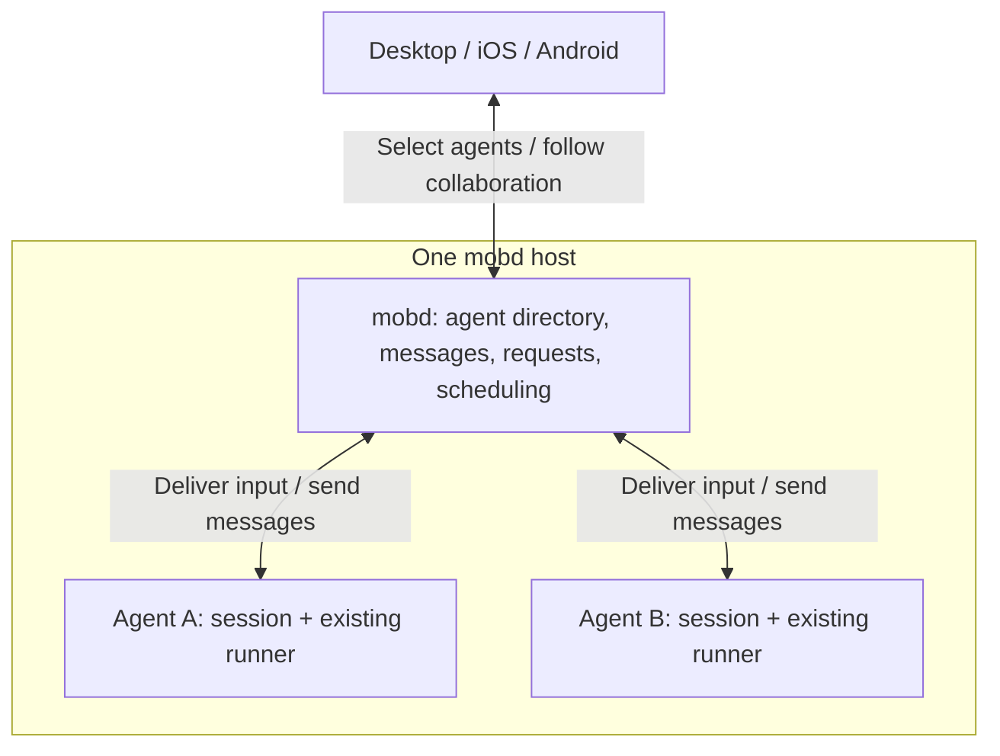

# Agent communication and collaboration

Status: architecture draft COLLAB-1, 2026-11-02. Not implemented or released.
Read [agent concepts](agent-concepts.md) for the shared vocabulary.
The [implementation design](agent-collaboration-design.md) (COLLAB-2) records the decisions
(one level, mention-based authorization, user first, no automatic retry) and the data model.

## Decision

Use **mobd as the message coordinator for existing agents**. Each agent is one
persistent session, runs through its existing framework adapter, and keeps its
own context. Clients select collaborators and display the exchange.

This architecture fits Mob's current session, runner and scheduler model. No
fundamental architectural blocker was found for collaboration within one mobd.
The required addition is durable messaging plus scheduling the recipient and
resuming the requester. Runtime behavior still needs validation before release.

## Architecture

- **Agent identity:** reuse the session ID. Names and short IDs help users find
  an agent; the selected reference points to that specific session.
- **Agents:** decide what to ask and how to use the reply. For a particular task,
  A coordinates its request and B supplies its contribution. These roles can
  reverse in another task; there is no permanent supervisor agent.
- **mobd:** saves and routes messages, tracks each request, and schedules work
  through the existing runners. It coordinates execution without making the
  agents' reasoning or planning decisions.
- **Clients:** provide mention selection, progress, results and user controls.
  They read the same server state; execution continues when a client disconnects.

Agents access Mob's communication tools through the existing MCP integration.
The recipient receives a source-labelled input in its own resumed session.
Codex, Claude Code and Pi can therefore collaborate through Mob's common layer.
The design requires no new external broker or framework-specific peer protocol.

## How an exchange works

Example: in UI agent A's chat, the user says, "Ask @API agent to confirm the
interface, then continue the UI work."

1. The client resolves the mention to agent B and passes that reference with
   the user's instruction to A. A mention identifies a collaborator; the user's
   instruction determines whether any work should be requested.
2. A sends B a focused request through Mob's tools. mobd saves the request and
   its sender, recipient and replies as one traceable exchange.
3. When A needs B's answer, A ends its current turn and releases its execution
   resources. If B is busy, its incoming request waits until B can start a turn.
4. mobd resumes B in B's own context. B can ask A for clarification through the
   same exchange; A remains available to answer while waiting for the result.
5. After B finishes, mobd saves the result and schedules A to receive it.
   A evaluates the answer, continues its work and reports to the user.
6. All clients can follow the same exchange and open either conversation.
   Failure or interruption remains visible and can require user intervention.

**Communication** carries information between agents. **Collaboration** links a
request, clarification and result, then lets the requester continue its task.
A delivered message alone is not a completed collaboration. Progress updates
and informational messages do not independently start another agent run.

## Boundaries that make the design work

- **Scheduling:** deliver work at turn boundaries. Waiting releases the runner
  slot, so one-slot hosts can run A, then B, then A. More parallel work follows
  the existing resource limits. Each session has one active turn at a time.
- **Context:** exchange focused messages and references. Each agent retains its
  own conversation; long histories are not copied into every request. Clients
  keep pending work visible independently of the loaded chat history.
- **Control:** user instructions authorize the collaboration. Participants keep
  their existing permissions; peer messages do not provide human approval.
  Users can stop or cancel work, and interrupted work is not blindly repeated.
- **Shared work:** messaging does not isolate files or desktops. Agents working
  on the same project still need agreed responsibilities and resource scheduling.

## First delivery and assessment

Start with existing agents on one mobd: name/ID selection, focused requests,
clarification, results, requester continuation and visible user control. A may
coordinate several independent requests to selected collaborators. Keep further
automatic delegation out of the first delivery so exchanges remain bounded.

Automatic agent creation, cross-host communication, group chat and automatic
code merging are outside this scope. Desktop, iOS and Android use the same
behavior; mob-site explains the released feature.

The overall design is viable because it reuses Mob's execution model and keeps
collaboration state in the daemon. Its main architectural dependency is that
each supported framework can end a turn while waiting and later resume its
session. Validate the one-slot request/clarification/result flow first, followed
by reconnecting clients and long conversations. Exact API fields, state machines
and retry rules belong to the subsequent implementation design.
