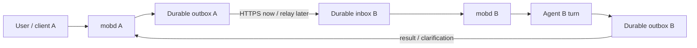
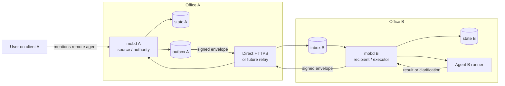
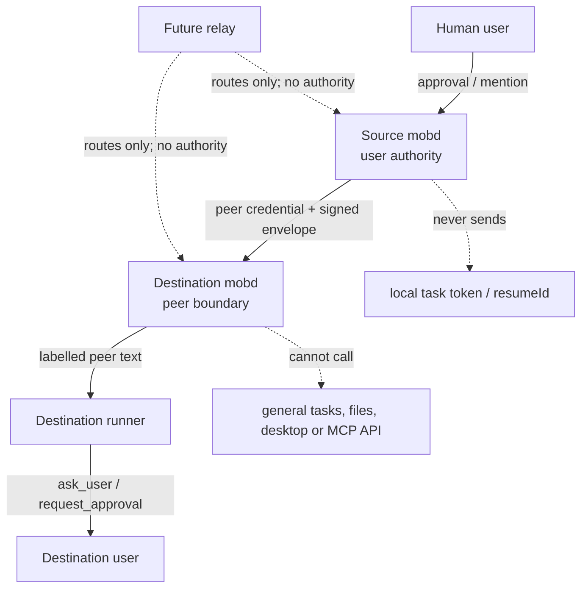

# Cross-machine agent collaboration (COLLAB-3)

Status: proposal, 2026-11-10. This document is the first design step for
collaboration between agents owned by different `mobd` instances. It extends
the local request and delivery model in [agent collaboration](agent-collaboration.md);
it does not change the local behavior yet.

## Recommendation

Add a small federation layer between `mobd` instances. Keep the existing
collaboration state machine and turn-boundary scheduler at each node, and move
only collaboration messages across the boundary.



The source node remains the authority for the exchange and request that its
user created. The destination node owns the local delivery, runner turn and
local permissions. Neither node writes the other node's `state.json`, and a
remote node never receives a local task token or runner resume handle.

The important ownership boundary is visible here:



`mobd A` owns the exchange and the user's authorization. `mobd B` owns the
recipient's session, runner settings and approvals. The relay, when added,
only routes envelopes; it is not an agent and does not become a third owner of
the conversation.

This gives us one protocol with two transports:

1. **First implementation:** direct HTTPS between nodes paired by their local
   agents at the users' request, normally over an existing LAN/VPN HTTPS setup.
   Users initiate pairing in Mob chat; no SSH login or per-machine CLI setup
   is part of the pairing flow.
2. **Later network:** the same envelopes through a relay that routes opaque
   node-to-node traffic and handles nodes that cannot accept inbound
   connections.

Do not start with a new broker, shared database or remote calls to `/tasks`.
Those approaches couple execution to the other machine, make a one-slot node
easy to deadlock, and give a peer access to APIs intended for a paired human
client.

## What is local today

The current implementation has four boundaries that cross-machine work must
preserve:

- `Session.ID` and all request participants are local to one `mobd` state file.
- `Exchange`, `Request` and `Delivery` are atomically committed together by one
  store writer.
- A collaboration tool call is authenticated by the local turn token at
  `/internal/tasks/{id}/collab/...`; that token cannot be valid on another node.
- The scheduler starts a delivery only at a turn boundary. Nothing is pushed
  into a running turn, and a runner is not held while waiting for another
  agent.

The cross-machine protocol should adapt to these boundaries instead of
removing them.

## One request from A to B and back

The network hop is asynchronous. No runner slot is held while A waits, and a
duplicate HTTP delivery cannot create a second B turn.

```mermaid
sequenceDiagram
    participant U as User / client A
    participant A as mobd A
    participant OA as outbox A
    participant B as mobd B
    participant IB as inbox B
    participant RB as Agent B turn

    U->>A: Send user turn mentioning @api@office-b
    A->>A: Create exchange + request + outbox in one commit
    A-->>U: Request pending; A turn ends
    OA->>B: POST signed request envelope
    B->>B: Verify peer, target ref, expiry and signature
    B->>IB: Commit envelope ID and local delivery
    B-->>OA: Ack durable acceptance
    OA->>OA: Mark outbox item acknowledged
    B->>RB: Start labelled turn at a turn boundary
    RB->>B: complete_request(result)
    B->>B: Commit result + result outbox
    B->>A: POST signed result envelope
    A->>A: Apply once to authoritative request
    A->>A: Schedule A's result turn when idle
    A-->>U: A resumes with B's result
```

If the POST times out after B commits, A retries the same envelope ID. B
acknowledges the duplicate and does not run the request again. If B's runner
crashes, B marks the request interrupted and sends that terminal notice; a
user can decide what to do next.

## Identity and addresses

An agent address must include the node that owns the session:

```go
type AgentRef struct {
	ServerID  string `json:"serverId"`
	SessionID string `json:"sessionId"`
}
```

`serverId` is the existing stable Mob office identity and `sessionId` remains
the canonical agent identity inside that office. A handle is a display and
lookup hint, not an identity; it is scoped to one node. A UI may render a
remote reference as `@api@office`, but records store the two IDs above and
never a hostname, URL, list position or short ID.

The existing `serverId` is not proof of server identity. Each node therefore
also needs a federation key record:

```go
type Peer struct {
	ServerID       string
	Name           string
	Endpoint       string
	PublicKey      []byte
	Capabilities   []string
	CreatedAt      time.Time
	RevokedAt      *time.Time
}
```

The first pairing is user-authorized and agent-configured, using a one-time
invitation as described below. It pins the peer's public key and endpoint;
discovery does not create trust. Revoking a peer stops new delivery and
invalidates its queued outbound work. The client bearer token in `auth.json`
is for human/device API access and must not be reused as a node credential.

## Pairing through agents

The user talks to the agents through existing Mob conversations. Each agent
asks its **own** `mobd` to prepare or join a pairing; the daemons perform the
handshake and persist their own configuration. The user never needs to log in
to either machine, run a command, edit a config file or copy a permanent key.

For example, the user tells agent A, "Connect with the API agent on office B;
share only this agent." Agent A returns a pairing invitation. The user gives
that invitation to agent B in Mob and says, "Pair with this office; share only
this API agent." The respective users confirm the concrete peer and sharing
scope in Mob; the agents then report the connection status.

```mermaid
sequenceDiagram
    participant U as User(s) in Mob
    participant AA as Agent A
    participant DA as mobd A
    participant AB as Agent B
    participant DB as mobd B

    U->>AA: Prepare pairing; share selected local agent
    AA->>DA: prepare_peer_pairing(local scope)
    DA-->>U: Short-lived invitation card
    U->>AB: Pair using this invitation; select local agent
    AB->>DB: join_peer_pairing(invitation, local scope)
    DB->>DA: Redeem invitation; exchange identity and key proofs
    DA-->>U: Confirm B identity and A's sharing scope
    DB-->>U: Confirm A identity and B's sharing scope
    U->>DA: Approve from Mob
    U->>DB: Approve from Mob
    DA->>DB: Exchange approved pairing records; verify connectivity
    Note over DA,DB: Each daemon persists its own peer record
    DA-->>U: Paired; selected remote agents available
    DB-->>U: Paired; selected remote agents available
```

The user can be the same person on both sides or two different owners. In the
first release, a local approver is an already paired Mob client with the
existing office-wide authority; this does not add individual user identity.
For different owners, each approves access to their own office. A's user
cannot authorize access to B merely by knowing B's name or endpoint.

### Bootstrap and discovery

Before pairing, normal `send_request` cannot carry the invitation: there is
no authorized peer yet. The minimum bootstrap is a one-time invitation passed
through the user's existing Mob conversations. A client already connected to
both offices may offer "Send to office B" and forward it after the user selects
the target. That is a client feature, not an assumption that the daemons share
client credentials. Cross-user sharing uses the invitation link. A relay or
team directory is not required for this first flow.

The invitation contains a pairing ID, A's `serverId`, public-key fingerprint,
HTTPS endpoint, expiry and a high-entropy single-use secret. A stores only the
secret hash. Reuse the existing device-pairing lifetime (10 minutes) and
invitation pattern, with separate federation records and endpoints. Redemption
reserves the invitation for one B identity/key; retries by that same proven
identity recover the same pending pairing, while another identity is refused.
The invitation permits only this handshake, not collaboration or general API
access. Secret redemption uses a request body, never a URL query or logs; the
client handles the invitation secret as a fragment, like device pairing.

A display name is not enough to find or authenticate a machine. If no
invitation or previously verified reference is available, the agent asks for
one rather than guessing an endpoint. Public keys, challenges and exact
handshake encoding must be specified and tested before implementation.

### Local tools and approval

The proposed local MCP surface is deliberately small:

| Tool | Effect |
| --- | --- |
| `prepare_peer_pairing(localAgents)` | Create a pending invitation for the selected local agents; grant no peer access. |
| `join_peer_pairing(invitation, localAgents)` | Start identity verification and request approval for the concrete peer and scope. |
| `peer_pairing_status(pairingId)` | Read pending approval, connection problem, paired or expired status. |

Tool names are proposals, not available capabilities. Calls use the existing
local task authentication pattern; the task token never crosses machines.
Pairing mutations are allowed only from locally user-started turns, with
server-side checks; a turn started by another agent cannot change peer trust.
Agents use these operations rather than editing `auth.json` or invoking the
device-pairing CLI. Keys and permanent peer credentials stay with `mobd`.

Reuse the Mob question/approval UI, but bind the approval record to the pairing
ID, both server IDs and public keys, endpoint and exact local sharing scope.
The daemon validates and consumes that approval before granting access; an
agent's claim that "the user approved" is not a grant. An existing recorded
approval for that exact proposal is reused on retries. A change of peer, key
or scope requires a new approval. Ordinary reconnects require none.

The current generic `request_approval` response alone does not provide that
binding. Implementation must add it to the daemon and client approval path,
without the mention-based approval exemption used for ordinary agent messages.
These API checks do not sandbox a local agent running as the same OS user;
the existing local trust model still applies.

### Completion and recovery

Pairing work is asynchronous and belongs to the daemon. A tool returns a
pending ID; the agent can end its turn while the user or peer responds. The
existing blocking ask tool must not hold a runner slot for the handshake.
Pairing approvals belong to that pending record and its expiry, not to the
originating task's questions, which expire when the turn ends. Reuse the
approval presentation, not the current task-bound lifetime.

Both daemons save the same pairing identity and negotiated scope, plus their
own local grant. Collaboration is enabled only after both approvals and key
proofs have been verified. A lost response or restart resumes the same pending
record; one-sided completion is shown as pending, never as a working link.
Expiry or rejection leaves no collaboration grant. Before activation, recheck
that each shared session exists, is unarchived and remains authorized.

The agent checks the saved network configuration automatically. Direct
request/result POSTs require working paths in both directions; pairing alone
does not make two private networks reachable. If those paths are unavailable,
report the missing route and propose tunnel/relay setup through the same chat.
Opening ports, changing firewall rules or creating network accounts is a
separate approved action, not a hidden side effect of pairing. Endpoints come
from the user-provided invitation or an existing verified configuration, with
certificate checks and no credential-bearing redirects.

Revocation is also available through Mob: it disables the local grant
immediately, even while the peer is offline. Re-pairing or an auth reset must
not silently restore an old grant. Every admission and queued delivery checks
the current grant; stopping already running work remains a separate action.

## Authorization model

Authorization still starts with the user who wrote the message on the source
node:

1. The client selects a remote agent and includes its `AgentRef` in the user
   turn's mentions.
2. The source node snapshots those references into the exchange. An agent may
   send only to those recipients, exactly as it does locally today.
3. The source node signs and queues a request envelope for the selected peer.
4. The destination node verifies the peer, target `ServerID` and target
   `SessionID`, then delivers the text as a labelled collaboration message.

The destination agent runs with its own runner settings and approvals. A
message from a remote agent is still peer text and never counts as the user's
approval. Questions and approvals go to the local user. A remote peer cannot
create a local task, call local MCP, change settings, or address a third agent
through the federation endpoint.

The trust boundaries are therefore separate:



The source user's mention authorizes the source agent to contact the selected
recipient. It does not authorize the destination agent to perform an action on
the source user's behalf, and peer text never satisfies a local approval gate.

For a future multi-user network, node pairing and user membership are separate
permissions. A user may be allowed to discover an agent without being allowed
to send work to it. The first implementation uses a user-approved allowlist per
peer, configured by the local agent through the pairing flow; team and per-user
ACLs belong in the relay phase.

## Message envelope

The transport carries an envelope, not a Mob API request:

```go
type CollaborationEnvelope struct {
	Version       int       `json:"version"`
	ID            string    `json:"id"`             // globally unique event ID
	Kind          string    `json:"kind"`           // request, clarification, answer, result, cancel, notice
	ExchangeID    string    `json:"exchangeId"`
	RequestID     string    `json:"requestId"`
	Sequence      uint64    `json:"sequence"`       // monotonic per request direction
	From          AgentRef  `json:"from"`
	To            AgentRef  `json:"to"`
	Text          string    `json:"text,omitempty"`
	CreatedAt     time.Time `json:"createdAt"`
	ExpiresAt     time.Time `json:"expiresAt"`
	PayloadHash   string    `json:"payloadHash"`
	Signature     []byte    `json:"signature"`
}
```

The exact Go type can evolve, but these properties are required:

- `ID` is the idempotency key. A receiver applies an envelope once and safely
  acknowledges duplicate delivery.
- `ExchangeID` and `RequestID` correlate a remote event with the source
  request. They are not assumed to be unique without the source `ServerID`.
- `From` and `To` are checked against the authenticated peer and the pinned
  target. They are not taken from an untrusted prompt.
- `Sequence` makes a clarification/result stream ordered without relying on
  synchronized clocks.
- `ExpiresAt` bounds stale work. The receiver checks a maximum allowed lifetime
  rather than trusting an arbitrary remote clock.
- The signed bytes cover routing fields, timestamps, kind and text. The
  signature gives message authentication even when a relay is later added.

The envelope must not contain bearer credentials, task tokens, `resumeId`,
desktop control data or arbitrary files. Attachments need a separate, explicit
transfer protocol with its own authorization and size limits.

## Delivery semantics

Use **at-least-once delivery with durable deduplication**. Exactly-once network
delivery is not realistic, while dropping a request after an HTTP timeout is
hard for users to understand.

### Source node

When `send_request` succeeds, one local commit creates the request and an
outbox record. The request is visible as pending even if the peer is offline.
The transport retries an outbox record with bounded exponential backoff until
it is acknowledged, expires or is cancelled. A successful HTTP response means
the destination durably accepted the envelope, not that its agent has answered.

### Destination node

The federation handler authenticates and validates the envelope, then commits
an inbox record before returning an acknowledgement. Repeated `ID`s return the
same acknowledgement and never create another turn. The local delivery loop
turns an accepted request into the existing labelled collaboration turn when
the target session is idle. A queued delivery is withdrawn if the user sends a
message first, as it is locally.

### Result path

Clarifications, answers, results and terminal notices travel back through the
same outbox/inbox path. The source node applies them to its authoritative
request only after validating the request, direction, sequence and peer. A
remote turn ending unexpectedly marks the request interrupted; it is not
automatically rerun. The existing expiry, cancellation and exchange budget
rules remain the source of truth.

This produces clear failure states:

| Failure | User-visible result |
| --- | --- |
| Peer offline | Pending request; bounded retry and an expiry time |
| Connection timeout after send | Retry with the same envelope ID |
| Destination restart before commit | No acknowledgement; source retries |
| Destination restart after commit | Duplicate is acknowledged; no second turn |
| Destination runner crash | Local request becomes interrupted; no automatic rerun |
| Peer revoked | Outbox fails and request needs user intervention |

## Transport boundary

Introduce a narrow internal interface so local behavior does not depend on
network details:

```go
type CollaborationTransport interface {
	Send(context.Context, AgentRef, CollaborationEnvelope) error
	Close() error
}
```

The initial HTTP transport needs only a dedicated federation surface, for
example:

- `GET /federation/v1/hello`: authenticated capability and protocol exchange;
- `POST /federation/v1/envelopes`: signed envelope ingestion and durable ack;
- `GET /federation/v1/agents`: optional, allowlisted agent directory used by a
  picker, never an authorization grant.

These routes must not be added to the paired-client API or the local
`/internal/tasks` surface. They accept only peer credentials and enforce a
small body limit, per-peer queue limit, replay protection and rate limit.

Bootstrapping has a separate, bounded `/federation/v1/pair` surface: it accepts
an unexpired invitation and subsequent proof from the bound candidate, not an
already established peer credential. It exposes only the pending handshake,
never the agent directory or message delivery. No open invitation means no
new pairing. Local pairing MCP calls use dedicated task-authenticated handlers
with the approval checks above; the remote pairing handler cannot call them.

For the first network implementation, both nodes make outbound HTTPS requests
to their peer's verified endpoint. Existing tunnel or VPN configuration must
supply reachability; HTTPS supplies transport encryption. A persistent stream
is not required for correctness; it is an optimization after request/result
delivery works through ordinary POSTs.

The later relay implements the same `CollaborationTransport` contract. It
routes by `ServerID`, stores envelopes long enough for reconnect, and cannot
change a signed envelope. Before the relay is exposed to untrusted users,
payload encryption to the destination public key should be added so the relay
does not need to read request text.

## Storage changes

The current atomic JSON store is sufficient for one daemon owning its own
state. The first implementation should extend it with durable outbox/inbox
records rather than introduce a distributed database:

```go
type OutboxItem struct {
	Envelope CollaborationEnvelope `json:"envelope"`
	PeerID   string                `json:"peerId"`
	Attempts int                   `json:"attempts"`
	NextTry  time.Time             `json:"nextTry"`
	AckedAt  *time.Time            `json:"ackedAt,omitempty"`
}

type InboxItem struct {
	EnvelopeID string    `json:"envelopeId"`
	ReceivedAt time.Time `json:"receivedAt"`
	AppliedAt  *time.Time `json:"appliedAt,omitempty"`
}
```

Outbox creation and the source request must be one commit. Inbox acceptance
and the local delivery must be one commit. This keeps a crash from producing a
request with no message or an acknowledgement with no durable message. The
records need a bounded retention policy; terminal request history remains in
the existing collaboration records.

At the protocol boundary, use `AgentRef` fields alongside the current local
string IDs. Do not overload a local session ID with `serverId/sessionId` text;
that would make old clients and every existing lookup ambiguous. A migration
can keep `From`/`To` for local history while adding `FromRef`/`ToRef` for
federated requests.

## Directory and sharing

Remote agents should not become globally visible just because two nodes are
paired. A node publishes only sessions included in the local user's approved
sharing scope, configured by the agent during pairing or a later approved
update. The published card contains the minimum picker data:

```go
type AgentCard struct {
	Ref       AgentRef `json:"ref"`
	Handle    string   `json:"handle,omitempty"`
	Title     string   `json:"title"`
	Framework string   `json:"framework"`
	Available bool     `json:"available"`
}
```

Titles and handles are cached for display only. Every send revalidates the
full `AgentRef`, archive state, peer permission and current share setting. A
deleted or moved handle never retargets an old request.

## Phased implementation

1. **Protocol seam and loopback tests.** Add `AgentRef`, envelope validation,
   outbox/inbox records and a loopback transport. Exercise duplicate delivery,
   restart recovery, ordering, expiry and user-first scheduling without opening
   a network port.
2. **Agent-configured pairing and direct transport.** Add the local pairing
   MCP tools, task authentication and typed approval binding, pending pairing
   storage/recovery, invitation cards and approval/status UI in the apps.
   Support invitation forwarding when a client already connects to both offices.
   Add the separate federation handshake, signed HTTPS envelopes, a scoped
   directory and request/result/clarification delivery. CLI-only pairing is not
   a completed first release. Validate with two `httptest` servers and then a
   real one-slot A → B → A exchange, including offline/restart recovery.
3. **Collaboration client support.** Let a user choose a remote agent, show its
   node name and connection state, and display pending/failed delivery
   separately from a runner failure. Keep local mentions and existing clients
   compatible; clients without pairing approval support cannot approve it.
4. **Relay and teams.** Add a relay transport, per-user membership and ACLs,
   encrypted payloads, audit events and quotas. Group collaboration, agent
   discovery across an organization and shared file/workspace coordination
   belong here, not in the direct two-node protocol.

Pairing acceptance checks: complete the flow entirely through Mob chat and
approval cards; reject expired invitations, reuse by another candidate and peer-started management
calls; refuse an approval for different keys or scopes; resume after a lost
handshake response or daemon restart without duplicate grants; handle rejection
on either side without enabling collaboration; block unshared agents; show a
missing network path clearly; revoke locally while the peer is offline.

## Explicit non-goals

- Sharing or merging `state.json`, runner context, desktop sessions or working
  folders between machines.
- Letting a remote agent invoke another node's general task, file, desktop or
  MCP APIs.
- Automatic B → C delegation in the first cross-machine version.
- Treating a node hostname, URL, pairing `serverId` or prompt text as proof of
  identity or user approval.
- Exactly-once execution, automatic reruns after a crashed turn, or silent
  retargeting when an agent is deleted or renamed.
