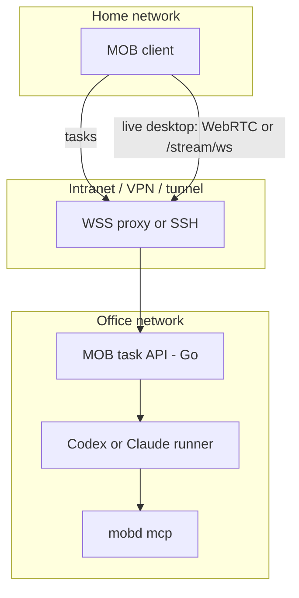

# Architecture

MOB splits **control** (what the agent should do) from **view** (what the human sees) and from **actuation** (how the agent drives the office Mac UI).

This repository owns the office daemon, `mobd mcp`, the API and release tooling.
The desktop client lives in [xrdavies/mob](https://github.com/xrdavies/mob).
Signed and notarized macOS Apple Silicon binaries are distributed through
`https://mob-releases.0xd.app/mobd/`; see [installation and releases](releases.md).

## Components

### Client (dispatcher + monitor)

Runs on the home Mac and iPhone.

- **Dispatcher:** send tasks, watch task status, converse with the office agent session.
- **Monitor:** the apps show the live desktop that mobd streams. The small view only watches; the large view has an explicit Control mode for mouse, keyboard and touch input.

Clients are a remote control + monitor, not the place where the agent runtime lives.

### Control plane (task API)

The HTTP API is implemented in **Go** as `mobd` (see the [API reference](mobd-v3.md)):

- create / list / cancel tasks
- list conversations and restore their complete user/assistant transcripts
- attach each task/turn to a stable runner session (Codex or Claude Code)
- stream or poll status (SSE)
- questions and approval requests, plus steering when supported by the runner
- typed agent activities and a global FIFO desktop queue
- session management, a global event stream, desktop snapshots and image uploads

`mobd` stores conversations, messages, activities, questions, turn states and runner resume IDs in an atomic private JSON snapshot (`MOBD_STATE_PATH`). Each conversation allows one active turn. Codex defaults to app-server mode; its exec fallback and the Claude runner translate provider output into the same model. SSE debug logs are separate from chat messages. See [the session API](../README.md#conversations-and-runner-lifecycle).

### Office runners

Process(es) on the office Mac that:

- receive a task from the control plane
- start or resume a **Codex** or **Claude Code** session with the configured MCP tools
- report progress back to the control plane

**Codex** and **Claude Code** implement the shared runner interface. Each adapter
translates its provider's output into mobd events. See [runners](runners.md) for
configuration, capabilities and the adapter contract.

### Actuation (local MCP)

How the agent opens apps and operates the GUI on the office Mac.

The `mob-mcp` tool set is built into the `mobd` binary and served by `mobd mcp`
over stdio. The agent launches it as a separate process for each task.
`internal/desktop` captures and drives the desktop through one backend per OS
(macOS today; Linux and others return "unsupported"); mobd also uses it directly
for `/screen` and `/health` permission checks. See [desktop streaming](desktop-streaming.md).

The desktop tools are `screenshot`, `click`, `type_text`, `key`, `list_windows`
and `open_app`. Screenshots return PNG data and display metadata, including
`scale_factor`; clicks use logical point coordinates. Grant Accessibility and
Screen Recording to the responsible process or launching app and verify actual
tool operation with the [office checklist](office-smoke-checklist.md).

`mcpCommand` and `mcpArgs` configure an external MCP command when needed.
The default command is this mobd binary with the `mcp` argument.

### Live desktop (stream)

- mobd captures the display with ScreenCaptureKit and encodes H.264 with VideoToolbox, sized to the view the client shows; an unchanged screen sends nothing.
- `POST /stream` opens a session with a WebRTC offer (Pion): one video track plus `control`, `input` and `pointer` data channels. Where UDP cannot pass, the same session continues over `GET /stream/ws`.
- mobd's own rate control adapts bitrate, size and frame rate from receiver reports (WebRTC) or acknowledgements (WebSocket); clients send `resize` when their view changes.
- Input arrives as normalized coordinates and web key codes and is posted with CGEvent; held keys and buttons are released when the session ends.
- One session per client; it closes on credential revocation, deletion, auth reset or daemon shutdown. `/health` lists `stream` and `streamResize` and reports `streamSessions`.
- Details: [desktop streaming](desktop-streaming.md).
- Transport: use the intranet / VPN or an SSH tunnel. For home-to-office access,
  [Tailscale Serve](remote-access.md) provides a private HTTPS/WSS entry point to
  a loopback mobd listener; a public reverse proxy needs authentication on all routes.
- The [connection design](remote-access.md) offers private networking, user-managed
  Funnel and our managed relay using the same API. mobd enforces individual
  client authentication in every mode, with no anonymous access. The [pairing protocol](pairing.md)
  and local management are implemented; desktop/mobile integration is pending.
  The managed relay still needs device enrollment and isolation between users.

See [desktop streaming](desktop-streaming.md) and [security](security.md).

## Operating limits

- Tasks share one desktop. Keep `maxRunning: 1` to serialize agent input; mobd
  does not provision separate desktops or virtual machines.
- Human Control mode does not automatically pause an active agent.
- Run one daemon per state path. Storage is an atomic JSON snapshot with separate
  image files; interrupted turns fail on restart and are not rerun automatically.
- Per-device bearer credentials protect all business routes. All paired clients
  share one office; mobd has no multi-user isolation or dedicated security audit log.

## Trust and network sketch

`ask_user` and `request_approval` are implemented. Runner permissions default to
`bypass`; `approve` enables provider approval gates for Codex app-server and Claude.
The MCP request tool alone is an instruction-based gate, not a sandbox. See
[runners](runners.md) and [security](security.md) for the supported boundaries.
