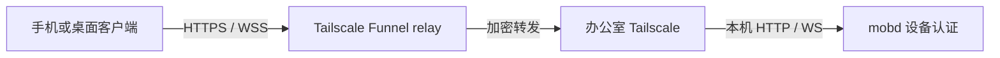
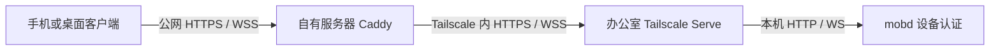

# mobd 连接配置：内网、Funnel 与自建中继

本手册以办公室 Mac 运行 mobd 为前提，提供三种可自行部署的连接方式。
它们共用 mobd 的强制配对认证，不需要为每种方式增加 mobd 插件或认证配置。
先选一种入口，完成网络验证，再按文末步骤配对。

| 方式 | 适用场景 | Tailscale 安装位置 | 客户端入口示例 |
| --- | --- | --- | --- |
| [内网直连](#内网直连) | 同一局域网，或已有 VPN 能访问办公室 IP | 不需要 | `http://192.168.1.20:8080` |
| [Tailscale Funnel](#tailscale-funnel) | 从外网访问，不维护公网服务器 | 办公室 Mac | `https://office-mac.example-tailnet.ts.net` |
| [自建中继](#自建中继) | 使用自己的公网服务器和域名 | 办公室 Mac、公网服务器 | `https://office.example.com` |

这里的“自建中继”是 **公网 HTTPS 网关 + Tailscale 私有连接**，手机无需安装 Tailscale。
它不是自建 DERP：DERP 只为 Tailscale 节点转发加密流量，单独部署 DERP 不会产生可供普通
手机使用的 HTTPS 入口。自建网关也不等于已经实现产品中的“我们的托管中继”。
网络中继类型见 [Tailscale 连接类型](https://tailscale.com/docs/reference/connection-types)。
两端都能安装 Tailscale、希望入口仅在 tailnet 内可见时，使用原有的
[Tailscale + Serve 指南](remote-access.md#双端可以安装-vpn-时tailscale--serve)。

mobd 已支持邀请、凭据及撤销；客户端是否能扫码、保存凭据、携带认证连接各通道，取决于其适配版本。
客户端更新前也可以用本文的 curl 步骤验证网络、配对和 SSE；旧匿名客户端不能直接连接。

## 共用准备

按 [安装说明](../README.md#install--run-office-mac) 初始化 mobd、配置 runner 和 macOS 权限。
以下 `mobd` 命令在办公室执行；使用仓库构建的开发版时，替换为 `./bin/mobd`。

```bash
mobd status
curl -i --connect-timeout 5 --max-time 10 http://127.0.0.1:8080/health
```

服务未启动时运行 `mobd start`。本机 `/health` 未带凭据应返回 **401**，说明认证接口可达；
它不是完整业务健康检查。连接失败时先查 `mobd logs`、实际监听地址和端口。

`mobd init` 新生成的配置使用 `"listen": "0.0.0.0:8080"`，同时支持内网直连和本机代理。
`init` 不覆盖已有配置。以下网络方案都可以继续使用这个监听地址；只需要隧道访问时，
可自行改为 `127.0.0.1:8080`。公网 HTTPS 由 Tailscale 或网关提供，mobd 本身保持 HTTP。

修改现有配置时保留其他字段，在无任务运行时 `mobd restart`。环境变量和启动参数会覆盖配置，
无参数重启还会复用已保存参数；以 `mobd status` 显示的地址为准。
本手册均假设端口为 8080，使用其他端口时需同步修改转发目标。

办公室 Mac 需要保持联网、唤醒和用户登录，桌面操作依赖该用户会话。
若要登录后恢复 mobd，未启动时运行 `mobd start --login`，已启动时运行 `mobd restart --login`。
Tailscale 的后台服务不会替你启动 mobd。

## 内网直连

1. 在办公室 Mac 的“系统设置 → 网络 → 当前连接 → 详细信息”查看实际局域网 IP，
   例如 `192.168.1.20`。客户端需能路由到该地址；访客 Wi-Fi 或 AP 隔离可能阻止设备互访。
   从家庭网络直接填写办公室私有 IP 不会自动穿透 NAT，需要已有 VPN 或后两种方案。
2. 确认 mobd 监听 `0.0.0.0:8080`。已有配置若为 `127.0.0.1:8080`，修改 `listen` 后重启。
   如有启动参数覆盖，可明确运行 `mobd restart --listen 0.0.0.0:8080`；
   使用自定义配置时同时保留对应的 `--config PATH`。
3. 在手机或桌面客户端所在网络打开 `http://192.168.1.20:8080/pair`，应看到固定配对提示页。
   或在客户端电脑执行：

   ```bash
   curl -i --connect-timeout 5 --max-time 10 http://192.168.1.20:8080/health
   ```

   预期 **401**。超时先检查 IP、网络隔离和 macOS 防火墙是否允许 mobd 入站。
4. 在办公室生成邀请：

   ```bash
   mobd link --url http://192.168.1.20:8080
   ```

   命令会提示 HTTP 风险，但照常输出二维码、链接和有效期。随后完成[配对与验收](#配对与验收)。

`0.0.0.0` 是监听地址，`127.0.0.1` 是设备自身地址，都不能作为其他设备的局域网入口。
建议在路由器上为办公室 Mac 保留 DHCP 地址；地址变化后需核验并更新客户端入口。
无需设置路由器公网端口映射。

普通内网 HTTP 不加密邀请、长期凭据和业务内容，能监听链路的人可能取得它们。
配对认证仍然必需。要保留客户端记录但停止其访问，可在办公室执行
`mobd clients revoke CLIENT_ID`；这不会停止其他客户端或 mobd。

## 办公室安装 Tailscale

后两种方案共用这一步。下面使用 Homebrew 的开源命令行版 `tailscale` + `tailscaled`，
命令依据 [Tailscale 官方 macOS 指引](https://github.com/tailscale/tailscale/wiki/Tailscaled-on-macOS#installing-tailscaled-from-homebrew)。
先安装 [Homebrew](https://brew.sh/)；如果已经运行其他 Tailscale 安装版本，先确认并处理已有安装，
不要同时启动多套守护进程。本手册后续的 `sudo tailscale` 均指这一命令行版。

```bash
brew install --formula tailscale
sudo brew services start tailscale
sudo tailscale up
sudo tailscale status
```

打开 `tailscale up` 输出的登录链接，登录自己的账号，将办公室 Mac 加入 tailnet。
登录后应能在 `status` 和管理控制台中看到该设备。办公室网络必须允许 Tailscale 出站连接；
无需为 mobd 在办公室路由器上开放公网入站端口。连接不通时用 `sudo tailscale netcheck`
诊断，并参考官方[防火墙要求](https://tailscale.com/docs/reference/faq/firewall-ports)。

## Tailscale Funnel



完成办公室 Tailscale 安装及本机 mobd 检查后，在办公室执行：

```bash
sudo tailscale serve status
sudo tailscale funnel status
```

确认 Tailscale 的 HTTPS 443 根路径没有其他服务后启用：

```bash
sudo tailscale funnel --bg --https=443 http://127.0.0.1:8080
sudo tailscale funnel status
```

首次执行按终端给出的网页链接启用 HTTPS 和 Funnel，tailnet 需要开启 MagicDNS。
账号没有相应权限时由 tailnet 管理员配置。不要覆盖同一端口已有的发布配置：
同一个 Tailscale 端口不能同时保持私有 Serve 和公网 Funnel，最后的配置决定可见范围。
详见 [Funnel 要求](https://tailscale.com/docs/features/tailscale-funnel)。

成功输出包含 `Available on the internet` 和实际地址，例如：

```text
https://office-mac.example-tailnet.ts.net
|-- / proxy http://127.0.0.1:8080
```

手机关闭 Wi-Fi、使用蜂窝网络且不连接 Tailscale，打开该域名的 `/pair` 页面检查可达性，
或在家庭电脑用 curl 请求 `/health`，预期 **401**。首次公开 DNS 生效可能需要等待数分钟。
本机后端继续使用 HTTP，客户端用输出的 HTTPS 域名，不添加 `:8080` 或路径前缀。

办公室生成邀请，再完成[配对与验收](#配对与验收)：

```bash
mobd link --url https://office-mac.example-tailnet.ts.net
```

`--bg` 保存发布配置，Tailscale 重启后恢复；电脑离线或 mobd 停止时仍不可访问。
域名不是每次生成邀请就更换的临时地址，但设备名、tailnet 名或注册身份变化可能改变入口。
关闭本节发布的入口：

```bash
sudo tailscale funnel --bg --https=443 off
sudo tailscale funnel status
```

关闭入口不撤销 mobd 凭据。不要使用 `funnel reset` 清除其他服务的配置。
[Funnel CLI](https://tailscale.com/docs/reference/tailscale-cli/funnel) 说明了后台恢复和关闭行为。
Funnel 的 relay 由 Tailscale 运营，TLS 在办公室终止；Funnel 有带宽限制，需实测画面延迟。

## 自建中继

此方案使用一台 Ubuntu/Debian 公网服务器运行 Caddy，办公室运行私有 Tailscale Serve。
手机使用自己的域名，不安装 Tailscale，也不需要在办公室开启 Funnel。



### 1. 公网服务器加入同一个 tailnet

办公室按前文安装并登录 Tailscale。在公网服务器按
[Linux 官方安装说明](https://tailscale.com/docs/install/linux) 安装：

```bash
curl -fsSL https://tailscale.com/install.sh | sh
sudo tailscale up
sudo tailscale status
sudo tailscale ip -4
```

安装脚本需要提权时会调用 sudo。通过输出链接登录与办公室相同的 tailnet。
在办公室也执行 `sudo tailscale ip -4`，记录两端的 Tailscale IP。
本例假设网关为 `100.101.102.103`、办公室为 `100.101.102.104`。

### 2. 限定网关到办公室的访问

在 Tailscale 管理控制台配置网关只能访问办公室 TCP 443。
以下是**专用两机 tailnet** 的最小网络放行示例，使用前替换两端实际 IP：

```json
{
  "grants": [
    {
      "src": ["100.101.102.103"],
      "dst": ["100.101.102.104"],
      "ip": ["tcp:443"]
    }
  ]
}
```

放行规则累加；只新增这条规则不会限制已有的 allow-all。专用网络需移除宽泛放行，
共享 tailnet 则由管理员调整相关规则并保留其他业务配置，不要直接覆盖整份策略。
设备重新注册导致 IP 改变时同步更新规则。参见 [grants 语法](https://tailscale.com/docs/reference/syntax/grants)。

### 3. 办公室启用私有 Serve

检查现有发布状态，确认 443 根路径可用于 mobd，再执行：

```bash
sudo tailscale serve status
sudo tailscale funnel status
sudo tailscale serve --bg --https=443 http://127.0.0.1:8080
sudo tailscale serve status
sudo tailscale funnel status
```

按首次运行提示启用 HTTPS，确认 MagicDNS 已开启。输出应为 `Available within your tailnet`，
且该端口没有 Funnel 公网发布。若从前一方案切换，先关闭对应的 Funnel 入口。
复制实际 Serve 域名，例如 `office-mac.example-tailnet.ts.net`。

在**公网服务器**测试到办公室的这一段连接：

```bash
curl -i --connect-timeout 10 --max-time 15 https://office-mac.example-tailnet.ts.net/health
```

预期 **401**。只有这一步通过后再配置公网代理；DNS 失败检查服务器的 Tailscale DNS 设置，
超时检查 tailnet 策略、办公室在线状态及 `tailscale netcheck`。不要用 `-k` 跳过证书验证。

### 4. 公网服务器配置 Caddy

准备域名，例如 `office.example.com`，将 A 记录指向公网服务器；只有 IPv6 确实可用时才配置 AAAA。
服务器防火墙和云安全组放行 TCP 80、443，供客户端访问及自动证书签发；保留已有管理访问规则。
办公室不做公网端口映射，也不公开 VNC 的 5900 或 mobd 的 8080。

按 [Caddy 官方 Ubuntu/Debian 安装步骤](https://caddyserver.com/docs/install#debian-ubuntu-raspbian)
安装稳定版及其 systemd 服务。编辑 `/etc/caddy/Caddyfile`，添加以下独立站点，保留已有站点：

```caddyfile
office.example.com {
    reverse_proxy https://office-mac.example-tailnet.ts.net {
        header_up Host {upstream_hostport}
    }
}
```

两个域名都必须替换为自己的实际值。上游使用完整 Serve 域名，Caddy 会验证其证书；
显式设置上游 Host 兼容不同 Caddy 版本。Caddy 默认转发客户端 Authorization，支持 WebSocket
升级，并对 `text/event-stream` 即时刷新，无需另写 SSE/VNC 路由或配置共享 token。
见 [reverse_proxy 文档](https://caddyserver.com/docs/caddyfile/directives/reverse_proxy)。

不要删除或替换客户端的 Authorization，不在代理中缓存配对或业务响应。
若另加访问日志，应屏蔽敏感头和 `/vnc?ticket=` 查询参数，避免记录凭据或短期票据。
自定义 Web 客户端的 Origin 需加入 mobd 的 `corsOrigins` 精确允许列表，并保留原有来源；
Caddy 改写上游 Host 不会自动授权公网域名的 Web 页面。

在公网服务器验证并加载配置：

```bash
sudo caddy validate --config /etc/caddy/Caddyfile --adapter caddyfile
sudo systemctl reload caddy
sudo systemctl status caddy --no-pager
```

验证失败时先修复配置，不执行 reload。Caddy 会为公网域名自动申请和续期证书，前提是 DNS、
端口和出站网络满足要求，见[自动 HTTPS](https://caddyserver.com/docs/automatic-https)。

### 5. 外网连接和关闭

在家庭电脑或手机蜂窝网络测试公网入口，手机无需加入 tailnet：

```bash
curl -i --connect-timeout 10 --max-time 15 https://office.example.com/health
```

预期返回 mobd 的 **401**。然后在**办公室**生成邀请：

```bash
mobd link --url https://office.example.com
```

使用公网域名完成[配对与验收](#配对与验收)。客户端入口是公网域名，不能填办公室 Serve 域名。
这里 TLS 在自有网关终止，**网关可读取凭据、会话和画面内容**，必须使用可信服务器。
网关到办公室仍由 Tailscale 加密；若无法直连，可能经过 DERP，不能保证这段始终点对点。
它仍使用 Tailscale 的协调服务，不是自托管控制平面或自建 DERP。

关闭对外发布时，移除 Caddyfile 中本节的站点块，验证并 reload，保留其他站点。
Caddy reload 可能影响现有 WebSocket；需要立即停止目标客户端的 SSE/VNC 时，在办公室撤销其凭据。
若办公室的 Serve 入口也不再使用，可关闭本节配置：

```bash
sudo tailscale serve --bg --https=443 off
```

## 配对与验收

三种方式使用相同流程。先在办公室用所选入口运行 `mobd link --url ...`，
再在支持配对的客户端粘贴完整链接或扫描二维码，核对目标地址后确认添加。
二维码/邀请为 **10 分钟、单次使用**；桌面和手机分别生成邀请并配对。
已签发凭据不会随邀请过期或日常重启失效，直到撤销、删除或 mobd 认证重置。
仅打开 `/pair` 提示页不会兑换邀请或自动唤起 App。

客户端尚未适配时，可在客户端电脑的 bash/zsh 终端执行下面的接口测试；需要 curl 7.76+ 和 jq。
用所选入口替换 `MOBD_URL`，从配对链接的 `#invite=...&serverId=...&v=1` 中取出 invite 值，
在 `read` 等待输入时粘贴。不要粘贴完整链接，也不要把邀请写进 URL query。

```bash
MOBD_URL='https://office.example.com'
MOBD_TEST_DIR=$(mktemp -d)
chmod 700 "$MOBD_TEST_DIR"
read -rs MOBD_INVITE
printf '\n'
printf '%s' "$MOBD_INVITE" | jq -Rs '{invite: ., name: "network-test"}' |
  curl --fail-with-body -sS --connect-timeout 10 --max-time 20 \
    -H 'Content-Type: application/json' --data-binary @- \
    -o "$MOBD_TEST_DIR/credential.json" "$MOBD_URL/pair"
unset MOBD_INVITE
```

兑换成功返回 **201**，响应写入仅当前用户可访问的临时目录。若 curl 报错，先处理错误，
不要继续；邀请过期、已兑换或成功响应丢失时，在办公室生成新邀请。
不使用 `-L` 跟随重定向，也不使用 `-k` 跳过 HTTPS 证书验证。

查看非敏感标识，确认返回的 serverId 与邀请中的一致，再保存测试用请求头：

```bash
jq '{serverId, clientId}' "$MOBD_TEST_DIR/credential.json"
jq -er '"Authorization: Bearer " + .token' "$MOBD_TEST_DIR/credential.json" > "$MOBD_TEST_DIR/headers"
curl -fsS -H "@$MOBD_TEST_DIR/headers" "$MOBD_URL/health"
curl -iN -H "@$MOBD_TEST_DIR/headers" --max-time 20 "$MOBD_URL/events"
```

`/health` 应为 **200**，并检查 `checks`、`runners`；SSE 应为 **200**、
`Content-Type: text/event-stream`，空闲约 15 秒出现 `: ping`。
第二条 curl 在 20 秒主动结束，退出码 28 属于预期。完整客户端需把凭据保存到系统安全存储，
这里的临时文件仅用于测试。serverId 比对不替代 HTTPS 或可信网络对服务器身份的保护。

在办公室查看测试客户端，然后只撤销本次返回的 clientId：

```bash
mobd clients list
mobd connections
mobd clients revoke CLIENT_ID
```

在测试终端再次请求应为 **401**，然后清理测试文件：

```bash
curl -i -H "@$MOBD_TEST_DIR/headers" "$MOBD_URL/health"
rm "$MOBD_TEST_DIR/credential.json" "$MOBD_TEST_DIR/headers"
rmdir "$MOBD_TEST_DIR"
unset MOBD_TEST_DIR MOBD_URL
```

需要移除撤销记录时，在办公室运行 `mobd clients delete CLIENT_ID`。
不要为了清理一次测试执行 `auth reset`，它会使所有客户端凭据失效。

正式使用前，还需在实际客户端验证上传、截图、附件、任务事件、断线重连和 VNC 画面。
`/vnc` 使用 Authorization 握手，WebView 无法设置请求头时使用
[短期 VNC 票据](pairing.md#实时桌面票据)，不能把长期凭据放进 URL。
Screen Sharing 登录与 mobd 配对各自独立，办公室 `vncAddr` 仍指向本机 VNC 服务。
撤销目标客户端应中断其 SSE/VNC，其他客户端应保持正常。

## 常见问题

| 现象 | 检查 |
| --- | --- |
| 本机都无法访问 | mobd 是否启动、`status` 监听端口、`logs` 的启动错误 |
| 内网超时 | IP 是否变化、监听是否仍为 loopback、访客网络/AP 隔离、防火墙 |
| Funnel 域名无法访问 | `funnel status`、办公室在线状态、首次 DNS 传播、Funnel/HTTPS 权限 |
| 自建中继 502 | 先在网关 curl 办公室 Serve 域名；检查 tailnet 规则、DNS、Caddy 上游和办公室 mobd |
| 证书错误 | 使用实际入口域名，检查 DNS、系统时间、证书签发；不要关闭证书校验 |
| 配对后仍为 401 | 是否使用兑换后的 token、请求是否带 Authorization、设备是否已被撤销 |
| VNC 403 / 502 | 403 检查 Origin 允许列表；502 检查办公室 Screen Sharing 和 `vncAddr` |
| SSE 无心跳 / 画面卡顿 | 代理是否缓冲、Tailscale 是否退回中继、Funnel 带宽、办公室上行网络 |

操作命令按官方文档与 mobd 接口核对。自动测试不能替代真实跨网 DNS、证书、访问策略及画面性能验收。
