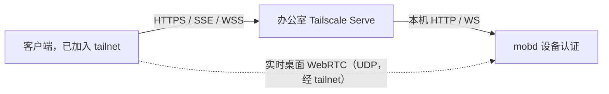
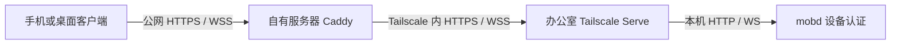

# mobd 连接配置

本手册以办公室 Mac 运行 mobd 为前提，说明客户端（mob、mob-ios、mob-android）如何连接。
所有方式共用 mobd 的强制配对认证：首次配对，之后用设备凭据访问，没有匿名模式。
先选一种入口，完成网络验证，再按[配对与验收](#配对与验收)添加客户端。

| 方式 | 适用场景 | Tailscale 安装位置 | 客户端入口示例 | 实时桌面 |
| --- | --- | --- | --- | --- |
| [内网直连](#内网直连) | 同一局域网，或已有 VPN 能访问办公室 IP | 不需要 | `http://192.168.1.20:8080` | WebRTC |
| [Tailscale Serve](#tailscale-serve) | 两端都能安装 Tailscale，入口仅在 tailnet 内可见 | 办公室 Mac、客户端 | `https://office-mac.example-tailnet.ts.net` | WebRTC |
| [Tailscale Funnel](#tailscale-funnel) | 从外网访问，不维护公网服务器 | 办公室 Mac | `https://office-mac.example-tailnet.ts.net` | WebSocket 回退 |
| [自建中继](#自建中继) | 使用自己的公网服务器和域名 | 办公室 Mac、公网服务器 | `https://office.example.com` | WebSocket 回退 |
| [SSH 跳板机](#ssh-跳板机) | 无法安装 VPN，但两端能 SSH 到同一台可信服务器 | 不需要 | `http://127.0.0.1:18080` | WebSocket 回退 |

mobd 在同一端口提供 HTTP API、SSE、实时桌面信令（`POST /stream`）和 WebSocket 回退
（`/stream/ws`）。实时桌面优先使用 WebRTC（UDP，经局域网或 tailnet 直连 mobd）；
只通 TCP 的入口下客户端自动回退到 `/stream/ws`，画质和延迟较差。
详见[实时桌面](desktop-streaming.md)，安全边界见 [security](security.md)。

## 共用准备

按 [安装说明](../README.md#install--run-office-mac) 初始化 mobd、配置 runner 和 macOS 权限。
以下 `mobd` 命令在办公室执行；使用仓库构建的开发版时，替换为 `./bin/mobd`。

```bash
mobd status
curl -i --connect-timeout 5 --max-time 10 http://127.0.0.1:8080/health
```

服务未启动时运行 `mobd start`。`/health` 未带凭据应返回 **401**，说明认证接口可达；
它不是完整业务健康检查。连接失败时先查 `mobd logs`、实际监听地址和端口。

`mobd init` 生成的配置使用 `"listen": "0.0.0.0:8080"`，同时支持内网直连和本机代理。
只需要隧道或代理访问时，可改为 `127.0.0.1:8080`；WebRTC 视频不经过 HTTP 监听地址，
仍在局域网或 tailnet 上直连 mobd 的 UDP 端口 `9527`（`streamPort` / `MOBD_STREAM_PORT`，
所有接口；`0` 表示每个会话随机端口）。公网 HTTPS 由 Tailscale 或网关提供，mobd 本身保持 HTTP。

修改现有配置时保留其他字段，在无任务运行时 `mobd restart`。环境变量和启动参数会覆盖配置，
无参数重启还会复用已保存参数；以 `mobd status` 显示的地址为准。
本手册均假设端口为 8080，使用其他端口时需同步修改转发目标。

办公室 Mac 需要保持联网、唤醒和用户登录，桌面操作依赖该用户会话；配置电源设置避免自动睡眠导致失联。
若要登录后恢复 mobd，未启动时运行 `mobd start --login`，已启动时运行 `mobd restart --login`。
Tailscale 的后台服务不会替你启动 mobd。

## 内网直连

1. 在办公室 Mac 的“系统设置 → 网络 → 当前连接 → 详细信息”查看实际局域网 IP，
   例如 `192.168.1.20`。客户端需能路由到该地址；访客 Wi-Fi 或 AP 隔离可能阻止设备互访。
   从家庭网络直接填写办公室私有 IP 不会自动穿透 NAT，需要已有 VPN 或其他方式。
2. 确认 mobd 监听 `0.0.0.0:8080`。已有配置若为 `127.0.0.1:8080`，修改 `listen` 后重启。
   如有启动参数覆盖，可明确运行 `mobd restart --listen 0.0.0.0:8080`；
   使用自定义配置时同时保留对应的 `--config PATH`。
3. 在客户端所在网络打开 `http://192.168.1.20:8080/pair`，应看到固定配对提示页。
   或在客户端电脑执行：

   ```bash
   curl -i --connect-timeout 5 --max-time 10 http://192.168.1.20:8080/health
   ```

   预期 **401**。超时先检查 IP、网络隔离和 macOS 防火墙是否允许 mobd 入站
   （TCP 8080；实时桌面另需 UDP 9527）。
4. 在办公室生成邀请：

   ```bash
   mobd link --url http://192.168.1.20:8080
   ```

   命令会提示 HTTP 风险，但照常输出二维码、链接和有效期。随后完成[配对与验收](#配对与验收)。

`0.0.0.0` 是监听地址，`127.0.0.1` 是设备自身地址，都不能作为其他设备的局域网入口。
建议在路由器上为办公室 Mac 保留 DHCP 地址；地址变化后需核验并更新客户端入口。

普通内网 HTTP 不加密邀请、长期凭据和业务内容，能监听链路的人可能取得它们。
配对认证仍然必需。已有公司 VPN 能访问办公室 Mac 时同样适用本节，可达性由公司网络策略决定。

## 办公室安装 Tailscale

Serve、Funnel 和自建中继共用这一步。下面使用 Homebrew 的开源命令行版 `tailscale` + `tailscaled`，
命令依据 [Tailscale 官方 macOS 指引](https://github.com/tailscale/tailscale/wiki/Tailscaled-on-macOS#installing-tailscaled-from-homebrew)。
先安装 [Homebrew](https://brew.sh/)；如果已经运行其他 Tailscale 安装版本（如 GUI 应用），
先确认并处理已有安装，不要同时启动多套守护进程。本手册的 `sudo tailscale` 均指这一命令行版。

```bash
brew install --formula tailscale
sudo brew services start tailscale
sudo tailscale up
sudo tailscale status
```

打开 `tailscale up` 输出的登录链接，登录自己的账号，将办公室 Mac 加入 tailnet。
办公室网络必须允许 Tailscale 出站连接；无需为 mobd 开放公网入站端口。连接不通时用
`sudo tailscale netcheck` 诊断，并参考官方[防火墙要求](https://tailscale.com/docs/reference/faq/firewall-ports)。
Tailscale 尽量点对点连接，UDP 不通时经其加密中继（DERP）转发，
见[连接类型](https://tailscale.com/docs/reference/connection-types)。

## Tailscale Serve



### 1. 客户端加入 tailnet

在客户端设备安装并登录 [Tailscale](https://tailscale.com/download)，加入与办公室相同的 tailnet。

### 2. 限制访问范围

在 Tailscale 管理控制台的访问控制中，将访问限定到需要使用 mobd 的可信设备和办公室 Mac 的 TCP 443 与 UDP 9527（实时桌面）。
mobd 不根据 Tailscale 身份头自动配对或隔离用户数据。以下是**专用两机 tailnet** 的最小示例，
将 IP 替换为两端 `tailscale ip -4` 的实际输出（`src` 为客户端，`dst` 为办公室）：

```json
{
  "grants": [
    {
      "src": ["100.101.102.103"],
      "dst": ["100.101.102.104"],
      "ip": ["tcp:443", "udp:9527"]
    }
  ]
}
```

规则是累加放行：**仅添加这条规则不会收紧已有的 allow-all**。专用 tailnet 应替换默认全放行策略；
共享 tailnet 由管理员调整相关规则并保留其他业务配置，不要直接覆盖整份策略。
设备重新注册导致地址变化时同步更新。参见 [grants 语法](https://tailscale.com/docs/reference/syntax/grants)。
WebRTC 视频直连 mobd 的 UDP 9527；只放行 TCP 443 时客户端会回退到 WebSocket，画质和延迟较差。
修改了 `streamPort` 时同步修改规则中的端口。

### 3. 启用私有 HTTPS 入口

检查现有发布状态，确认 HTTPS 443 根路径未被其他服务占用，再执行：

```bash
sudo tailscale serve status
sudo tailscale funnel status
sudo tailscale serve --bg --https=443 http://127.0.0.1:8080
sudo tailscale serve status
```

首次使用按提示启用 tailnet HTTPS 证书，确认 MagicDNS 已开启。输出应为
**Available within your tailnet**，且 `funnel status` 没有将该端口公开。
复制实际地址，例如 `https://office-mac.example-tailnet.ts.net`，不要追加 `:8080` 或路径前缀。
`--bg` 保存配置，Tailscale 重启后恢复，但不会启动 mobd。
参见 [Serve 命令](https://tailscale.com/docs/reference/tailscale-cli/serve)。

在客户端电脑验证（预期 **401**），然后生成邀请并完成[配对与验收](#配对与验收)：

```bash
curl -i --connect-timeout 10 --max-time 15 https://office-mac.example-tailnet.ts.net/health
```

```bash
mobd link --url https://office-mac.example-tailnet.ts.net
```

关闭入口：`sudo tailscale serve --bg --https=443 off`。它不停止 mobd，也不撤销凭据；
不要用 `tailscale serve reset` 清除同机其他服务。移除家庭设备时同时更新访问策略。

## Tailscale Funnel


客户端无需安装 Tailscale。完成办公室 Tailscale 安装及本机 mobd 检查后，在办公室执行：

```bash
sudo tailscale serve status
sudo tailscale funnel status
```

确认 HTTPS 443 根路径没有其他服务后启用：

```bash
sudo tailscale funnel --bg --https=443 http://127.0.0.1:8080
sudo tailscale funnel status
```

首次执行按终端给出的网页链接启用 HTTPS 和 Funnel，tailnet 需要开启 MagicDNS。
账号没有相应权限时由 tailnet 管理员配置。同一个 Tailscale 端口不能同时保持私有 Serve
和公网 Funnel，最后的配置决定可见范围。详见 [Funnel 要求](https://tailscale.com/docs/features/tailscale-funnel)。

成功输出包含 `Available on the internet` 和实际地址，例如：

```text
https://office-mac.example-tailnet.ts.net
|-- / proxy http://127.0.0.1:8080
```

手机关闭 Wi-Fi、使用蜂窝网络且不连接 Tailscale，打开该域名的 `/pair` 页面检查可达性，
或在家庭电脑用 curl 请求 `/health`，预期 **401**。首次公开 DNS 生效可能需要等待数分钟。
客户端使用输出的 HTTPS 域名，不添加 `:8080` 或路径前缀。生成邀请，再完成[配对与验收](#配对与验收)：

```bash
mobd link --url https://office-mac.example-tailnet.ts.net
```

`--bg` 保存发布配置，Tailscale 重启后恢复；电脑离线或 mobd 停止时仍不可访问。
设备名、tailnet 名或注册身份变化可能改变入口。关闭本节发布的入口：

```bash
sudo tailscale funnel --bg --https=443 off
sudo tailscale funnel status
```

关闭入口不撤销 mobd 凭据。不要使用 `funnel reset` 清除其他服务的配置。
Funnel 的 relay 由 Tailscale 运营，TLS 在办公室终止，relay 不解密应用内容。
Funnel 有不可配置的带宽限制，只通 TCP：实时桌面走 WebSocket 回退，从 540p 起步并随带宽调整，首帧需数秒，实测常降到 360p。
Funnel 的启用权限只控制谁能发布服务，不替代 mobd 配对认证。

## 自建中继

使用一台 Ubuntu/Debian 公网服务器运行 Caddy，办公室运行私有 Tailscale Serve。
手机使用自己的域名，不安装 Tailscale，也不需要在办公室开启 Funnel。
这不是自建 DERP（DERP 只为 Tailscale 节点转发流量，不提供普通手机可用的 HTTPS 入口），
也不是产品计划中的托管中继。



### 1. 公网服务器加入同一个 tailnet

办公室按前文安装并登录 Tailscale。在公网服务器按
[Linux 官方安装说明](https://tailscale.com/docs/install/linux) 安装：

```bash
curl -fsSL https://tailscale.com/install.sh | sh
sudo tailscale up
sudo tailscale status
sudo tailscale ip -4
```

通过输出链接登录与办公室相同的 tailnet。在办公室也执行 `sudo tailscale ip -4`，记录两端的 Tailscale IP。
本例假设网关为 `100.101.102.103`、办公室为 `100.101.102.104`。

### 2. 限定网关到办公室的访问

按 [Tailscale Serve](#2-限制访问范围) 一节的 grants 示例，`src` 填网关、`dst` 填办公室，
只放行 TCP 443。

### 3. 办公室启用私有 Serve

按 [Tailscale Serve](#3-启用私有-https-入口) 一节启用私有入口；若从 Funnel 切换，先关闭对应的 Funnel 入口。
在**公网服务器**测试到办公室的这一段连接：

```bash
curl -i --connect-timeout 10 --max-time 15 https://office-mac.example-tailnet.ts.net/health
```

预期 **401**。只有这一步通过后再配置公网代理；DNS 失败检查服务器的 Tailscale DNS 设置，
超时检查 tailnet 策略、办公室在线状态及 `tailscale netcheck`。不要用 `-k` 跳过证书验证。

### 4. 公网服务器配置 Caddy

准备域名，例如 `office.example.com`，将 A 记录指向公网服务器；只有 IPv6 确实可用时才配置 AAAA。
服务器防火墙和云安全组放行 TCP 80、443，供客户端访问及自动证书签发；保留已有管理访问规则。
办公室不做公网端口映射，也不公开 mobd 的 8080。

按 [Caddy 官方 Ubuntu/Debian 安装步骤](https://caddyserver.com/docs/install#debian-ubuntu-raspbian)
安装稳定版及其 systemd 服务。编辑 `/etc/caddy/Caddyfile`，添加以下独立站点，保留已有站点：

```caddyfile
office.example.com {
    reverse_proxy https://office-mac.example-tailnet.ts.net {
        header_up Host {upstream_hostport}
    }
}
```

两个域名都必须替换为实际值。上游使用完整 Serve 域名，Caddy 会验证其证书。
Caddy 默认转发客户端 Authorization，支持 WebSocket 升级，并对 `text/event-stream` 即时刷新，
无需另写 SSE/WebSocket 路由。此拓扑只通 TCP，实时桌面走 `/stream/ws` WebSocket 回退。
见 [reverse_proxy 文档](https://caddyserver.com/docs/caddyfile/directives/reverse_proxy)。

不要删除或替换客户端的 Authorization，不在代理中缓存配对或业务响应。
若另加访问日志，应屏蔽敏感头和 `/stream/ws?ticket=` 查询参数，避免记录凭据或短期票据。
自定义 Web 客户端的 Origin 需加入 mobd 的 `corsOrigins` 精确允许列表，并保留原有来源。

在公网服务器验证并加载配置：

```bash
sudo caddy validate --config /etc/caddy/Caddyfile --adapter caddyfile
sudo systemctl reload caddy
sudo systemctl status caddy --no-pager
```

验证失败时先修复配置，不执行 reload。Caddy 会为公网域名自动申请和续期证书，前提是 DNS、
端口和出站网络满足要求，见[自动 HTTPS](https://caddyserver.com/docs/automatic-https)。

### 5. 外网连接和关闭

在家庭电脑或手机蜂窝网络测试公网入口（预期 mobd 的 **401**），然后在**办公室**生成邀请：

```bash
curl -i --connect-timeout 10 --max-time 15 https://office.example.com/health
mobd link --url https://office.example.com
```

使用公网域名完成[配对与验收](#配对与验收)，不能填办公室 Serve 域名。
TLS 在自有网关终止，**网关可读取凭据、会话和画面内容**，必须使用可信服务器。
网关到办公室由 Tailscale 加密；无法直连时可能经过 DERP。

关闭对外发布时，移除 Caddyfile 中本节的站点块，验证并 reload，保留其他站点。
需要立即停止目标客户端的 SSE 和实时桌面时，在办公室撤销其凭据。
办公室 Serve 入口不再使用时按 Serve 一节关闭。

## SSH 跳板机

两端均能出站 SSH 到同一台可信服务器时可用，mobd 可保持 loopback 监听。
服务器必须允许 TCP forwarding，`GatewayPorts no` 保证反向端口只绑定服务器本机。
使用专用账号、密钥认证，并核验服务器主机密钥。

办公室运行（替换服务器地址和账号）：

```bash
ssh -NT -o ExitOnForwardFailure=yes \
  -o ServerAliveInterval=30 -o ServerAliveCountMax=3 \
  -R 127.0.0.1:18080:127.0.0.1:8080 mob-tunnel@relay.example.com
```

客户端电脑另开终端运行：

```bash
ssh -NT -o ExitOnForwardFailure=yes \
  -o ServerAliveInterval=30 -o ServerAliveCountMax=3 \
  -L 127.0.0.1:18080:127.0.0.1:18080 mob-tunnel@relay.example.com
```

客户端填写 `http://127.0.0.1:18080`，在办公室用 `mobd link --url http://127.0.0.1:18080` 生成邀请。
HTTP、SSE、WebSocket 都经过 SSH；实时桌面走 WebSocket 回退。
**跳板机及其本地用户能访问中间端口和转发的数据**，需要专用、可信的服务器。
SSH 不会自动重连，mobd 也不管理这些进程；长期使用需用服务管理器分别托管两个 SSH 进程。
已有可直达的办公室 SSH 入口时，仅用 `-L` 直连即可。

## `mobd link --url` 应填写哪个地址

填写客户端实际访问的入口，不能把 Serve/Funnel 的本机转发目标当成远端入口。
`mobd link` 保留输入的协议、主机和端口，并附加 `/pair#...` 配对信息；
它不检查网络可达性，也不修改监听地址。

| 接入方式 | `--url` 示例 |
| --- | --- |
| 办公室局域网直连 | `http://192.168.1.20:8080` |
| Tailscale 节点直连（mobd 监听可达接口） | `http://100.101.102.104:8080` 或 `http://office-mac:8080` |
| Tailscale Serve / Funnel | `https://office-mac.example-tailnet.ts.net` |
| 自建中继 | `https://office.example.com` |
| SSH 转发 | `http://127.0.0.1:18080` |

所有 HTTP URL 都会输出风险提示，但正常生成邀请。Tailscale 节点之间的连接本身已加密，
HTTP URL 不代表该段链路明文；普通局域网 HTTP 仍可能暴露凭据和业务数据。公网入口应使用 HTTPS。

## 配对与验收

所有方式使用相同流程。先在办公室用所选入口运行 `mobd link --url ...`，
再在客户端粘贴完整链接或扫描二维码，核对目标地址后确认添加。
二维码/邀请为 **10 分钟、单次使用**；每台客户端分别生成邀请并配对。
已签发凭据不会随邀请过期或日常重启失效，直到撤销、删除或 mobd 认证重置。
仅打开 `/pair` 提示页不会兑换邀请。协议见[配对](pairing.md)。

不使用客户端时，也可以在 bash/zsh 终端验证网络和配对；需要 curl 7.76+ 和 jq。
用所选入口替换 `MOBD_URL`，从配对链接的 `#invite=...&serverId=...&v=1` 中取出 invite 值，
在 `read` 等待输入时粘贴。不要粘贴完整链接，也不要把邀请写进 URL query。

```bash
MOBD_URL='https://office.example.com'
MOBD_TEST_DIR=$(mktemp -d)
chmod 700 "$MOBD_TEST_DIR"
read -rs MOBD_INVITE
printf '\n'
printf '%s' "$MOBD_INVITE" | jq -Rs '{invite: ., name: "network-test"}' |
  curl --fail-with-body -sS --connect-timeout 10 --max-time 20 \
    -H 'Content-Type: application/json' --data-binary @- \
    -o "$MOBD_TEST_DIR/credential.json" "$MOBD_URL/pair"
unset MOBD_INVITE
```

兑换成功返回 **201**，响应写入仅当前用户可访问的临时目录。邀请过期、已兑换或成功响应丢失时，
在办公室生成新邀请。不使用 `-L` 跟随重定向，也不使用 `-k` 跳过 HTTPS 证书验证。

确认返回的 serverId 与邀请中的一致，再保存测试用请求头：

```bash
jq '{serverId, clientId}' "$MOBD_TEST_DIR/credential.json"
jq -er '"Authorization: Bearer " + .token' "$MOBD_TEST_DIR/credential.json" > "$MOBD_TEST_DIR/headers"
curl -fsS -H "@$MOBD_TEST_DIR/headers" "$MOBD_URL/health"
curl -iN -H "@$MOBD_TEST_DIR/headers" --max-time 20 "$MOBD_URL/events"
```

`/health` 应为 **200**，并检查 `checks`、`runners`；SSE 应为 **200**、
`Content-Type: text/event-stream`，空闲约 15 秒出现 `: ping`。
第二条 curl 在 20 秒主动结束，退出码 28 属于预期。serverId 比对不替代 HTTPS 或可信网络对服务器身份的保护。

在办公室查看测试客户端，然后只撤销本次返回的 clientId：

```bash
mobd clients list
mobd connections
mobd clients revoke CLIENT_ID
```

在测试终端再次请求应为 **401**，然后清理测试文件：

```bash
curl -i -H "@$MOBD_TEST_DIR/headers" "$MOBD_URL/health"
rm "$MOBD_TEST_DIR/credential.json" "$MOBD_TEST_DIR/headers"
rmdir "$MOBD_TEST_DIR"
unset MOBD_TEST_DIR MOBD_URL
```

需要移除撤销记录时运行 `mobd clients delete CLIENT_ID`。
不要为了清理一次测试执行 `auth reset`，它会使所有客户端凭据失效。

正式使用前，在实际客户端验证：提交无破坏性任务并实时收到事件，审批/回答（若启用）可继续任务；
上传、截图、附件；实时桌面持续更新，小窗只观看，切换到 Control 后才发送键鼠输入；
断网、重启 mobd 后能重新连接。实时桌面读数显示所用传输：`WebRTC · LAN`/`Tailscale`，
或只通 TCP 时的 `WebSocket`。撤销目标客户端应中断其 SSE 和实时桌面，其他客户端保持正常。
桌面权限和 runner 的完整检查见 [office smoke checklist](office-smoke-checklist.md)。

## 常见问题

| 现象 | 检查 |
| --- | --- |
| 本机都无法访问 | mobd 是否启动、`status` 监听端口、`logs` 的启动错误 |
| 内网超时 | IP 是否变化、监听是否仍为 loopback、访客网络/AP 隔离、防火墙 |
| tailnet 内超时 | 两端 `tailscale status`、办公室在线状态、DNS、TCP 443 访问规则及公司出站限制 |
| Funnel 域名无法访问 | `funnel status`、办公室在线状态、首次 DNS 传播、Funnel/HTTPS 权限 |
| HTTP 502 | Serve 的本机目标、mobd 是否运行；自建中继先在网关 curl 办公室 Serve 域名 |
| 证书错误 | 使用实际入口域名，检查 DNS、系统时间、证书签发；不要关闭证书校验 |
| 配对后仍为 401 | 是否使用兑换后的 token、请求是否带 Authorization、设备是否已被撤销 |
| 实时桌面打不开 | 403 检查 Origin 允许列表；503/`ended` 看 mobd 给出的原因（显示器休眠、屏幕录制权限）；客户端显示“Update mobd”时升级办公室 mobd |
| 实时桌面只能走 WebSocket | UDP 9527 不通：检查访问策略是否放行 `udp:9527`、防火墙或网络是否阻断 UDP |
| 画面延迟大 | `tailscale ping office-mac` 显示 `relay` 表示经 DERP；Funnel 带宽；办公室上行网络 |
| SSE 无心跳 | 额外代理必须关闭流缓冲和缓存，允许长连接 |

## 计划：我们的托管中继（未实现）

产品计划为每台办公室设备提供三种连接方式：私有网络（Tailscale/VPN）、用户自管 Funnel、
我们的托管中继。前两种即本手册的 Serve 和 Funnel；客户端中的模式选择界面和托管中继尚未实现，
不能在客户端显示为可用。

- 托管中继可先复用[自建中继](#自建中继)拓扑，由我们运行公网网关；办公室仍需安装 Tailscale，手机不需要。
  若要求办公室只安装 mobd，需要在 mobd 中增加出站连接器，当前没有这个能力。
- 设备注册后绑定到所属账号；请求先验证用户有权访问该设备，再由服务端查表选择上游，
  不接受客户端提供的转发目标。不同用户的办公室设备相互隔离，不放进全互通网络。
- API、SSE 和实时桌面统一授权；撤销设备或用户访问时关闭相关长连接。mobd 的设备认证仍然必需，
  网关不能用共享密钥冒充所有客户端。
- 网关终止 TLS 时运营方可读取流量，需明确告知用户；端到端内容加密另行设计。
- 实时桌面经 `mob-relay`（TURN）承载 WebRTC，见[实时桌面计划](desktop-streaming.md#plan-not-implemented)。
- 切换连接方式保留办公室设备身份和会话，仅替换入口；先核验新入口属于同一设备，
  不自动把旧凭据发送到新地址。
