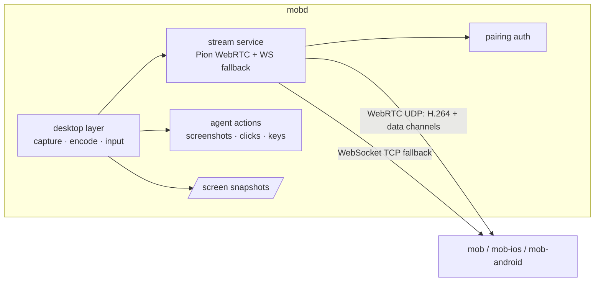

# Desktop streaming: design and plan

Status: **draft**, on branch `feat/webrtc-stream`. The protocol below is fixed only after the
validation spike (M0) passes.

## Context

The live desktop relays macOS Screen Sharing (VNC/RFB) through `/vnc`. That has two problems:

1. **Bandwidth.** The client receives the office Mac's full framebuffer (3840×2160, 32 bpp, lossless
   ZRLE tiles): about 33 MB per full frame before compression, tens of Mbps while the screen changes.
   Controls are fast over Tailscale; the picture is slow. Clients never show more than about 1080p.
2. **macOS only.** It depends on Apple's Screen Sharing service. Ubuntu and Windows are planned.

Snapshots (`/screen`) also capture a full-resolution PNG and decode it on every request.

## Decision

mobd captures, encodes and streams the desktop itself:

- a **desktop layer** in mobd with one backend per OS (capture, encode, input, displays, permissions);
- **H.264** from the OS hardware encoder, scaled to the size the client shows;
- **WebRTC through [Pion](https://github.com/pion/webrtc)** (MIT, pure Go) for video and input, with
  Pion's congestion control driving the encoder;
- a **WebSocket fallback** carrying the same stream where UDP cannot pass (Tailscale Funnel, the
  self-hosted HTTPS gateway, UDP-blocked networks).

VNC, `/vnc`, svnc and the client RFB code are removed. mobd and all three apps are released together,
so there is no compatibility period.

### Alternatives considered

| Option | Why not |
| --- | --- |
| Keep VNC, reduce colour depth | Halves data at best; still full resolution, still macOS only. |
| Lower the office Mac's resolution | Changes the machine the user works on in the office. |
| RustDesk (AGPL-3.0) as a separate app | Works, but the view leaves MOB, needs a second install and credential. Possible later as an optional "Open in RustDesk". |
| Embed or port RustDesk | AGPL would apply to mobd and the apps. Its design is used as a reference only (no code). |
| Sunshine/Apollo, KasmVNC, TigerVNC, wayvnc | GPL, per-OS, game- or Linux-specific; would be sidecars with different protocols. |
| Guacamole | Translates VNC/RDP; captures nothing. |
| Pure-Go capture/encode | Not possible: capture and real-time encoding need OS APIs and hardware encoders. |

Borrowed from RustDesk's design: adapt frame rate and bitrate to measured delay before resolution;
capture only on change; keyframe on request; cursor sent separately from the video; a system service
next to the user session to reach the login screen (later).

## Goals and non-goals

Goals
- Picture size follows the client: viewport × pixel density, capped at 1920×1080 by default.
- Idle desktop ≈ 0 bandwidth; typical office work 0.5–3 Mbps at 1080p (to be measured in M0).
- Quality adapts automatically; the user can choose Auto / High / Low per machine.
- One pairing and credential for everything (see [pairing](pairing.md)).
- Agent screenshots and actions use the same desktop layer as the live view.
- Adding an OS means adding one backend.

Non-goals for this release
- Ubuntu and Windows backends (Linux is a compiled placeholder; plan below).
- The macOS login window (needs a privileged helper; later). Locked-screen behaviour is measured in M2.
- Audio, file transfer, multi-monitor selection (main display only), clipboard sync.

## Architecture



### Desktop layer (`internal/desktop`)

Grows out of `internal/actuate`. Interfaces (draft):

```go
type Display struct { ID string; Width, Height int; Scale float64; Main bool }

type Capturer interface {
    // Start delivers frames no larger than size, at most fps, only when the screen changed.
    Start(ctx context.Context, display string, size image.Point, fps int) (<-chan Frame, error)
    Snapshot(ctx context.Context, display string, maxWidth int) (image.Image, error)
}

type Encoder interface {
    Encode(Frame) (AccessUnit, error)       // H.264 Annex B, no B-frames
    SetTarget(bitrate, fps int, size image.Point)
    ForceKeyframe()
}

type Input interface {
    Pointer(x, y float64, buttons Buttons) error   // display points
    Scroll(x, y, dx, dy float64) error
    Key(code Key, down bool) error
    Text(s string) error
    Cursor() (CursorState, error)                    // position + shape, sent separately
}

type Backend interface {
    Displays() ([]Display, error)
    Permissions() Permissions
    Capturer() Capturer
    NewEncoder(EncoderConfig) (Encoder, error)
    Input() Input
}
```

| OS | Capture | Encode | Input | Status |
| --- | --- | --- | --- | --- |
| macOS | ScreenCaptureKit (scaled, frame-rate limited, cursor excluded) | VideoToolbox H.264 | CGEvent (existing) | This release |
| Linux (Ubuntu) | xdg-desktop-portal ScreenCast + PipeWire; X11 XShm/XDamage fallback | VAAPI; OpenH264 fallback | portal RemoteDesktop + libei; X11 XTest | Placeholder returning `ErrUnsupported` |
| Windows | Windows.Graphics.Capture / DXGI duplication | Media Foundation (NVENC/QSV/AMF) | SendInput | Later |

Native code stays in thin cgo / Objective-C shims per OS; everything else is Go. x264 is not used
(GPL). OpenH264's patent terms must be confirmed before shipping it as a fallback.

Ubuntu notes for later: the portal asks the user once; store the `restore_token` (persist mode 2) and
replace it after every start. Capture does not work while the screen is locked or before login;
GNOME Remote Login covers login over RDP only.

### Stream service

**Signaling** (authenticated like every business route):

```http
POST /stream
Authorization: Bearer <device credential>
Content-Type: application/json

{"offer": "<SDP>", "maxWidth": 1600, "maxHeight": 1000, "quality": "auto"}
```

`201 {"session": "ID", "answer": "<SDP>", "display": {...}, "wsTicket": "…"}`. ICE is gathered
before answering (no trickle) to keep signaling one request. Host candidates only by default, so
Tailscale and LAN addresses work without STUN and the public IP is not exposed. Optional
`stream.iceServers` config for a TURN server (for example on a self-hosted gateway).
`DELETE /stream/{session}` ends it. One live session per client; a new one replaces the old.

**Media**: one H.264 video track (constrained baseline, no B-frames, keyframe on PLI or request,
no periodic keyframes while idle).

**Data channels**

| Channel | Delivery | Messages |
| --- | --- | --- |
| `control` | reliable, ordered | quality changes, keyframe request, display geometry, cursor shape, stats, errors |
| `input` | reliable, ordered | button down/up, keys, text, scroll, modifiers |
| `pointer` | unreliable (`maxRetransmits: 0`) | pointer moves, latest wins |

Messages are small JSON objects with a `t` field in v1 (`{"t":"key","code":"KeyA","down":true}`);
coordinates are display points with the display id. Binary encoding only if M0 shows it matters.

**Adaptation**: Pion NACK, TWCC and the GCC bandwidth estimator. The estimate sets the encoder bitrate;
when it falls below the profile's floor, lower frame rate first, then resolution.

| Profile | Max size | Frame rate | Bitrate range |
| --- | --- | --- | --- |
| High | client size, ≤ 1920×1080 | ≤ 30 | up to 8 Mbps |
| Low | ≤ 1280×720 | ≤ 15 | up to 1.5 Mbps |
| Auto | as High | ≤ 30 | follows the estimate, 150 kbps – 8 Mbps |

Values are starting points to be tuned with M0 and M6 measurements.

**WebSocket fallback**: `GET /stream/ws` carries the same session. Native clients send the Bearer
header; the desktop webview cannot set WebSocket headers, so it uses the single-use `wsTicket`
returned by `POST /stream` (the existing ticket mechanism, re-scoped from `/vnc`). Binary messages:
1 byte type (`1` video access unit, `2` cursor image) + 8 byte timestamp + 1 byte flags (keyframe) +
payload. Text messages use the data-channel JSON schema. The client acknowledges frames; mobd lowers
bitrate and frame rate when unacknowledged bytes or round-trip time grow, and drops non-key frames
while the socket is backed up.

**Choosing a transport**: the client starts WebRTC and the WebSocket in parallel, keeps WebRTC if it
connects within about 3 s, otherwise keeps the WebSocket. No user setting.

| Connection mode | Client needs Tailscale | Transport |
| --- | --- | --- |
| LAN | no | WebRTC (UDP) |
| Tailscale private network / Serve | yes | WebRTC (UDP) |
| Tailscale Funnel | no | WebSocket (TCP) |
| Self-hosted HTTPS gateway | no | WebSocket, or WebRTC if a TURN server runs on the gateway |
| Our relay (future) | no | WebRTC through our TURN |

### Snapshots

`/screen` uses `Capturer.Snapshot` at the requested width instead of `screencapture` + PNG decode.
Clients request their displayed width × pixel density at quality ≈ 65. An `ETag` lets clients skip
unchanged images.

### Security

- Same mandatory pairing; `/stream` and `/stream/ws` are business routes. The WS ticket is 30 s,
  single use, bound to the client and the session, and dies with revoke, delete or reset.
- Media is DTLS-SRTP (WebRTC) or inside the HTTPS/Tailscale connection (fallback).
- Revocation closes the stream session and its data channels, like SSE today.
- Input is accepted only from the session's data channels; the agent's actions keep their own path.
- Host-only ICE by default; no third-party STUN.

### Removing VNC

`/vnc` returns `410 {"error": "Update the MOB app to use the live desktop"}`. Removed: the relay,
`vncAddr`, the `vncTicket` feature and Screen Sharing in setup checks. `/health` lists `stream`.

## Validation spike (M0)

Throwaway branch `spike/webrtc`, not merged. ffmpeg (AVFoundation capture + `h264_videotoolbox`)
pipes H.264 into a Pion track on the office Mac; a test page shows `getStats()` numbers and sends
clicks over a data channel. Runs: LAN, Tailscale direct, Tailscale through DERP, phone hotspot,
throttled link (2 Mbps, 2% loss), Funnel (WebSocket path).

| # | Question | Pass if |
| --- | --- | --- |
| 1 | WebRTC connects over Tailscale | within ~2 s, direct candidate pair |
| 2 | Bandwidth at 1080p | idle ≤ ~100 kbps, typing/scrolling ≤ ~3 Mbps, text readable |
| 3 | Latency | screen-to-viewer ≤ ~150 ms direct; click ≤ ~100 ms |
| 4 | Adaptation | no freeze > ~1 s at 2 Mbps / 2% loss; recovers in a few seconds |
| 5 | Through DERP | usable at lower quality |
| 6 | Desktop webview | H.264 plays in Safari WebKit and the Tauri window |
| 7 | Office Mac cost | CPU ≲ 15 % while streaming |
| 8 | Funnel | WebRTC fails cleanly; the WebSocket path is usable |

The result (numbers and go/no-go) is recorded at the end of this document before M1 starts.

## Plan

All repos use branch `feat/webrtc-stream`; they merge to `main` together at release.

### mobd

| Step | Content | Verified by |
| --- | --- | --- |
| M0 | Validation spike above | Report with numbers |
| M1 | `internal/desktop` interfaces; macOS screenshot and CGEvent input moved onto them, no behaviour change; Linux/Windows placeholders | existing tests |
| M2 | ScreenCaptureKit capture; `/screen` uses it with `ETag`; check locked screen and Screen Recording re-prompts | snapshot size/time test; office Mac |
| M3 | VideoToolbox encoder: bitrate, frame rate, size, keyframe; nothing sent while idle | encode benchmark (720p, 1080p) |
| M4 | `POST /stream` / `DELETE`, Pion video track, session per client, closed on revoke; Go test client | test client receives video |
| M5 | Data channels and input; cursor position and shape | test client clicks; agent actions unchanged |
| M6 | GCC-driven adaptation, profiles, `stream` health feature | throttled-link runs |
| M7 | WebSocket fallback with ticket and acks | test client over Funnel |
| M8 | Remove VNC (`/vnc` → 410), setup checks, config | `go test ./...` |
| M9 | Docs: this file, pairing, security, remote access, connection setup, README | review |

### Clients (each in its own repo, after mobd M7)

| Step | mob (desktop) | mob-ios | mob-android |
| --- | --- | --- | --- |
| 1 | Snapshot size = view × DPR | same | same |
| 2 | View-only: `RTCPeerConnection` in the webview | native WebRTC SDK | native WebRTC SDK |
| 3 | Control over data channels | touch gestures + keys bar | touch gestures + keys bar |
| 4 | Quality setting, kB/s readout | same | same |
| 5 | WebSocket fallback (WebCodecs) | VideoToolbox | MediaCodec |
| 6 | Remove svnc, ticket code, Desktop sign-in | remove RFB/VNC, sign-in | same |
| 7 | Tests and app check | Simulator | emulator/phone |

### mob-site

Install guide without Screen Sharing or Desktop sign-in; quality setting; Funnel fallback; lock-screen
limitation; Ubuntu planned.

### Release

End-to-end on the office Mac (LAN, Tailscale, Funnel, hotspot) with all three apps; merge every
`feat/webrtc-stream`; publish mobd, desktop and Android together and submit iOS. Clients without the
`stream` feature in `/health` show "Update mobd on the office computer".

### Checkpoints

- After M0: go/no-go on Pion + Tailscale.
- After M2: locked screen and permission prompts.
- After M6: measured bitrate and latency.
- After desktop step 2: WebKit H.264 playback (fallback: WebSocket + WebCodecs only).

## Spike results

_Pending._
