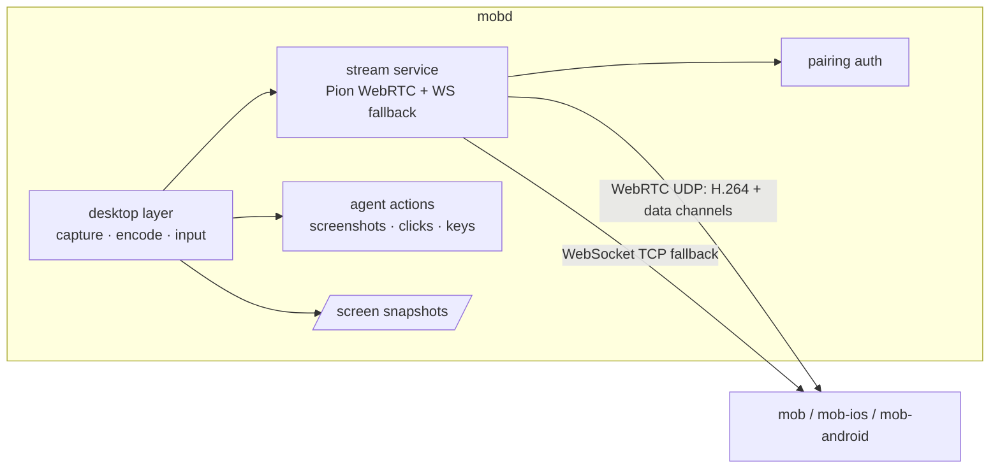

# Live desktop streaming

mobd captures, encodes and streams the office desktop itself. Clients (mob, mob-ios,
mob-android) show it in their live view and can send mouse, keyboard and touch input.
Screen Sharing is not used.

- **Capture:** ScreenCaptureKit, scaled to the size the client shows; an unchanged screen sends nothing.
- **Encode:** VideoToolbox H.264 (constrained baseline, no B-frames, keyframe on request, no periodic
  keyframes while idle).
- **Transport:** WebRTC through [Pion](https://github.com/pion/webrtc), with a WebSocket fallback
  carrying the same session where UDP cannot pass (Tailscale Funnel, an HTTPS gateway, SSH tunnels).
- **Input:** JSON messages over data channels (or the WebSocket), posted with CGEvent.

Agent screenshots and actions, `/screen` snapshots and the live view all use the same desktop layer.



## Desktop layer (`internal/desktop`)

`Backend` (`backend.go`) is implemented once per OS: permissions, displays, snapshots, display
state, `StartStream`, keep-awake, remote input, and the agent's click, key, paste, window and
app operations. macOS implements it; Linux and other systems compile a placeholder that returns
`ErrUnsupported` (the API answers 501 for the live view). Native code stays in thin cgo /
Objective-C shims; everything else is Go.

On macOS one `SCStream` feeds a VideoToolbox session in native code; Go receives Annex B access
units and adjusts bitrate, size, frame rate and keyframes on the running stream rather than
restarting it. A consumer that falls behind loses frames, not latency.

## Stream service (`internal/stream`)

### Signaling

```http
POST /stream
Authorization: Bearer <device credential>
Content-Type: application/json

{"offer": "<SDP>", "maxWidth": 1600, "maxHeight": 1000, "quality": "auto"}
```

`201 {"session", "answer", "wsTicket", "width", "height", "display"}`. `width`/`height` are the
encoded size. Without `offer` the session waits for the WebSocket only and `answer` is omitted.
ICE is gathered before answering (no trickle). Candidates are host-only UDP, so LAN and Tailscale
addresses work without STUN and the office's public IP is not exposed. All sessions share one UDP
socket on every interface, port `streamPort` (default 9527, `MOBD_STREAM_PORT`), so a firewall or
tailnet rule can allow it; `0` gives each session a random port. mobd fails to start if the port is taken.

- The picture is scaled to fit `maxWidth`/`maxHeight`, the display and the quality profile; never
  upscaled; even sizes.
- Errors: 400 bad body, offer or quality; 401; 501 no backend on this OS; 503 with the reason
  (display asleep, missing Screen Recording).
- `DELETE /stream/{id}` answers 204, or 404 for an unknown or another client's session.
- One session per client; a new `POST /stream` replaces the old one. The session is a pairing
  connection (`mobd connections` lists it), so revoke, delete, auth reset and daemon shutdown close it.
  It closes after 30 s if the peer never connects.
- The session wakes the display and holds a display-sleep assertion until 30 s after it ends.
- `/health` lists the `stream` and `streamResize` features and reports `streamSessions`.

### Data channels

The client creates the channels; mobd accepts messages on any of them and sends its own messages
on the one labelled `control`.

| Channel | Delivery | Messages |
| --- | --- | --- |
| `control` | reliable, ordered | keyframe requests, resize; from mobd: cursor, stats, errors, ended |
| `input` | reliable, ordered | buttons, keys, text, scroll |
| `pointer` | unreliable (`maxRetransmits: 0`) | pointer moves, latest wins |

Messages are small JSON objects with a `t` field. Coordinates are **normalized to the display**
(`0,0` top left, `1,1` bottom right).

| `t` | Direction | Fields |
| --- | --- | --- |
| `move` | client | `x`, `y` (a drag while a button is held) |
| `button` | client | `x`, `y`, `button` (`left`/`right`/`middle`), `down`; presses within 500 ms and 4 pt count as double/triple clicks |
| `key` | client | `code` (web `KeyboardEvent.code`, e.g. `KeyA`, `ShiftLeft`, `Enter`), `down`; modifiers follow the held modifier keys |
| `text` | client | `text` (≤ 4096 characters, typed as Unicode without the clipboard; newlines press Return) |
| `scroll` | client | `x`, `y`, `dx`, `dy` in pixels (positive = down/right, like `WheelEvent`) |
| `keyframe` | client | — |
| `resize` | client | `maxWidth`, `maxHeight`: refits the running session without reconnecting |
| `cursor` | mobd | `x`, `y` when the pointer moves (≤ 30/s) |
| `stats` | mobd | current `kbps`, `width`, `height`, `fps` and link measurements |
| `error` | mobd | `about` (message type), `message`; at most once a second per type |
| `ended` | mobd | `message`: why the session stopped (e.g. the display went to sleep) |

Everything held is released when the session ends, so a dropped client leaves no key or button
down. Input needs Accessibility, like the agent's actions. The cursor *shape* stays in the video:
macOS has no public API for another application's current cursor image.

### Rate control

mobd steers the encoder itself from the viewer's receiver reports (WebRTC) or frame
acknowledgements (WebSocket): loss and round-trip time, once a second. Bitrate ramps up while the
link is clean and backs off on loss or queueing delay; size follows a ladder with hysteresis
(1080p ≥ 2500 kbps, 720p ≥ 1000, 540p ≥ 450, else 360p, at most one change per 5 s); below 400 kbps
the frame rate is capped at 15. Pion's NACK responder handles retransmission, limited to 30% of
fresh bytes. The floor is 150 kbps.

| Profile | Max size | Frame rate | Ceiling | Start |
| --- | --- | --- | --- | --- |
| `high` | client size, ≤ 1920×1080 | 30 | 6000 kbps | 3000 kbps |
| `auto` (default) | client size, ≤ 1920×1080 | 30 | 6000 kbps | 1200 kbps |
| `low` | ≤ 1280×720 | 15 | 1000 kbps | 600 kbps |

### WebSocket fallback

`GET /stream/ws?session=ID` carries a session opened by `POST /stream`. Native clients send the
Bearer header; webviews, which cannot set WebSocket headers, add `&ticket=` with the single-use
`wsTicket` ([pairing](pairing.md#实时桌面票据)). 403 for an unknown origin, 404 for an unknown
session, 409 if WebRTC already carries it.

Binary messages from mobd are video: byte 0 = `1` (H.264 access unit, Annex B), bytes 1–8 capture
time in microseconds (big endian), byte 9 flags (bit 0 keyframe), then the access unit. Text
messages use the data-channel JSON schema in both directions, plus `{"t":"ack","pts":N}` from the
client for every video message. mobd keeps about 1.5 round trips of video in flight and drops
non-key frames beyond that. WebSocket sessions start at 540p / 450 kbps and ramp up.

The client chooses the transport: it starts WebRTC, gives it a head start, then tries the WebSocket;
whichever connects first carries the session. Typical results:

| Connection | Transport |
| --- | --- |
| LAN, Tailscale private network / Serve | WebRTC (UDP) |
| Tailscale Funnel, self-hosted HTTPS gateway, SSH tunnel | WebSocket (TCP) |

Through Funnel's public relay the first picture takes several seconds; the stream starts at 540p
and adapts, and in tests it often dropped to 360p. Prefer a private network for regular use.

## Snapshots

`GET /screen` captures with ScreenCaptureKit at the requested width and encodes natively (ImageIO),
so a 4K display is never encoded at full size for a small view; macOS 13 falls back to
`screencapture`. Responses carry an `ETag` (exposed over CORS); `If-None-Match` on an unchanged
screen answers `304`. A sleeping display answers `503` with the reason.

## Locked screen

- While the display is awake, a locked screen is captured like any other, and typing the password
  through `text` unlocks the Mac.
- While the display sleeps, capture sees no display. A stream session wakes it, so opening the live
  view on a sleeping, locked Mac shows the lock screen. Snapshots do not wake it.
- If the display is forced to sleep during a session, the session sends `ended` with the reason and
  closes; a new session wakes the display again.
- `/health` `display` fails only while the display sleeps; a locked screen is ok with detail "locked".
- The macOS login window before any user signs in is out of reach (no user session).

## Security

- `/stream` and `/stream/ws` are business routes under the same mandatory pairing. The WebSocket
  ticket is 30 s, single use, bound to its client and invalidated with it.
- Media is DTLS-SRTP (WebRTC) or inside the HTTPS/Tailscale/SSH connection (fallback).
- Revocation closes the stream session and its channels, like SSE.
- Input is accepted only from the session's own channels; the agent's actions keep their own path.
- Host-only ICE; no third-party STUN.

## Testing

`cmd/stream-probe` is a command-line viewer: `go run ./cmd/stream-probe -url … -token …` reports
first-picture time, bitrate and frame rate. `-ws` uses the WebSocket fallback; `-quality`,
`-max-width`, `-pli`, `-click` and `-type` exercise the other paths.

## Plan (not implemented)

- **`mob-relay`:** a small Go program on [Pion TURN](https://github.com/pion/turn) running on the
  public gateway, so WebRTC works through the self-hosted gateway (and later our hosted relay).
  mobd would be configured with the relay URL and a shared secret, issue short-lived per-session
  TURN credentials (HMAC of `expiry:clientId`) and return them as `iceServers` in `POST /stream`.
  Clients configure nothing.
- **Linux backend:** one virtual desktop per conversation (Xvfb, XShm, XTest, GStreamer); see the
  draft plan in [Linux](linux.md).
- **Windows backend:** the logged-in user's desktop (DXGI, Media Foundation, SendInput); stage 2
  of the plan in [Windows](windows.md).
- **macOS login window:** a privileged helper to reach the screen before any user signs in.
- Not planned for now: audio, file transfer, clipboard sync, multi-monitor selection (main display only).
