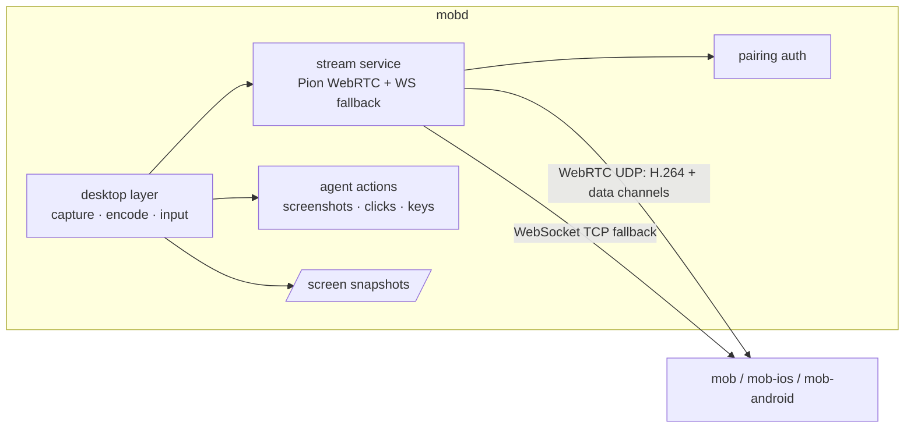

# Desktop streaming: design and plan

Status: **accepted**, on branch `feat/webrtc-stream`. The validation spike (M0) passed; see
[Spike results](#spike-results).

## Context

The live desktop relays macOS Screen Sharing (VNC/RFB) through `/vnc`. That has two problems:

1. **Bandwidth.** The client receives the office Mac's full framebuffer (3840×2160, 32 bpp, lossless
   ZRLE tiles): about 33 MB per full frame before compression, tens of Mbps while the screen changes.
   Controls are fast over Tailscale; the picture is slow. Clients never show more than about 1080p.
2. **macOS only.** It depends on Apple's Screen Sharing service. Ubuntu and Windows are planned.

Snapshots (`/screen`) also capture a full-resolution PNG and decode it on every request.

## Decision

mobd captures, encodes and streams the desktop itself:

- a **desktop layer** in mobd with one backend per OS (capture, encode, input, displays, permissions);
- **H.264** from the OS hardware encoder, scaled to the size the client shows;
- **WebRTC through [Pion](https://github.com/pion/webrtc)** (MIT, pure Go) for video and input, with
  Pion's congestion control driving the encoder;
- a **WebSocket fallback** carrying the same stream where UDP cannot pass (Tailscale Funnel, the
  self-hosted HTTPS gateway, UDP-blocked networks).

VNC, `/vnc`, svnc and the client RFB code are removed. mobd and all three apps are released together,
so there is no compatibility period.

### Alternatives considered

| Option | Why not |
| --- | --- |
| Keep VNC, reduce colour depth | Halves data at best; still full resolution, still macOS only. |
| Lower the office Mac's resolution | Changes the machine the user works on in the office. |
| RustDesk (AGPL-3.0) as a separate app | Works, but the view leaves MOB, needs a second install and credential. Possible later as an optional "Open in RustDesk". |
| Embed or port RustDesk | AGPL would apply to mobd and the apps. Its design is used as a reference only (no code). |
| Sunshine/Apollo, KasmVNC, TigerVNC, wayvnc | GPL, per-OS, game- or Linux-specific; would be sidecars with different protocols. |
| Guacamole | Translates VNC/RDP; captures nothing. |
| Pure-Go capture/encode | Not possible: capture and real-time encoding need OS APIs and hardware encoders. |

Borrowed from RustDesk's design: adapt frame rate and bitrate to measured delay before resolution;
capture only on change; keyframe on request; cursor sent separately from the video; a system service
next to the user session to reach the login screen (later).

## Goals and non-goals

Goals
- Picture size follows the client: viewport × pixel density, capped at 1920×1080 by default.
- Idle desktop ≈ 0 bandwidth; typical office work well under 1 Mbps at 1080p (M0: 13–165 kbps).
- Quality adapts automatically; the user can choose Auto / High / Low per machine.
- One pairing and credential for everything (see [pairing](pairing.md)).
- Agent screenshots and actions use the same desktop layer as the live view.
- Adding an OS means adding one backend.

Non-goals for this release
- Ubuntu and Windows backends (Linux is a compiled placeholder; plan below).
- The macOS login window before sign-in (needs a privileged helper; later). See "Locked screen".
- Audio, file transfer, multi-monitor selection (main display only), clipboard sync.

## Architecture



### Desktop layer (`internal/desktop`)

M1 moved `internal/actuate` here. `Backend` (`backend.go`) holds today's operations: displays,
permissions, PNG capture, click, key, paste, windows and app launching; `macOS` implements them and
other systems get a placeholder that returns `ErrUnsupported`. The streaming interfaces below are
added with the steps that implement them (capture M2, encoder M3, pointer/scroll/cursor M5) (draft):

```go
type Display struct { ID string; Width, Height int; Scale float64; Main bool }

type Capturer interface {
    // Start delivers frames no larger than size, at most fps, only when the screen changed.
    Start(ctx context.Context, display string, size image.Point, fps int) (<-chan Frame, error)
    Snapshot(ctx context.Context, display string, maxWidth int) (image.Image, error)
}

type Encoder interface {
    Encode(Frame) (AccessUnit, error)       // H.264 Annex B, no B-frames
    SetTarget(bitrate, fps int, size image.Point)
    ForceKeyframe()
}

type Input interface {
    Pointer(x, y float64, buttons Buttons) error   // display points
    Scroll(x, y, dx, dy float64) error
    Key(code Key, down bool) error
    Text(s string) error
    Cursor() (CursorState, error)                    // position + shape, sent separately
}

type Backend interface {
    Displays() ([]Display, error)
    Permissions() Permissions
    Capturer() Capturer
    NewEncoder(EncoderConfig) (Encoder, error)
    Input() Input
}
```

| OS | Capture | Encode | Input | Status |
| --- | --- | --- | --- | --- |
| macOS | ScreenCaptureKit (scaled, frame-rate limited, cursor excluded) | VideoToolbox H.264 | CGEvent (existing) | This release |
| Linux (Ubuntu) | xdg-desktop-portal ScreenCast + PipeWire; X11 XShm/XDamage fallback | VAAPI; OpenH264 fallback | portal RemoteDesktop + libei; X11 XTest | Placeholder returning `ErrUnsupported` |
| Windows | Windows.Graphics.Capture / DXGI duplication | Media Foundation (NVENC/QSV/AMF) | SendInput | Later |

Native code stays in thin cgo / Objective-C shims per OS; everything else is Go. x264 is not used
(GPL). OpenH264's patent terms must be confirmed before shipping it as a fallback.

Ubuntu notes for later: the portal asks the user once; store the `restore_token` (persist mode 2) and
replace it after every start. Capture does not work while the screen is locked or before login;
GNOME Remote Login covers login over RDP only.

### Stream service

**Signaling** (authenticated like every business route):

```http
POST /stream
Authorization: Bearer <device credential>
Content-Type: application/json

{"offer": "<SDP>", "maxWidth": 1600, "maxHeight": 1000, "quality": "auto"}
```

`201 {"session": "ID", "answer": "<SDP>", "width": 1280, "height": 720, "display": {...}}` (M4);
`wsTicket` arrives with the fallback (M7) and `iceServers` with the relay.
ICE is gathered before answering (no trickle) to keep signaling one request. Host candidates only by
default, so Tailscale and LAN addresses work without STUN and the public IP is not exposed.
`iceServers` is present only when a relay is configured (see "Self-hosted relay"); clients use it as
given and never configure TURN themselves.
`DELETE /stream/{session}` ends it. One live session per client; a new one replaces the old.

**Media**: one H.264 video track (constrained baseline, no B-frames, keyframe on PLI or request,
no periodic keyframes while idle).

**Data channels**

| Channel | Delivery | Messages |
| --- | --- | --- |
| `control` | reliable, ordered | quality changes, keyframe request, display geometry, cursor shape, stats, errors |
| `input` | reliable, ordered | button down/up, keys, text, scroll, modifiers |
| `pointer` | unreliable (`maxRetransmits: 0`) | pointer moves, latest wins |

Messages are small JSON objects with a `t` field. Coordinates are **normalized to the display**
(`0,0` top left, `1,1` bottom right), so they survive resizes and differ from no encoded size.

| `t` | Channel | Fields |
| --- | --- | --- |
| `move` | `pointer` | `x`, `y` (a drag while a button is held) |
| `button` | `input` | `x`, `y`, `button` (`left`/`right`/`middle`), `down`; repeated presses within 500 ms and 4 pt count as double/triple clicks |
| `key` | `input` | `code` (web `KeyboardEvent.code`, e.g. `KeyA`, `ShiftLeft`, `Enter`), `down`; modifiers follow the held modifier keys |
| `text` | `input` | `text` (≤ 4096 characters, typed as Unicode without the clipboard; newlines press Return) |
| `scroll` | `input` | `x`, `y`, `dx`, `dy` in pixels (positive = down/right, like `WheelEvent`) |
| `keyframe` | `control` | — |
| `cursor` | `control`, from mobd | `x`, `y` when the pointer moves (≤ 30/s) |
| `error` | `control`, from mobd | `about` (message type), `message`; at most once a second per type |

Everything held is released when the session ends, so a dropped client leaves no key or button
down. Input needs Accessibility, like the agent's actions. The cursor *shape* stays in the video
for now: macOS has no public API for another application's current cursor image.

**Adaptation**: Pion NACK, TWCC and the GCC bandwidth estimator. The estimate sets the encoder bitrate;
when it falls below the profile's floor, lower frame rate first, then resolution.

| Profile | Max size | Frame rate | Bitrate range |
| --- | --- | --- | --- |
| High | client size, ≤ 1920×1080 | ≤ 30 | up to 8 Mbps |
| Low | ≤ 1280×720 | ≤ 15 | up to 1.5 Mbps |
| Auto | as High | ≤ 30 | follows the estimate, 150 kbps – 8 Mbps |

Values are starting points to be tuned with M0 and M6 measurements.

**WebSocket fallback**: `GET /stream/ws` carries the same session. Native clients send the Bearer
header; the desktop webview cannot set WebSocket headers, so it uses the single-use `wsTicket`
returned by `POST /stream` (the existing ticket mechanism, re-scoped from `/vnc`). Binary messages:
1 byte type (`1` video access unit, `2` cursor image) + 8 byte timestamp + 1 byte flags (keyframe) +
payload. Text messages use the data-channel JSON schema. The client acknowledges frames; mobd lowers
bitrate and frame rate when unacknowledged bytes or round-trip time grow, and drops non-key frames
while the socket is backed up.

**Choosing a transport**: the client starts WebRTC and the WebSocket in parallel, keeps WebRTC if it
connects within about 3 s, otherwise keeps the WebSocket. No user setting.

| Connection mode | Client needs Tailscale | Transport |
| --- | --- | --- |
| LAN | no | WebRTC (UDP) |
| Tailscale private network / Serve | yes | WebRTC (UDP) |
| Tailscale Funnel | no | WebSocket (TCP) |
| Self-hosted HTTPS gateway | no | WebSocket; WebRTC through `mob-relay` once that ships |
| Our relay (future) | no | WebRTC through the hosted `mob-relay` |

### Self-hosted relay (later step)

`mob-relay` is a small Go program built on [Pion TURN](https://github.com/pion/turn) (MIT), running on
the public gateway server next to the HTTPS entry. It listens on a public UDP port and on TURN over TLS
(443) for networks that block UDP, and reaches the office Mac over Tailscale as the gateway already does.

mobd's config names the relay and a shared secret only:

```json
{"relay": {"url": "turns:relay.example.com:443", "secret": "…"}}
```

For each stream session mobd issues a short-lived TURN credential (username `expiry:clientId`,
password = HMAC-SHA1 of the username with the shared secret, valid for minutes) and returns it in
`iceServers`. Users configure nothing on clients; a leaked credential expires on its own; revoking a
client stops new credentials. The same program later runs our hosted relay.

### Sessions (M4)

`POST /stream` scales the display to the client's `maxWidth`/`maxHeight` and the profile (High and
Auto ≤ 1920×1080 at 30 fps and 4000 kbps, Low ≤ 1280×720 at 15 fps and 1000 kbps; never upscaled;
even sizes) and answers once ICE gathering finishes. Errors: 400 bad offer or quality, 401, 501 no
backend, 503 with the reason (locked screen, Screen Recording). `DELETE /stream/{id}` answers 204,
or 404 for another client's or an unknown session. A session is a pairing connection (`mobd
connections` lists it as `/stream`), so revoke, delete and auth reset close it. It wakes the display
and holds a display-sleep assertion until it ends, and closes after 30 s if the peer never connects.
`/health` reports `streamSessions`. `cmd/stream-probe -url … -token …` is a development viewer.

Measured with a dev mobd and the probe on one Mac: answer 0.34 s, connected 0.54 s, first frame
0.55 s; each PLI produced a keyframe; a revoke stopped the video within a second.

### Office Mac results (M6)

Run on 2026-10-16 against M4002 (macOS 26.5, 4K panel at 1920×1080 points) from a Mac Studio, with
this branch's mobd and `cmd/stream-probe`.

| Check | Result |
| --- | --- |
| Answer / connected / first frame (LAN) | 0.07–0.22 s / 0.28–0.44 s / 0.29–0.44 s |
| Idle desktop, 720p | 0–600 kbps, 0–2 fps (only on change) |
| Scrolling terminal | 50–90 kbps at 5–9 fps after the first second |
| Rate control on a clean link | 1500 → 5170 kbps in 12 s; 720p → 1080p after the hold |
| Low profile | 960×540, 15 fps, ≤ 1000 kbps |
| Narrow view (`maxWidth` 720) | 720×406 |
| Picture-loss report every 3 s | keyframe each time |
| Tailscale address | works; ICE still picks the LAN path when both ends share one |
| mobd CPU while streaming | ~2.7% |
| Input | click and Unicode text work, including at the lock screen |
| Display put to sleep mid-stream | `ended` with the reason within 1 s, then closed |

Not measured: a remote network (Tailscale relay, phone off Wi-Fi).

### WebSocket fallback results (M7)

Run on 2026-10-18 with a dev mobd (`46b80f1`) on the Mac Studio and `stream-probe -ws`. For Funnel,
the office Mac forwarded a temporary `:8443` Funnel to it and the probe was pinned to Funnel's public
relay (`-resolve`), so every byte crossed the relay. Pion is not in this path; capture, encoder, rate
control and sessions are shared with WebRTC.

| Check | LAN | Funnel (8 runs) |
| --- | --- | --- |
| `POST /stream` answered | 0.09–0.30 s | 1.6–3.6 s |
| WebSocket open | 0.10–0.30 s | 3.1–6.9 s |
| First picture | 0.12–0.35 s | 3.6–8.8 s |
| Steady state | 720p, 1.2–1.4 Mbps, ~100 kbps idle | 360p, 120–500 kbps, 3–20 fps, rare 1 s stalls |

The Funnel target (< 2 s) is not met, and mostly not by mobd: from this network the relay connects
TCP in ~0.17 s but takes 1.3–2 s more for TLS, and carries ~200 kbps (a 530 KB screenshot took 21 s).
Two things are ours and are left for when Funnel is picked up again:

- The client pays the TLS handshake twice (`POST /stream`, then the WebSocket). Opening the session
  from `GET /stream/ws` itself would save one, 1.5–3.5 s here.
- Starting at 720p / 1200 kbps is ~5× this link: the first keyframe takes ~1 s, the controller sees
  60–100% loss, steps to 360p within 2–5 s and sends up to 7 keyframes in 8 s. WebSocket sessions
  should start lower (540p, ~450 kbps) and ramp.

Even with both, this relay path would stay around 2.5–3 s; < 2 s needs a faster route to the relay.

### Encoder (M3)

Measured on a Mac Studio (1080p display, M3 test):

| | Result |
| --- | --- |
| Start → first keyframe | 0.37 s |
| Resize → keyframe at the new size | ~0.1 s (1280×720, 960×540, 1920×1080; size verified from the SPS) |
| Keyframe on request, idle screen | 7 ms |
| Keyframe size at 4000 kbps | 1080p 200 KB, 720p 135 KB, 540p 115 KB |
| Keyframe size at 500 kbps | 1080p 113 KB |

Notes for M6: low-latency rate control spends about bitrate ÷ fps on each changed frame (a
spinner animating at ~28 fps cost ~2.3 Mbps at a 4000 kbps target), so the target bitrate, not the
amount of change, sets the cost of an active screen; and the 1.5× per-second byte cap does not stop a
single keyframe from exceeding it, so the size ladder must step down before keyframes outgrow the
link. A consumer that falls behind loses frames, not latency: after a dropped unit the stream
discards deltas and asks for a keyframe.

### Snapshots

`/screen` captures with ScreenCaptureKit at the requested width and encodes natively (ImageIO), so a
4K display is never encoded at full size for a small view; macOS 13 falls back to `screencapture`.
Measured on a 1080p Mac: 640 px JPEG in ~0.2 s (59 KB), full PNG in ~0.1 s. Clients request their
displayed width × pixel density at quality ≈ 65 and send `If-None-Match` with the last `ETag`
(exposed over CORS); an unchanged screen answers `304` with no body. A locked or sleeping display
answers `503` with the reason, and `/health` reports it as the `display` check.

### Security

- Same mandatory pairing; `/stream` and `/stream/ws` are business routes. The WS ticket is 30 s,
  single use, bound to the client and the session, and dies with revoke, delete or reset.
- Media is DTLS-SRTP (WebRTC) or inside the HTTPS/Tailscale connection (fallback).
- Revocation closes the stream session and its data channels, like SSE today.
- Input is accepted only from the session's data channels; the agent's actions keep their own path.
- Host-only ICE by default; no third-party STUN.

### Locked screen

Measured on the office Mac in M6 (this corrects the M0 conclusion):

- ScreenCaptureKit, running as the user, sees **no display while the display sleeps**. While the
  display is **awake, a locked screen is captured** like any other screen (23–25 fps at 1280×720).
- A stream session wakes the display and holds a display-sleep assertion, so opening the live view
  on a sleeping, locked Mac shows the lock screen.
- **Typing the password through the `text` message unlocks the Mac.** Unicode keyboard events reach
  the login field; the old VNC keyboard path dropped characters there.
- If the display is forced to sleep during a session (`pmset displaysleepnow`), capture stops and
  the session sends `ended` with the reason, then closes; a new session wakes the display again.
- `/health` `display` is a problem only while the display sleeps; a locked screen is reported as ok
  with detail "locked".

The macOS login window before any user signs in is still out of reach (no user session); a
privileged helper for that stays a later step.

### Removing VNC

`/vnc` returns `410 {"error": "Update the MOB app to use the live desktop"}`. Removed: the relay,
`vncAddr`, the `vncTicket` feature and Screen Sharing in setup checks. `/health` lists `stream`.

## Validation spike (M0)

Throwaway branch `spike/webrtc`, not merged. ffmpeg (AVFoundation capture + `h264_videotoolbox`)
pipes H.264 into a Pion track on the office Mac; a test page shows `getStats()` numbers and sends
clicks over a data channel. Runs: LAN, Tailscale direct, Tailscale through DERP, phone hotspot,
throttled link (2 Mbps, 2% loss), Funnel (WebSocket path).

| # | Question | Pass if |
| --- | --- | --- |
| 1 | WebRTC connects over Tailscale | within ~2 s, direct candidate pair |
| 2 | Bandwidth at 1080p | idle ≤ ~100 kbps, typing/scrolling ≤ ~3 Mbps, text readable |
| 3 | Latency | screen-to-viewer ≤ ~150 ms direct; click ≤ ~100 ms |
| 4 | Adaptation | no freeze > ~1 s at 2 Mbps / 2% loss; recovers in a few seconds |
| 5 | Through DERP | usable at lower quality |
| 6 | Desktop webview | H.264 plays in Safari WebKit and the Tauri window |
| 7 | Office Mac cost | CPU ≲ 15 % while streaming |
| 8 | Funnel | WebRTC fails cleanly; the WebSocket path is usable |

The result (numbers and go/no-go) is recorded at the end of this document before M1 starts.

## Plan

All repos use branch `feat/webrtc-stream`; they merge to `main` together at release.

### mobd

| Step | Content | Verified by |
| --- | --- | --- |
| M0 | Validation spike above | Report with numbers |
| M1 | **Done.** `internal/desktop` with a `Backend` per OS; macOS screenshot and CGEvent input moved onto it, no behaviour change; Linux/other placeholders | existing tests; Linux build |
| M2 | **Done.** ScreenCaptureKit snapshots at the requested size, encoded natively (`SCScreenshotManager` + ImageIO; `screencapture` on macOS 13); `/screen` with `ETag`/`304`; locked/asleep detection in `/health` (`display`) and `/screen` (503) | real capture test; macOS 13 build |
| M3 | **Done.** `desktop.StartStream`: one `SCStream` feeding a VideoToolbox session on a serial queue in native code (frames never cross into Go); Go receives Annex B access units and adjusts bitrate, size and keyframes while it runs; no periodic keyframes, unchanged screens encode nothing | real-stream test with SPS check; race detector; macOS 13 build |
| M4 | **Done.** `internal/stream`: `POST /stream` / `DELETE /stream/{id}`, Pion H.264 track fed by `desktop.StartStream`, keyframe on PLI/FIR, one session per client (a new one replaces it), closed on revoke/delete/reset/shutdown and when the peer never connects; display woken and kept awake per session; `cmd/stream-probe` | fake-source and real-pipeline tests; dev mobd + probe: pair, stream, PLI, DELETE, revoke |
| M5 | **Done.** `desktop.Input` (held state, drags, multi-clicks, release) over a per-OS `RemoteInput`; macOS CGEvent mouse/key/Unicode/pixel scroll with web key codes; `input`/`pointer`/`control` channels; cursor position on `control` (shape stays in the video) | recorded-event tests; data-channel test; opt-in real pointer test |
| M6 | **Done.** Own rate control from receiver reports and ICE RTT (start low, ramp, back off once per RTT sample), size ladder with hysteresis, half frame rate below 400 kbps, retransmission budget (30% of fresh bytes), profiles, `stats`/`ended` on `control`, `stream` health feature | impaired-link test (2 Mbps/1%/20 ms: 1.3–1.95 Mbps, no freezes, recovery to 4 Mbps in 12 s); office Mac over LAN and Tailscale |
| M7 | **Done, Funnel target open.** `GET /stream/ws` (header or `wsTicket` from `POST /stream`, which no longer needs an offer); binary access units, control JSON, per-frame acks driving in-flight flow control and the shared rate controller; keyframe at connect, start at 720p. Fixed the retransmission budget mixing RTX and video sequence numbers. First picture < 2 s on the LAN, 3.6–8.8 s through Funnel (see M7 results; two fixes deferred) | ws tests; LAN and Funnel probe runs |
| M8 | Remove VNC (`/vnc` → 410), setup checks, config | `go test ./...` |
| M9 | Docs: this file, pairing, security, remote access, connection setup, README | review |
| later | `mob-relay` (Pion TURN) and per-session TURN credentials in `POST /stream` | gateway with a phone off Wi-Fi |

### Clients (each in its own repo, after mobd M7)

| Step | mob (desktop) | mob-ios | mob-android |
| --- | --- | --- | --- |
| 1 | Snapshot size = view × DPR | same | same |
| 2 | View-only: `RTCPeerConnection` in the webview | native WebRTC SDK | native WebRTC SDK |
| 3 | Control over data channels | touch gestures + keys bar | touch gestures + keys bar |
| 4 | Quality setting, kB/s readout | same | same |
| 5 | WebSocket fallback (WebCodecs) | VideoToolbox | MediaCodec |
| 6 | Remove svnc, ticket code, Desktop sign-in | remove RFB/VNC, sign-in | same |
| 7 | Tests and app check | Simulator | emulator/phone |

### mob-site

Install guide without Screen Sharing or Desktop sign-in; quality setting; Funnel fallback; lock-screen
limitation; Ubuntu planned.

### Release

End-to-end on the office Mac (LAN, Tailscale, Funnel, hotspot) with all three apps; merge every
`feat/webrtc-stream`; publish mobd, desktop and Android together and submit iOS. Clients without the
`stream` feature in `/health` show "Update mobd on the office computer".

### Checkpoints

- After M0: go/no-go on Pion + Tailscale — **go**.
- After M2: locked-screen detection and permission prompts with a signed build.
- After M6: measured bitrate and latency.
- After desktop step 2: WebKit H.264 playback (fallback: WebSocket + WebCodecs only).

## Spike results

Run on 2026-10-16 against the office Mac (M4002: Apple Silicon, macOS 26.5, 4K panel at 1920×1080
points), from a Mac Studio on the same LAN and on the tailnet. Code: branch `spike/webrtc` (not
merged). Capture and encode: a Swift helper (ScreenCaptureKit + VideoToolbox, constrained baseline,
low-latency rate control); transport: Pion WebRTC v4.2.23, interceptor v0.1.49.

| # | Question | Result |
| --- | --- | --- |
| 1 | Connect over LAN / Tailscale | **Pass.** 10–25 ms to connected, host candidates only. Signaling over the Tailscale address still chose the direct LAN pair (best path, no setting). |
| 2 | Bandwidth at 1080p | **Pass.** Idle 13–67 kbps (~3 fps on change); scrolling terminal 90–165 kbps at 8–11 fps; text readable. VNC needed tens of Mbps. |
| 3 | Latency | **Pass** on LAN: ICE and data-channel RTT 1 ms; browser decode 2–7 ms. |
| 4 | Adaptation (2 Mbps, 1–2% loss, 20 ms, socket-level shaper) | **Fail, to fix in M6.** GCC's estimate fell from ~6 Mbps to 100 kbps and stayed there; video mostly froze. With the default leaky-bucket pacer it did not recover after the impairment ended; with the no-op pacer it recovered within ~5 s. Resolution ladder shrank keyframes from 100–200 KB to ~25 KB. The shaper may exaggerate this; re-measure on a real network. |
| 5 | Through DERP | Not measured (both ends share a LAN). Moved to M6. |
| 6 | Desktop webview | **Pass.** WKWebView plays WebRTC H.264 (1080p, ~3 ms decode) and WebSocket + WebCodecs (0 decode errors). |
| 7 | Office Mac cost | **Pass.** ~2% CPU for capture + encode + Pion. |
| 8 | Funnel | **Pass** via WebSocket fallback: 1080p, 120–165 kbps, 8–11 fps, 0 errors through Funnel's public relay; first picture took 6–9 s (fix in M7). |

Findings that change the implementation:

- ffmpeg's AVFoundation screen input delivers no frames on macOS 26; ScreenCaptureKit is required.
- The `SCStream` must be retained, or capture stops without an error. (The spike also added an
  `NSApplication`; M2 showed ScreenCaptureKit works inside mobd without one.)
- Capture and encoding live in one long-running component that is adjusted, not restarted:
  restarting on every bitrate change or keyframe request froze the stream.
- No display while the console is locked or the display sleeps (see "Locked screen").
- macOS ties the Screen Recording grant to the exact binary; unsigned rebuilds need re-approval.
  Release builds are signed with a stable identity; development needs the same or re-approval.
- dummynet (`dnctl`/`pfctl`) does not shape traffic on macOS 26; impair links in-process for tests.

Decision: **go** with Pion WebRTC + the WebSocket fallback; rate control is a dedicated part of M6.
