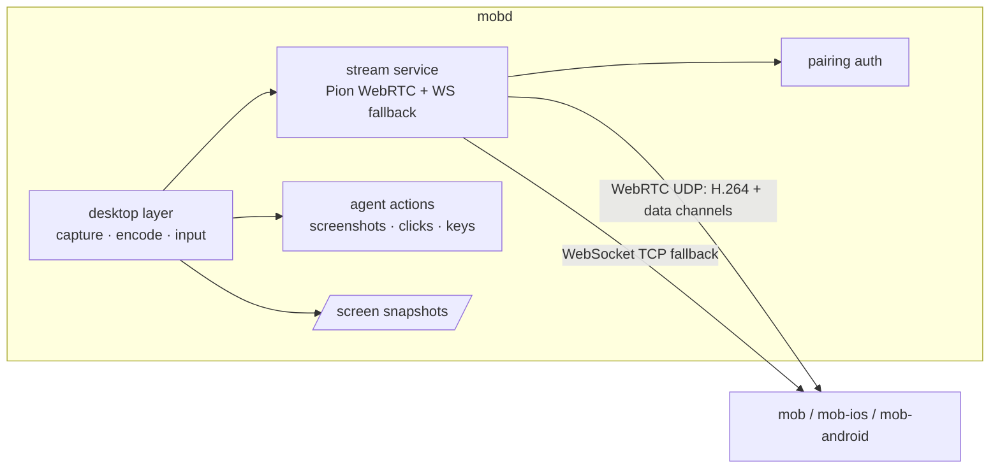

# Desktop streaming: design and plan

Status: **accepted**, on branch `feat/webrtc-stream`. The validation spike (M0) passed; see
[Spike results](#spike-results).

## Context

The live desktop relays macOS Screen Sharing (VNC/RFB) through `/vnc`. That has two problems:

1. **Bandwidth.** The client receives the office Mac's full framebuffer (3840×2160, 32 bpp, lossless
   ZRLE tiles): about 33 MB per full frame before compression, tens of Mbps while the screen changes.
   Controls are fast over Tailscale; the picture is slow. Clients never show more than about 1080p.
2. **macOS only.** It depends on Apple's Screen Sharing service. Ubuntu and Windows are planned.

Snapshots (`/screen`) also capture a full-resolution PNG and decode it on every request.

## Decision

mobd captures, encodes and streams the desktop itself:

- a **desktop layer** in mobd with one backend per OS (capture, encode, input, displays, permissions);
- **H.264** from the OS hardware encoder, scaled to the size the client shows;
- **WebRTC through [Pion](https://github.com/pion/webrtc)** (MIT, pure Go) for video and input, with
  Pion's congestion control driving the encoder;
- a **WebSocket fallback** carrying the same stream where UDP cannot pass (Tailscale Funnel, the
  self-hosted HTTPS gateway, UDP-blocked networks).

VNC, `/vnc`, svnc and the client RFB code are removed. mobd and all three apps are released together,
so there is no compatibility period.

### Alternatives considered

| Option | Why not |
| --- | --- |
| Keep VNC, reduce colour depth | Halves data at best; still full resolution, still macOS only. |
| Lower the office Mac's resolution | Changes the machine the user works on in the office. |
| RustDesk (AGPL-3.0) as a separate app | Works, but the view leaves MOB, needs a second install and credential. Possible later as an optional "Open in RustDesk". |
| Embed or port RustDesk | AGPL would apply to mobd and the apps. Its design is used as a reference only (no code). |
| Sunshine/Apollo, KasmVNC, TigerVNC, wayvnc | GPL, per-OS, game- or Linux-specific; would be sidecars with different protocols. |
| Guacamole | Translates VNC/RDP; captures nothing. |
| Pure-Go capture/encode | Not possible: capture and real-time encoding need OS APIs and hardware encoders. |

Borrowed from RustDesk's design: adapt frame rate and bitrate to measured delay before resolution;
capture only on change; keyframe on request; cursor sent separately from the video; a system service
next to the user session to reach the login screen (later).

## Goals and non-goals

Goals
- Picture size follows the client: viewport × pixel density, capped at 1920×1080 by default.
- Idle desktop ≈ 0 bandwidth; typical office work well under 1 Mbps at 1080p (M0: 13–165 kbps).
- Quality adapts automatically; the user can choose Auto / High / Low per machine.
- One pairing and credential for everything (see [pairing](pairing.md)).
- Agent screenshots and actions use the same desktop layer as the live view.
- Adding an OS means adding one backend.

Non-goals for this release
- Ubuntu and Windows backends (Linux is a compiled placeholder; plan below).
- The macOS login window and the lock screen (need a privileged helper; later). See "Locked screen".
- Audio, file transfer, multi-monitor selection (main display only), clipboard sync.

## Architecture



### Desktop layer (`internal/desktop`)

M1 moved `internal/actuate` here. `Backend` (`backend.go`) holds today's operations: displays,
permissions, PNG capture, click, key, paste, windows and app launching; `macOS` implements them and
other systems get a placeholder that returns `ErrUnsupported`. The streaming interfaces below are
added with the steps that implement them (capture M2, encoder M3, pointer/scroll/cursor M5) (draft):

```go
type Display struct { ID string; Width, Height int; Scale float64; Main bool }

type Capturer interface {
    // Start delivers frames no larger than size, at most fps, only when the screen changed.
    Start(ctx context.Context, display string, size image.Point, fps int) (<-chan Frame, error)
    Snapshot(ctx context.Context, display string, maxWidth int) (image.Image, error)
}

type Encoder interface {
    Encode(Frame) (AccessUnit, error)       // H.264 Annex B, no B-frames
    SetTarget(bitrate, fps int, size image.Point)
    ForceKeyframe()
}

type Input interface {
    Pointer(x, y float64, buttons Buttons) error   // display points
    Scroll(x, y, dx, dy float64) error
    Key(code Key, down bool) error
    Text(s string) error
    Cursor() (CursorState, error)                    // position + shape, sent separately
}

type Backend interface {
    Displays() ([]Display, error)
    Permissions() Permissions
    Capturer() Capturer
    NewEncoder(EncoderConfig) (Encoder, error)
    Input() Input
}
```

| OS | Capture | Encode | Input | Status |
| --- | --- | --- | --- | --- |
| macOS | ScreenCaptureKit (scaled, frame-rate limited, cursor excluded) | VideoToolbox H.264 | CGEvent (existing) | This release |
| Linux (Ubuntu) | xdg-desktop-portal ScreenCast + PipeWire; X11 XShm/XDamage fallback | VAAPI; OpenH264 fallback | portal RemoteDesktop + libei; X11 XTest | Placeholder returning `ErrUnsupported` |
| Windows | Windows.Graphics.Capture / DXGI duplication | Media Foundation (NVENC/QSV/AMF) | SendInput | Later |

Native code stays in thin cgo / Objective-C shims per OS; everything else is Go. x264 is not used
(GPL). OpenH264's patent terms must be confirmed before shipping it as a fallback.

Ubuntu notes for later: the portal asks the user once; store the `restore_token` (persist mode 2) and
replace it after every start. Capture does not work while the screen is locked or before login;
GNOME Remote Login covers login over RDP only.

### Stream service

**Signaling** (authenticated like every business route):

```http
POST /stream
Authorization: Bearer <device credential>
Content-Type: application/json

{"offer": "<SDP>", "maxWidth": 1600, "maxHeight": 1000, "quality": "auto"}
```

`201 {"session": "ID", "answer": "<SDP>", "display": {...}, "wsTicket": "…", "iceServers": [...]}`.
ICE is gathered before answering (no trickle) to keep signaling one request. Host candidates only by
default, so Tailscale and LAN addresses work without STUN and the public IP is not exposed.
`iceServers` is present only when a relay is configured (see "Self-hosted relay"); clients use it as
given and never configure TURN themselves.
`DELETE /stream/{session}` ends it. One live session per client; a new one replaces the old.

**Media**: one H.264 video track (constrained baseline, no B-frames, keyframe on PLI or request,
no periodic keyframes while idle).

**Data channels**

| Channel | Delivery | Messages |
| --- | --- | --- |
| `control` | reliable, ordered | quality changes, keyframe request, display geometry, cursor shape, stats, errors |
| `input` | reliable, ordered | button down/up, keys, text, scroll, modifiers |
| `pointer` | unreliable (`maxRetransmits: 0`) | pointer moves, latest wins |

Messages are small JSON objects with a `t` field in v1 (`{"t":"key","code":"KeyA","down":true}`);
coordinates are display points with the display id. Binary encoding only if M0 shows it matters.

**Adaptation**: Pion NACK, TWCC and the GCC bandwidth estimator. The estimate sets the encoder bitrate;
when it falls below the profile's floor, lower frame rate first, then resolution.

| Profile | Max size | Frame rate | Bitrate range |
| --- | --- | --- | --- |
| High | client size, ≤ 1920×1080 | ≤ 30 | up to 8 Mbps |
| Low | ≤ 1280×720 | ≤ 15 | up to 1.5 Mbps |
| Auto | as High | ≤ 30 | follows the estimate, 150 kbps – 8 Mbps |

Values are starting points to be tuned with M0 and M6 measurements.

**WebSocket fallback**: `GET /stream/ws` carries the same session. Native clients send the Bearer
header; the desktop webview cannot set WebSocket headers, so it uses the single-use `wsTicket`
returned by `POST /stream` (the existing ticket mechanism, re-scoped from `/vnc`). Binary messages:
1 byte type (`1` video access unit, `2` cursor image) + 8 byte timestamp + 1 byte flags (keyframe) +
payload. Text messages use the data-channel JSON schema. The client acknowledges frames; mobd lowers
bitrate and frame rate when unacknowledged bytes or round-trip time grow, and drops non-key frames
while the socket is backed up.

**Choosing a transport**: the client starts WebRTC and the WebSocket in parallel, keeps WebRTC if it
connects within about 3 s, otherwise keeps the WebSocket. No user setting.

| Connection mode | Client needs Tailscale | Transport |
| --- | --- | --- |
| LAN | no | WebRTC (UDP) |
| Tailscale private network / Serve | yes | WebRTC (UDP) |
| Tailscale Funnel | no | WebSocket (TCP) |
| Self-hosted HTTPS gateway | no | WebSocket; WebRTC through `mob-relay` once that ships |
| Our relay (future) | no | WebRTC through the hosted `mob-relay` |

### Self-hosted relay (later step)

`mob-relay` is a small Go program built on [Pion TURN](https://github.com/pion/turn) (MIT), running on
the public gateway server next to the HTTPS entry. It listens on a public UDP port and on TURN over TLS
(443) for networks that block UDP, and reaches the office Mac over Tailscale as the gateway already does.

mobd's config names the relay and a shared secret only:

```json
{"relay": {"url": "turns:relay.example.com:443", "secret": "…"}}
```

For each stream session mobd issues a short-lived TURN credential (username `expiry:clientId`,
password = HMAC-SHA1 of the username with the shared secret, valid for minutes) and returns it in
`iceServers`. Users configure nothing on clients; a leaked credential expires on its own; revoking a
client stops new credentials. The same program later runs our hosted relay.

### Snapshots

`/screen` captures with ScreenCaptureKit at the requested width and encodes natively (ImageIO), so a
4K display is never encoded at full size for a small view; macOS 13 falls back to `screencapture`.
Measured on a 1080p Mac: 640 px JPEG in ~0.2 s (59 KB), full PNG in ~0.1 s. Clients request their
displayed width × pixel density at quality ≈ 65 and send `If-None-Match` with the last `ETag`
(exposed over CORS); an unchanged screen answers `304` with no body. A locked or sleeping display
answers `503` with the reason, and `/health` reports it as the `display` check.

### Security

- Same mandatory pairing; `/stream` and `/stream/ws` are business routes. The WS ticket is 30 s,
  single use, bound to the client and the session, and dies with revoke, delete or reset.
- Media is DTLS-SRTP (WebRTC) or inside the HTTPS/Tailscale connection (fallback).
- Revocation closes the stream session and its data channels, like SSE today.
- Input is accepted only from the session's data channels; the agent's actions keep their own path.
- Host-only ICE by default; no third-party STUN.

### Locked screen

ScreenCaptureKit, running as the user, sees **no display** while the console is locked or the
display sleeps (M0). Screen Sharing (VNC) kept working there because Apple runs it as a system
service. This release:

- keeps the display awake (power assertion) while a stream session is open, so idle display sleep
  does not lock the Mac under a watching client;
- reports `locked` on the stream's `control` channel and in `/health` problems, and clients show
  "The office Mac is locked" instead of a black picture;
- recommends turning off auto-lock on a dedicated office Mac (setup guide), and states the trade-off.

A privileged helper that shows and unlocks the lock screen (RustDesk-style) is a later step.

### Removing VNC

`/vnc` returns `410 {"error": "Update the MOB app to use the live desktop"}`. Removed: the relay,
`vncAddr`, the `vncTicket` feature and Screen Sharing in setup checks. `/health` lists `stream`.

## Validation spike (M0)

Throwaway branch `spike/webrtc`, not merged. ffmpeg (AVFoundation capture + `h264_videotoolbox`)
pipes H.264 into a Pion track on the office Mac; a test page shows `getStats()` numbers and sends
clicks over a data channel. Runs: LAN, Tailscale direct, Tailscale through DERP, phone hotspot,
throttled link (2 Mbps, 2% loss), Funnel (WebSocket path).

| # | Question | Pass if |
| --- | --- | --- |
| 1 | WebRTC connects over Tailscale | within ~2 s, direct candidate pair |
| 2 | Bandwidth at 1080p | idle ≤ ~100 kbps, typing/scrolling ≤ ~3 Mbps, text readable |
| 3 | Latency | screen-to-viewer ≤ ~150 ms direct; click ≤ ~100 ms |
| 4 | Adaptation | no freeze > ~1 s at 2 Mbps / 2% loss; recovers in a few seconds |
| 5 | Through DERP | usable at lower quality |
| 6 | Desktop webview | H.264 plays in Safari WebKit and the Tauri window |
| 7 | Office Mac cost | CPU ≲ 15 % while streaming |
| 8 | Funnel | WebRTC fails cleanly; the WebSocket path is usable |

The result (numbers and go/no-go) is recorded at the end of this document before M1 starts.

## Plan

All repos use branch `feat/webrtc-stream`; they merge to `main` together at release.

### mobd

| Step | Content | Verified by |
| --- | --- | --- |
| M0 | Validation spike above | Report with numbers |
| M1 | **Done.** `internal/desktop` with a `Backend` per OS; macOS screenshot and CGEvent input moved onto it, no behaviour change; Linux/other placeholders | existing tests; Linux build |
| M2 | **Done.** ScreenCaptureKit snapshots at the requested size, encoded natively (`SCScreenshotManager` + ImageIO; `screencapture` on macOS 13); `/screen` with `ETag`/`304`; locked/asleep detection in `/health` (`display`) and `/screen` (503) | real capture test; macOS 13 build |
| M3 | Long-lived `SCStream` feeding a VideoToolbox encoder in native code (frames never cross into Go); adjusted while running (bitrate, byte cap, size ladder, keyframe), never restarted; nothing sent while idle | encode benchmark (540p–1080p) |
| M4 | `POST /stream` / `DELETE`, Pion video track, session per client, closed on revoke; display kept awake per session; Go test client | test client receives video |
| M5 | Data channels and input; cursor position and shape | test client clicks; agent actions unchanged |
| M6 | Rate control (see M0 result 4): start low and ramp, resolution ladder, no leaky-bucket pacer, tuned GCC or own loss/RTT controller; profiles; `stream` health feature | in-process link shaper; real device off the office network |
| M7 | WebSocket fallback with ticket and acks; keyframe at connect, start at 720p | test client over Funnel; first picture < 2 s |
| M8 | Remove VNC (`/vnc` → 410), setup checks, config | `go test ./...` |
| M9 | Docs: this file, pairing, security, remote access, connection setup, README | review |
| later | `mob-relay` (Pion TURN) and per-session TURN credentials in `POST /stream` | gateway with a phone off Wi-Fi |

### Clients (each in its own repo, after mobd M7)

| Step | mob (desktop) | mob-ios | mob-android |
| --- | --- | --- | --- |
| 1 | Snapshot size = view × DPR | same | same |
| 2 | View-only: `RTCPeerConnection` in the webview | native WebRTC SDK | native WebRTC SDK |
| 3 | Control over data channels | touch gestures + keys bar | touch gestures + keys bar |
| 4 | Quality setting, kB/s readout | same | same |
| 5 | WebSocket fallback (WebCodecs) | VideoToolbox | MediaCodec |
| 6 | Remove svnc, ticket code, Desktop sign-in | remove RFB/VNC, sign-in | same |
| 7 | Tests and app check | Simulator | emulator/phone |

### mob-site

Install guide without Screen Sharing or Desktop sign-in; quality setting; Funnel fallback; lock-screen
limitation; Ubuntu planned.

### Release

End-to-end on the office Mac (LAN, Tailscale, Funnel, hotspot) with all three apps; merge every
`feat/webrtc-stream`; publish mobd, desktop and Android together and submit iOS. Clients without the
`stream` feature in `/health` show "Update mobd on the office computer".

### Checkpoints

- After M0: go/no-go on Pion + Tailscale — **go**.
- After M2: locked-screen detection and permission prompts with a signed build.
- After M6: measured bitrate and latency.
- After desktop step 2: WebKit H.264 playback (fallback: WebSocket + WebCodecs only).

## Spike results

Run on 2026-10-16 against the office Mac (M4002: Apple Silicon, macOS 26.5, 4K panel at 1920×1080
points), from a Mac Studio on the same LAN and on the tailnet. Code: branch `spike/webrtc` (not
merged). Capture and encode: a Swift helper (ScreenCaptureKit + VideoToolbox, constrained baseline,
low-latency rate control); transport: Pion WebRTC v4.2.23, interceptor v0.1.49.

| # | Question | Result |
| --- | --- | --- |
| 1 | Connect over LAN / Tailscale | **Pass.** 10–25 ms to connected, host candidates only. Signaling over the Tailscale address still chose the direct LAN pair (best path, no setting). |
| 2 | Bandwidth at 1080p | **Pass.** Idle 13–67 kbps (~3 fps on change); scrolling terminal 90–165 kbps at 8–11 fps; text readable. VNC needed tens of Mbps. |
| 3 | Latency | **Pass** on LAN: ICE and data-channel RTT 1 ms; browser decode 2–7 ms. |
| 4 | Adaptation (2 Mbps, 1–2% loss, 20 ms, socket-level shaper) | **Fail, to fix in M6.** GCC's estimate fell from ~6 Mbps to 100 kbps and stayed there; video mostly froze. With the default leaky-bucket pacer it did not recover after the impairment ended; with the no-op pacer it recovered within ~5 s. Resolution ladder shrank keyframes from 100–200 KB to ~25 KB. The shaper may exaggerate this; re-measure on a real network. |
| 5 | Through DERP | Not measured (both ends share a LAN). Moved to M6. |
| 6 | Desktop webview | **Pass.** WKWebView plays WebRTC H.264 (1080p, ~3 ms decode) and WebSocket + WebCodecs (0 decode errors). |
| 7 | Office Mac cost | **Pass.** ~2% CPU for capture + encode + Pion. |
| 8 | Funnel | **Pass** via WebSocket fallback: 1080p, 120–165 kbps, 8–11 fps, 0 errors through Funnel's public relay; first picture took 6–9 s (fix in M7). |

Findings that change the implementation:

- ffmpeg's AVFoundation screen input delivers no frames on macOS 26; ScreenCaptureKit is required.
- The `SCStream` must be retained, or capture stops without an error. (The spike also added an
  `NSApplication`; M2 showed ScreenCaptureKit works inside mobd without one.)
- Capture and encoding live in one long-running component that is adjusted, not restarted:
  restarting on every bitrate change or keyframe request froze the stream.
- No display while the console is locked or the display sleeps (see "Locked screen").
- macOS ties the Screen Recording grant to the exact binary; unsigned rebuilds need re-approval.
  Release builds are signed with a stable identity; development needs the same or re-approval.
- dummynet (`dnctl`/`pfctl`) does not shape traffic on macOS 26; impair links in-process for tests.

Decision: **go** with Pion WebRTC + the WebSocket fallback; rate control is a dedicated part of M6.
