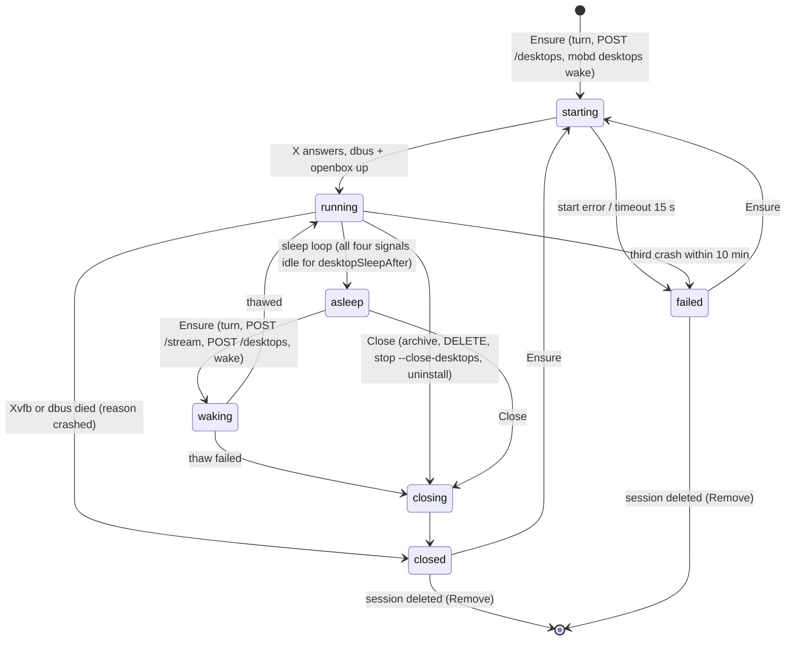

# Linux: detailed design

> **Status: implemented** on `feat/linux` (phases 0–4, section 12). This turns the agreed plan in
> [Linux](linux.md) into packages, interfaces, state, API and PR-sized steps. Statements about
> the code before the work cite `file:line` as of commit `3d589ce`. Choices the plan left open are
> marked *(design choice)*; unconfirmed OS behaviour *(to verify)*. Where the code differs, or a
> check settled a *(to verify)*, see [As built](#as-built). Phase 0 is shared by macOS, Linux and
> [Windows](windows.md).

## As built

**Different from this design:**

- **Start order:** Xvfb is started and its cookie verified before the scope is created, so losing
  a display race to another server just moves on to the next number; Xvfb is moved into the
  scope right after.
- **Running** means openbox manages the screen (`_NET_SUPPORTING_WM_CHECK`): an app opened before
  that stayed unmapped and unframed.
- **Crash during a turn:** only `session/` and `apps/` are killed; the runner keeps running
  without a display and the scope stops when the turn ends (stopping the scope would have killed
  the turn, which the design wanted to keep).
- **systemd** is reached over the user manager's private socket
  (`$XDG_RUNTIME_DIR/systemd/private`, as `systemctl --user`), so no session bus is needed, with a
  connection that outlives the context it was dialled with.
- **Paste** owns CLIPBOARD and PRIMARY and presses **Shift+Insert** (Ctrl+V types a literal in X
  terminals), then waits until the app fetched the text, so a following key cannot overtake it.
  At most 200 KB (no INCR transfers).
- **Encoders:** `gst.Encoders` is shared by all desktops; an encoder that errors or gives no
  first unit within 3 s is skipped for 5 minutes. Capture is `GetImage` (no MIT-SHM yet);
  `ShowCursor` is ignored (frames have no cursor; clients draw it).
- **`/stream`** reports the size of a starting or asleep desktop from its record, so opening the
  live view waits for the start or wakes it.
- **`mobd desktops logs`** reads the log files itself (works while mobd is stopped), not through
  a control-socket route. The offline `list` notes "mobd is stopped" once.
- **Memory pressure** counts as low at PSI `some avg60` ≥ 25%.
- **Release builds** for both architectures run on Ubuntu 22.04 runners (glibc 2.35).
- **Browsers:** downloads are set in Chrome's `Default/Preferences` and Firefox's `user.js` at
  every desktop start (unless the browser runs); snap browsers are not supported (they cannot open
  profiles under `~/.local/share`) and `doctor` warns.

**Not built:** `mobd setup-system-user` and the system-user deployment; reconnecting X after a
connection error is done once, without resubscribing anything else; the `fonts` doctor check;
hardware encoders are configured but untested.

**Settled by tests on Ubuntu 24.04 / Debian 13:** `FreezeUnit` replies once the cgroup is frozen
(systemd 255); Ubuntu 24.04 delegates the memory controller to the user manager; Ubuntu 22.04 and
24.04 `gstreamer1.0-plugins-bad` include OpenH264; `GetImage` of Xvfb has no cursor; a fresh
DAMAGE object reports once with no change; the `.deb` installs on Ubuntu 22.04/24.04 and
Debian 12; Chrome and Firefox honour the download settings.

## Contents

1. [Package layout](#1-package-layout)
2. [Interfaces](#2-interfaces)
3. [Desktop state machine](#3-desktop-state-machine)
4. [Turn dispatch](#4-turn-dispatch)
5. [Configuration](#5-configuration)
6. [HTTP API](#6-http-api)
7. [CLI](#7-cli)
8. [Filesystem layout](#8-filesystem-layout)
9. [Errors and recovery](#9-errors-and-recovery)
10. [Security](#10-security)
11. [Tests](#11-tests)
12. [Phases as pull requests](#12-phases-as-pull-requests)
13. [Open decisions](#13-open-decisions)

## Starting point (verified in code)

| Fact | Where |
| --- | --- |
| One process-wide backend: `var current = newBackend()`, `Current()` | `internal/desktop/backend.go:106-109` |
| Linux backend is `unsupported{name:"linux"}`; its comment still describes the abandoned portal/PipeWire plan | `internal/desktop/backend_linux.go:3-6` |
| Package functions (`Snapshot`, `StartStream`, `Click`, `Key`, `TypeText`, `OpenApp`, `ListWindows`, `Screenshot`) all call `current` | `internal/desktop/desktop.go:13-165` |
| `ErrUnsupported` says "only supported on macOS"; `unavailable()` talks about the "office Mac" | `internal/desktop/screen.go:16`, `desktop.go:42-52` |
| `TypeText` reports "via pasteboard" | `internal/desktop/desktop.go:155` |
| Key table is macOS virtual key codes; modifiers alias `cmd/meta→command`, `alt→option` | `internal/desktop/keys.go:9-29` |
| Delivery/drop logic (16-unit buffer, drop deltas until keyframe) lives in the darwin file | `internal/desktop/stream_darwin.go:21`, `:130-149` |
| `api.New` builds one `stream.Config` from global functions (`desktop.StartStream`, `desktop.KeepAwake`, `desktop.Current().Displays()`, `desktop.NewInput`) | `internal/api/server.go:78-92` |
| `stream.Config` fields: `Start`, `Display`, `KeepAwake`, `KeepAwakeAfter`, `Attach`, `NewInput`, `Loopback`, `UDP` | `internal/stream/stream.go:80-96` |
| `stream.Request` has `Offer`, `MaxWidth`, `MaxHeight`, `Quality` (no session) | `internal/stream/stream.go:51-56` |
| A stream session ends with an `ended` control message when its source ends | `internal/stream/stream.go:413-434` |
| `scheduleLocked`: FIFO, `len(s.cancels) < max(MaxRunning,1)`, `NextQueued` | `internal/api/server.go:230-243` |
| `runTask` defers cancel/token removal and reschedules | `internal/api/server.go:483-517` |
| Cancelling an undispatched task finishes it in place | `internal/api/server.go:340-346` |
| `/screen` uses the swappable `snapshot = desktop.Snapshot` | `internal/api/media.go:28`, `:30-78` |
| `runOptions` sets `MCPEnv` `MOB_API`, `MOB_TASK_ID`, `MOB_TASK_TOKEN` | `internal/api/media.go:172-192` |
| Task token check for `/internal/tasks/{id}/ask` (`X-Mob-Task-Token`, constant-time) | `internal/api/questions.go:67-76`, route `server.go:156` |
| `askInstructions` say "office Mac" | `internal/api/questions.go:20` |
| `/health` features list is a package var; TCC checks hard-coded | `internal/api/health.go:19`, `:80-81`, `:88-118` |
| Runners use `os.Environ()` | `internal/runner/codex/runner.go:70`, `codex/appserver.go:164`, `claude/runner.go:66` |
| `cli.Command{Name,Path,Args,Dir,Env,Stdin}`; `Setpgid` + `Kill(-pid)` | `internal/runner/cli/cli.go:29-37`, `:51-52`, `:100` |
| `runner.Options` has no env or cgroup field | `internal/runner/runner.go:23-37` |
| `mobd mcp` calls the desktop package directly (`hostDesktop`); tool texts say Quartz, pasteboard, bundle id | `internal/mcpserver/server.go:17-24`, `:37-54`, `:64`, `:115`, `:133`, `:147` |
| `mobd mcp` reaches mobd only through `httpAsker` (env `MOB_API`, …) | `internal/mcpserver/ask.go:39-70` |
| `service.New` fails unless darwin; logs via `/usr/bin/tail` | `internal/service/service.go:30-33`, `:239-243` |
| Control socket: `Stat_t` uid + 0700 check, `syscall.Flock` | `internal/control/control.go:36-48` |
| Pairing store: `syscall.Flock` | `internal/pairing/store.go:126`, `:449` |
| `control.Handler(store *pairing.Store)` only; built in `serve` | `internal/control/control.go:80`, `cmd/mobd/main.go:248` |
| `config` imports `control` for `DefaultPath` | `internal/config/config.go:17`, `:232-237` |
| `maxRunning` default 1, and `mobd init` writes `"maxRunning": 1` into the file | `internal/config/config.go:137`, `:313` |
| `statePath` default `os.UserConfigDir()/mob/state.json`; `dataDir` = its directory | `internal/config/config.go:128-135`, `:291-293` |
| `mobd stop`/`status`/`logs` reject options | `cmd/mobd/main.go:115-117` |
| A busy session rejects a new turn and deletion (`ErrSessionBusy`) | `internal/task/store.go:158-159`, `:322-323` |
| Non-terminal tasks become failed "interrupted by mobd restart" at open | `internal/task/persistence.go:105-107` |
| Session IDs are 32 hex characters | `internal/task/store.go:788-794` |
| `queuePosition` is computed on read | `internal/task/task.go:45-46`, `store.go:762-766` |
| CI: tests run only in the macOS release job; there is no pull-request workflow | `.github/workflows/release.yml:44`, `:64-65` |

## 1. Package layout

```text
cmd/mobd/
  main.go                 command dispatch; stop/start/restart through service.Manager
  desktops.go             NEW  mobd desktops list|close|wake|logs|doctor|seed <session> (control socket)
  provider_darwin.go      NEW  newProvider(): desktop.Shared(desktop.Current())
  provider_linux.go       NEW  newProvider(): manager.New(...) or Shared(unsupported) for desktopMode "none"
  provider_other.go       NEW  //go:build !darwin && !linux
cmd/stream-probe/main.go  + -session flag
internal/
  filelock/               NEW  Lock(path) (unlock func, error)
    filelock_unix.go           flock(2)
    filelock_windows.go        LockFileEx
  proc/                   NEW  process plumbing shared by runners and the desktop manager
    proc.go                    Spec, Watch (exit notification)
    proc_unix.go               Setpgid/Setsid, KillGroup
    proc_linux.go              CgroupFD (clone3 CLONE_INTO_CGROUP), pidfd watch, oom_score_adj
    proc_windows.go            Job Objects (Windows plan)
  config/
    config.go             + desktop keys, per-OS maxRunning default, ControlSocketDefault()
    dir.go                NEW  Dir() = ~/.mobd (darwin, linux); %LOCALAPPDATA%\mobd (windows)
  control/
    control.go            Listen/Call unchanged in behaviour; DefaultPath moves to config
    control_unix.go       NEW  ownership + 0700 check (moved from control.go:32-38)
    control_windows.go    NEW  ACL check (Windows plan)
    handler.go            Handler(Deps): pairing routes + desktop routes
  service/
    service.go            Manager interface, shared preflight (ports, control socket, PATH, bins, service.json)
    launchd.go            today's launchd code (moved from service.go)
    systemd.go            NEW  user unit, linger, systemctl --user
    unit.go               NEW  unit file rendering (tested)
    new_{darwin,linux,other}.go  NEW  New() per OS; Windows adds schtasks
                          (implementations carry no build tags, so both are tested with fake
                          launchctl/systemctl on any host; only New() is per OS)
    tail.go               NEW  Go tail -F for `mobd logs` (no /usr/bin/tail)
  desktop/                shared types and OS backends (no session knowledge)
    backend.go            Backend interface unchanged; Checker (optional)
    ops.go                NEW  Ops{Backend}: the validating wrappers now in desktop.go, per backend
    desktop.go            package funcs become On(current).X (macOS callers unchanged)
    provider.go           NEW  Provider, Desktop, Source, Shared(Backend)
    annexb.go             NEW  Annex B normalizer (AUD first, SPS/PPS before IDR, Key)
    unitqueue.go          NEW  bounded delivery + drop-until-keyframe (from stream_darwin.go)
    encode.go             NEW  EncodeImage(image.Image, format, maxWidth, quality)
    keys.go               ParseHotkey, modifier aliases (+ super/win)
    keys_darwin.go        macOS keyCodes (moved from keys.go)
    errors.go             NEW  per-OS wording for ErrUnsupported; ErrNoDesktop, ErrDesktopAsleep
    *_darwin.go/.m/.h     unchanged (macOS only)
    backend_linux.go      newBackend(): unsupported{"linux"} (the X11 backend is per desktop, not global)
    backend_other.go      //go:build !darwin && !linux
    x11/                  NEW  //go:build linux; one Backend per X display
      conn.go                  xgb connection with cookie, extension checks (SHM, DAMAGE, XTEST, XFIXES, RANDR)
      backend.go               X11 implements desktop.Backend
      capture.go               XShmGetImage/GetImage, damage tracking, last frame
      input.go                 XTest motion/button/key, RemoteInput
      keymap.go                web code→evdev, hotkey name→keysym, spare keycode for Unicode
      clipboard.go             CLIPBOARD owner window, SelectionRequest
      ewmh.go                  _NET_CLIENT_LIST_STACKING etc.
      apps.go                  desktop entries, launch via Launcher
      stream.go                capture loop → Encoder → annexb → unitqueue
    gst/                  NEW  //go:build linux && cgo; GStreamer shim
      gst.go, gst_linux.c/.h   Encoder, Probe
      gst_nocgo.go             //go:build linux && !cgo: Probe returns no encoders
    manager/              NEW  //go:build linux; per-session desktops (implements desktop.Provider)
      manager.go               Manager, map of desktops, events
      desktop.go               one desktop: state machine, start/close/freeze
      record.go                desktop.json
      spawn.go                 Xvfb, dbus-daemon, openbox, setxkbmap
      display.go               display number allocation, Xauthority
      sleep.go                 sleep loop and signals
      guard.go                 memory and disk guard
      reattach.go              startup reconciliation
      env.go                   TurnEnv, locale, wrappers (phase 4)
      logs.go                  per-component log files, rotation
      doctor.go                checks for /health and `mobd desktops doctor`
      offline.go               List/CloseAll from records without a running mobd
  cgroup/                 NEW  //go:build linux; cgroup v2 files (paths, stats, mkdir/rmdir, procs)
  sysd/                   NEW  //go:build linux; systemd over D-Bus (go-systemd/v22/dbus)
  mcpserver/
    server.go             Desktop interface unchanged; per-OS instructions and texts
    proxy.go              NEW  proxyBackend: Desktop over POST /internal/tasks/{id}/desktop/{op}
  api/
    server.go             New takes a desktop.Provider; scheduleLocked admits per session
    desktops.go           NEW  GET/POST/DELETE /desktops, SSE forwarding
    internal_desktop.go   NEW  /internal/tasks/{id}/desktop/{op}
    health.go             features computed; backend checks
  runner/
    runner.go             Options + Env, Cgroup, OOMScoreAdj
    cli/cli.go            Command + Cgroup, OOMScoreAdj; process code via internal/proc
    activity.go           unchanged on Linux (shellWrapper already strips bash/sh, activity.go:65)
packaging/linux/          NEW  deb control, postinst/prerm, unit templates, install.sh branch
```

**Moves:** `control.DefaultPath` → `config.ControlSocketDefault()` (removes the `config → control`
import of `config.go:17`, so `control` may import `config` later); `Stat_t`/`Flock` code →
`control_unix.go` + `filelock`; launchd code → `launchd_darwin.go`; macOS key table →
`keys_darwin.go`; `stream_darwin.go` delivery → `unitqueue.go`.

**Stays macOS-only:** ScreenCaptureKit/VideoToolbox/CGEvent/IOKit files
(`snapshot_darwin.*`, `stream_darwin.*`, `input_darwin.go`, `remote_darwin.go`,
`power_darwin.go`, `backend_darwin.go`), TCC permission checks, launchd, `pbcopy`.

**Import rule:** `desktop` (shared types) ← `desktop/x11`, `desktop/gst` ← `desktop/manager` ←
`cmd/mobd`. `api` sees only `desktop.Provider`; it never imports `manager`, so `api` tests stay
portable. `manager` imports `cgroup`, `sysd`, `proc`, `config`, never `api` or `task`.

**New dependencies:** `github.com/jezek/xgb` (BSD), `github.com/coreos/go-systemd/v22` (Apache-2,
pulls `godbus/dbus/v5`), `golang.org/x/sys/unix` (already transitive). GStreamer via cgo +
`pkg-config gstreamer-1.0 gstreamer-app-1.0 gstreamer-video-1.0`.

## 2. Interfaces

All signatures are design, not code to paste.

### 2.1 Provider and per-desktop handle (`internal/desktop/provider.go`)

```go
// Provider returns the desktop a session works on. macOS and Windows return one shared
// desktop for every session; Linux gives each session its own.
type Provider interface {
	// PerSession reports Linux-style desktops; /health advertises "sessionDesktops" when true.
	PerSession() bool
	// Get returns the session's desktop without starting or waking it; ErrNoDesktop if none.
	Get(sessionID string) (Desktop, error)
	// Reserve is called under the API server lock while scheduling. It never blocks or starts
	// processes. ok=false comes with the reason the turn keeps waiting.
	Reserve(sessionID string) (r Reservation, reason QueueReason, ok bool)
	// Ensure starts or wakes the session's desktop and waits until it runs (or ctx ends).
	Ensure(ctx context.Context, sessionID string, why string) (Desktop, error)
	// Close closes the session's desktop; reason is recorded and sent in events.
	// ErrTurnActive while a turn of the session runs, unless AfterTurn is set.
	Close(ctx context.Context, sessionID string, opt CloseOptions) error
	// Remove closes the desktop and deletes <dataDir>/desktops/<sessionID> (session deleted).
	Remove(ctx context.Context, sessionID string) error
	List() []Info
	Resources() Resources
	// Subscribe receives desktop, memory and disk events; the callback must not block.
	Subscribe(func(Event))
	// Shutdown detaches (desktops keep running); it never closes desktops.
	Shutdown()
}

type Reservation interface {
	// Turn returns the environment for the session's runner. Called after Ensure.
	Turn(d Desktop) (TurnEnv, error)
	// Release ends the turn or drops an unused reservation. Idempotent.
	Release()
}

type CloseOptions struct {
	Reason    CloseReason // archived, deleted, user, stop, uninstall, ...
	AfterTurn bool        // archive: close once the active turn ends instead of failing
}

// Desktop is one display: the agent's and the live view's handle.
type Desktop interface {
	SessionID() string           // "" for the shared desktop
	State() State
	// Backend fails with ErrDesktopAsleep / ErrNoDesktop unless the desktop is running.
	Backend() (Backend, error)
	// Snapshot of a running desktop, or the last frame of an asleep one (never wakes it).
	Snapshot(ctx context.Context, opts SnapshotOptions) (Image, State, error)
	// Source is what the stream manager uses for one viewer.
	Source() Source
	Info() Info
}

// Source feeds one live-view session.
type Source interface {
	Display() (Display, error)
	StartStream(ctx context.Context, opts StreamOptions) (Stream, error)
	// Hold wakes the desktop (macOS: display assertion; Linux: Ensure + viewer count)
	// and keeps it awake until release.
	Hold(reason string) (release func(), err error)
	NewInput() *Input
	// Done is closed when the desktop closes or crashes; the stream sends "ended" with Err.
	Done() <-chan struct{}
	Err() error
}

type TurnEnv struct {
	Env         []string // DISPLAY, XAUTHORITY, DBUS_SESSION_BUS_ADDRESS, PATH (session bin first), LANG...
	Cgroup      string   // absolute cgroup directory the runner starts in; "" = mobd's own
	OOMScoreAdj int      // raised for runners and their children; 0 = unchanged
}

type Info struct {
	SessionID    string     `json:"sessionId"`
	Display      string     `json:"display,omitempty"` // ":101"
	Width        int        `json:"width"`             // points
	Height       int        `json:"height"`
	Scale        float64    `json:"scale"`
	State        State      `json:"state"`
	Reason       string     `json:"reason,omitempty"`
	MemoryBytes  int64      `json:"memoryBytes"`
	DiskBytes    int64      `json:"diskBytes"`
	StartedAt    *time.Time `json:"startedAt,omitempty"`
	LastUsedAt   *time.Time `json:"lastUsedAt,omitempty"`
	ActiveTaskID string     `json:"activeTaskId,omitempty"`
	Viewers      int        `json:"viewers"`
}

type State string // "starting" "running" "asleep" "waking" "closing" "closed" "failed"

// As built (step 0.5): the type is DesktopState (desktop.State() is already the display-state
// function), and Close takes a CloseReason instead of CloseOptions: the API cancels a running
// turn of the session before closing (owner decision), so AfterTurn and ErrTurnActive are gone.

// Shared wraps one Backend: PerSession false, Get/Ensure always return it, Reserve always ok,
// Turn returns an empty TurnEnv, Close/Remove are no-ops, List is empty, Source.Hold is
// Backend.KeepAwake. Used on macOS and Windows.
func Shared(b Backend) Provider
```

`QueueReason` is a string: `""`, `"slots"` (maxRunning), `"desktops"` (maxDesktops), `"memory"`,
`"disk"`, `"desktopStarting"`. `CloseReason`: `archived`, `deleted`, `user`, `stop`, `uninstall`,
`crashed`, `reboot`, `sessionGone`, `startFailed`, `thawFailed`.

### 2.2 `desktop.Ops`: the package functions per backend (`internal/desktop/ops.go`)

The validating wrappers in `desktop.go:13-165` move to methods so they work on any backend;
package functions become `On(current).X(...)`, so macOS callers do not change.

```go
type Ops struct{ B Backend }
func On(b Backend) Ops
func (o Ops) Snapshot(ctx context.Context, opts SnapshotOptions) (Image, error)
func (o Ops) StartStream(ctx context.Context, opts StreamOptions) (Stream, error)
func (o Ops) Screenshot(ctx context.Context) ([]byte, ScreenMeta, error)
func (o Ops) Click(x, y float64, button string, count int) error
func (o Ops) Key(combo string) error
func (o Ops) TypeText(ctx context.Context, text string) (string, error) // "via clipboard" off macOS
func (o Ops) ListWindows(onScreenOnly bool) ([]Window, error)
func (o Ops) OpenApp(ctx context.Context, target string) (string, error)
func (o Ops) NewInput() *Input          // today's NewInput (remote.go:85) for any backend
func (o Ops) Unavailable() error        // today's unavailable() (desktop.go:42), per backend

// Checker is optionally implemented by a Backend (or Provider) for /health.
type Checker interface{ Checks(ctx context.Context) map[string]Check }
type Check struct{ OK, Unknown bool; Detail string }
```

### 2.3 Linux desktop manager (`internal/desktop/manager`)

```go
type Options struct {
	DataDir       string        // <dataDir>/desktops
	RuntimeDir    string        // $XDG_RUNTIME_DIR/mobd
	Size          [2]int        // desktopSize, points
	Scale         int           // desktopScale
	Layout        string        // desktopKeyboardLayout
	DisplayBase   int
	MaxDesktops   int
	SleepAfter    time.Duration // 0 disables sleep
	SleepCPU      float64       // fraction of one core
	Memory        MemoryLimits  // warn/floor percent
	Disk          DiskLimits    // warn percent/bytes, floor bytes
	BrowserSeed   string
	Encoders      []gst.Factory // probed at start (phase 3)
	Systemd       sysd.Client   // fakes in tests
	Cgroups       cgroup.FS
	Spawner       proc.Spawner
	Clock         clock.Clock
	Sessions      SessionLookup // exists/title/archived, implemented by the API over task.Store
}

type SessionLookup interface {
	Session(id string) (title string, exists bool)
	ActiveTask(id string) string // "" when the session has no non-terminal task
}

func New(opts Options) (*Manager, error) // checks cgroup v2 and the user manager; no processes
func (m *Manager) Attach(ctx context.Context) error  // re-attach from desktop.json (section 9)
func (m *Manager) Run(ctx context.Context)           // sleep loop, guards, supervision
// plus desktop.Provider
```

Per desktop (unexported `*desk`):

```go
type desk struct {
	mu     sync.Mutex   // state transitions; held across start/freeze/thaw/close work
	ops    sync.RWMutex // X calls take RLock; freeze and close take Lock (no X request in flight)
	rec    record       // desktop.json
	x      *x11.X11     // nil unless running
	ready  chan struct{} // closed when starting/waking ends
	done   chan struct{} // closed when the desktop ends (Source.Done)
	turn   string        // active task ID; set by Reservation, cleared by Release
	viewers int
	idleSince time.Time  // sleep timer
	cpuPrev  uint64      // cpu.stat usage_usec at the last tick
	crashes  []time.Time
	lastFrame []byte     // PNG of the last frame before freezing
}
```

### 2.4 cgroup and scope (`internal/cgroup`, `internal/sysd`)

```go
package sysd

type Client interface {
	// StartScope creates a transient scope under the calling user manager with the given PIDs,
	// Delegate=yes, CollectMode=inactive-or-failed, and waits for the job.
	StartScope(ctx context.Context, unit string, pids []int, desc string) error
	StopUnit(ctx context.Context, unit string) error      // SIGTERM to all, then SIGKILL (scope defaults)
	Freeze(ctx context.Context, unit string) error        // org.freedesktop.systemd1.Manager.FreezeUnit
	Thaw(ctx context.Context, unit string) error
	// UnitState returns ActiveState, FreezerState and ControlGroup.
	UnitState(ctx context.Context, unit string) (UnitState, error)
	Close() error
}

package cgroup

type FS interface {
	// Path resolves a unit's ControlGroup to /sys/fs/cgroup/...
	Path(controlGroup string) string
	Mkdir(dir string) error                 // child cgroup (session, apps, turn)
	Rmdir(dir string) error                 // fails while populated
	Move(dir string, pid int) error         // write cgroup.procs
	Open(dir string) (*os.File, error)      // O_DIRECTORY fd for CLONE_INTO_CGROUP
	CPUUsage(dir string) (time.Duration, error) // cpu.stat usage_usec (always present on v2)
	Memory(dir string) (int64, error)       // memory.current; ErrNoController if absent
	Populated(dir string) (bool, error)     // cgroup.events populated
	Frozen(dir string) (bool, error)        // cgroup.events frozen
	FreezeDirect(dir string, on bool) error // cgroup.freeze, fallback when FreezeUnit fails
}
```

Freezing goes through `FreezeUnit`/`ThawUnit` (systemd ≥ 246; Ubuntu 22.04 ships 249) *(design
choice: the user manager owns the scope's `cgroup.freeze`; delegation may not chown it to the user
*(to verify)*, and systemd then reports `FreezerState` consistently)*. `FreezeDirect` is the
fallback if the D-Bus call fails with "not supported". If `memory.current` is missing (memory
controller not delegated to `user@.service` *(to verify on Debian 12)*), memory is the sum of
`Pss` from `/proc/<pid>/smaps_rollup` over `cgroup.procs` of the subtree.

Cgroup tree of one desktop (`<scope>` = `.../user@<uid>.service/app.slice/mobd-desktop-<sid>.scope`):

```text
<scope>/            no processes once set up (cgroup v2 "no internal processes" with Delegate=yes)
  session/          Xvfb, dbus-daemon, openbox, setxkbmap
  apps/             apps started by open_app (setsid, own session)
  turn/             the runner of the current turn and everything its shell starts
```

The scope name uses the full 32-hex session ID (`mobd-desktop-<sid>.scope`). Controllers are not enabled in the scope's `cgroup.subtree_control`
*(design choice: accounting and the freezer work hierarchically without it, and processes can
then move freely between the leaves)*.

### 2.5 Process spawning (`internal/proc`)

```go
type Spec struct {
	Path string; Args, Env []string; Dir string
	Stdout, Stderr *os.File // log files; never pipes for desktop processes (they outlive mobd)
	NewSession  bool        // setsid: desktop processes and open_app apps
	NewGroup    bool        // setpgid: runners (cli.go:51 today)
	CgroupDir   *os.File    // CLONE_INTO_CGROUP (Go SysProcAttr.UseCgroupFD/CgroupFD, kernel ≥ 5.7)
	OOMScoreAdj int         // written to /proc/<pid>/oom_score_adj after start; only raised
}
type Spawner interface{ Start(Spec) (pid int, wait func() error, err error) }
// Watch notifies when a pid exits, for children and for re-attached non-children (pidfd_open + poll).
func Watch(ctx context.Context, pid int) (<-chan struct{}, error)
func KillGroup(pgid int, sig syscall.Signal) error
```

`internal/runner/cli` uses `proc` for `Setpgid`, the group kill and the new cgroup fd; Windows
adds Job Objects behind the same file split.

### 2.6 X11 backend (`internal/desktop/x11`), method by method

`x11.Open(display, xauthority string, opts Options) (*X11, error)` connects with the cookie and
requires SHM (falls back to `GetImage`), DAMAGE, XTEST, XFIXES. `*X11` implements
`desktop.Backend` (`backend.go:11-39`):

| Method | Implementation |
| --- | --- |
| `Name()` | `"x11"` |
| `Permissions()` | `Permissions{Accessibility: true, ScreenRecording: true}, nil`: nothing to grant |
| `RequestPermissions()` | no-op |
| `Displays()` | one `Display{ID: ":N", Width/Height: root size / scale, Scale: desktopScale, Main: true}` |
| `Snapshot(ctx, opts)` | `ShmGetImage` of the root (ZPixmap, BGRX) into a SysV segment, else `GetImage`; convert to `image.RGBA` and `desktop.EncodeImage` (no PNG round trip, unlike `Encode` at `screen.go:20`). Cursor-free: Xvfb draws its cursor in software and `GetImage` excludes it *(to verify)* |
| `State()` | `DisplayState{}` (never locked, never asleep) while the connection is alive; error when it is closed |
| `StartStream(ctx, opts)` | capture loop + `gst.Encoder` (section 2.7); `ErrUnsupported` when no encoder was probed |
| `KeepAwake(reason)` | returns a no-op release, nil: an X display does not sleep. Desktop sleep is the manager's `Hold`, not the backend's |
| `Remote()` | `RemoteInput` over XTest: `Mouse` = `FakeInput(MotionNotify)` + `ButtonPress/Release` (buttons 1/3/2); `KeyCode` = web code → evdev → keycode (+8); `Unicode` = keysym per rune, spare keycode remapped when missing; `Scroll` = buttons 4/5/6/7, one press per 50 px *(to tune)*; `Cursor` = `QueryPointer` / scale. `mods` is ignored: the client's modifier keys arrive as their own `KeyCode` events (`remote.go:119-127`) |
| `Click(x,y,right,count)` | motion to (x·scale, y·scale), then `count` press/release pairs 50 ms apart (inside openbox's default 200 ms double-click time) |
| `Key(key, mods)` | modifiers `command→Super_L`, `option→Alt_L`, `control→Control_L`, `shift→Shift_L`; key name → keysym (`return`→`Return`, letters, F-keys, arrows as `keys.go:9-21` names); keysym → keycode via the current mapping; press mods, key, release in reverse |
| `Paste(ctx, text)` | own `CLIPBOARD` (and `PRIMARY`) from a hidden InputOnly window, answer `SelectionRequest` for `UTF8_STRING`, `STRING`, `TEXT`, `TARGETS`; press `ctrl+v`; keep ownership until the next paste or close |
| `ListWindows(onScreen)` | `_NET_CLIENT_LIST_STACKING` (top first), title `_NET_WM_NAME` or `WM_NAME`, `App` = `WM_CLASS` class, `PID` = `_NET_WM_PID`, bounds = frame extents (`_NET_FRAME_EXTENTS`) + `TranslateCoordinates`, in points; on-screen = mapped and not `_NET_WM_STATE_HIDDEN` |
| `OpenApp(ctx, target)` | desktop entry by ID (`firefox`, `org.gnome.Calculator`) or `Name=` (case-insensitive) in `XDG_DATA_DIRS`/`~/.local/share/applications`, else executable on the desktop's `PATH` (wrappers first). `Exec=` field codes stripped. Started by the manager's `Launcher` in `<scope>/apps`, `setsid`, output to `logs/apps.log`, raised OOM score. Returns `opened "firefox" (firefox.desktop)` |

The X11 backend never touches systemd or cgroups; `OpenApp` calls a `Launcher` func the manager
passes in `x11.Options`.

### 2.7 Encoder (`internal/desktop/gst`)

```go
type Frame struct {
	Pix    []byte        // BGRX, Stride·Height
	Stride, Width, Height int
	PTS    time.Duration
}

type EncoderOptions struct{ Width, Height, FPS, Kbps int } // output size, scaled inside the pipeline

type Encoder interface {
	// Push queues one frame without blocking; a full queue drops the oldest.
	Push(f Frame)
	// Units delivers raw Annex B access units from h264parse; closed after Close or an error.
	Units() <-chan []byte
	SetBitrate(kbps int)
	SetSize(width, height int) // capsfilter change; the next unit is an IDR
	ForceKeyframe()            // GstForceKeyUnit upstream event
	Err() error
	Close()
}

type Factory struct {
	Name   string // "vah264enc", "vaapih264enc", "nvh264enc", "openh264enc"
	Detail string // "VA-API", "NVENC", "software"
	New    func(EncoderOptions) (Encoder, error)
}

// Probe builds each pipeline at 320x240 and encodes two frames; it returns the working
// factories in preference order. Run once at mobd start (and by `desktops doctor`).
func Probe(ctx context.Context) []Factory
```

Pipeline: `appsrc format=time is-live=true ! videoconvert ! videoscale ! capsfilter ! <enc> !
h264parse config-interval=-1 ! video/x-h264,stream-format=byte-stream,alignment=au,profile=constrained-baseline
! appsink sync=false max-buffers=4 drop=true`. VA-API uses `vapostproc` instead of
`videoconvert ! videoscale`. Encoder properties: rate control CBR, no B-frames, `key-int-max`
large (keyframes on request only). The capture loop owns frame pacing (no `videorate`): it pushes
a frame only on damage, at most `FPS` times a second, and re-pushes the last frame with a forced
keyframe when `Keyframe()` is called on an idle screen. `x11.stream` passes units through
`desktop.AnnexB` (inserts the AUD, adds cached SPS/PPS before an IDR if missing, sets `Key`) and
`desktop.UnitQueue` (the `stream_darwin.go:130-149` logic). When a hardware encoder fails to
start a session, `StartStream` tries the next probed factory.

### 2.8 Service manager (`internal/service`)

```go
type Manager interface {
	Start(cfg config.Config, args []string, login bool) error
	Stop() error              // stops and disables the service; never touches desktops
	Status() error
	Logs() error              // Go tail -F of <Dir>/mobd.log
	SavedArgs() ([]string, error)
	LoginEnabled() bool
	Dir() string              // ~/.mobd
	LogPath() string
}
func New() (Manager, error) // launchd on darwin, systemd on linux, error elsewhere (until Windows)
```

The preflight now in `service.go:48-103` (port checks, control socket, `LookPath` of
`codex`/`claude`, `service.json`, `service-args.json`) becomes a shared `prepare(cfg, args)` used
by both implementations. `main.go:179` prints `manager.LogPath()`.

systemd implementation:

- Writes `~/.config/systemd/user/mobd.service` (0644):

  ```ini
  [Unit]
  Description=mobd office agent daemon
  After=default.target

  [Service]
  Type=exec
  ExecStart=<exe> serve --config <home>/.mobd/service.json
  WorkingDirectory=<codex workdir>
  Environment=PATH=<captured PATH>
  StandardOutput=append:<home>/.mobd/mobd.log
  StandardError=append:<home>/.mobd/mobd.log
  Restart=on-failure
  RestartSec=2
  TimeoutStopSec=30
  KillMode=mixed

  [Install]
  WantedBy=default.target
  ```

  Logs go to `~/.mobd/mobd.log` like on macOS *(design choice: Debian does not keep a persistent
  user journal by default, and `mobd logs` stays one Go tail on every OS)*. Desktops are not in
  `mobd.service`'s cgroup, so `KillMode` never reaches them.
- `Start`: `prepare`, write the unit, `systemctl --user daemon-reload`, `loginctl enable-linger`
  (unless already on; prints `sudo loginctl enable-linger <user>` if polkit refuses *(to verify
  per release)*), `systemctl --user enable` when `login`, `systemctl --user start mobd`, then wait
  for `Health` as `service.go:149-158` does. Linger is enabled even without `--login` *(design
  choice: without linger, logging out of the last SSH session stops the user manager and every
  desktop scope with it)*.
- `Stop`: `systemctl --user disable --now mobd`; the unit file is kept (removed by `uninstall`).
  Linger is left on *(design choice: turning it off would end kept desktops at logout)*.
- `Status`: `systemctl --user is-active mobd` + `Health`. `LoginEnabled`: `is-enabled`.

**System deployment** (the plan's "system unit" option): a dedicated `mobd` system user with
linger runs the same **user** unit in its own `user@<uid>.service` *(design choice: cgroup
migration needs write access to the common ancestor, and a process in `system.slice` cannot move
runners into scopes under a user manager; a system service with `Delegate=yes` would also put the
desktops in `mobd.service`'s cgroup, so stopping it would kill them)*. The `.deb` ships a helper:
`mobd setup-system-user` (root) creates the user, enables linger and runs
`runuser -u mobd -- mobd start --login`.

### 2.9 MCP proxy (`internal/mcpserver/proxy.go`)

```go
// proxyBackend implements Desktop by calling the mobd that dispatched this turn.
type proxyBackend struct{ api, taskID, token string; client *http.Client }

func (p proxyBackend) Screenshot(ctx context.Context) ([]byte, desktop.ScreenMeta, error)
func (p proxyBackend) Click(x, y float64, button string, count int) error
func (p proxyBackend) TypeText(ctx context.Context, text string) (string, error)
func (p proxyBackend) Key(combo string) error
func (p proxyBackend) ListWindows(onScreenOnly bool) ([]desktop.Window, error)
func (p proxyBackend) OpenApp(ctx context.Context, target string) (string, error)

// desktopFromEnv picks proxyBackend when MOB_API, MOB_TASK_ID, MOB_TASK_TOKEN and
// MOB_DESKTOP_PROXY=1 are set, else hostDesktop (server.go:37).
func desktopFromEnv() Desktop
```

`Run` (`server.go:165-166`) uses `desktopFromEnv()` instead of `hostDesktop{}`. mobd sets
`MOB_DESKTOP_PROXY=1` in `MCPEnv` (`media.go:181`) when `runtime.GOOS != "darwin"`, so macOS keeps
direct calls until open question 9 of the plan is decided. The tool result strings (`"clicked …
via Quartz"`, `server.go:115`, `:133`) move to the server side of the proxy and to per-OS
constants, so Linux results never mention Quartz.

### 2.10 API server and stream config changes

`api.New` (`server.go:56`) gains the provider; `nil` means `desktop.Shared(desktop.Current())`
so existing tests keep compiling with one added argument:

```go
func New(cfg config.Config, store *task.Store, auth *pairing.Store, desktops desktop.Provider, runners ...runner.Runner) *Server
```

`Server` (`server.go:26-52`) gains `desktops desktop.Provider` and
`reservations map[string]desktop.Reservation` (task ID → reservation, guarded by `mu`).

`stream.Config` (`stream.go:80-96`) today has `Start`, `Display`, `KeepAwake`, `KeepAwakeAfter`,
`Attach`, `NewInput`, `Loopback`, `UDP`. `Start`, `Display`, `KeepAwake` and `NewInput` are
replaced by one resolver:

```go
type Config struct {
	// Source resolves the desktop a request watches; sessionID is "" for shared desktops.
	// Errors: desktop.ErrNoDesktop (409), task.ErrNotFound (404), others 503.
	Source         func(ctx context.Context, sessionID string) (desktop.Source, error)
	KeepAwakeAfter time.Duration
	Attach         func(parent context.Context, clientID string) (context.Context, func(), error)
	Loopback       bool
	UDP            net.PacketConn
	ViewOnly       bool // replaces NewInput == nil
}
type Request struct {
	SessionID string `json:"sessionId,omitempty"`
	Offer     string `json:"offer,omitempty"`
	MaxWidth  int    `json:"maxWidth"`
	MaxHeight int    `json:"maxHeight"`
	Quality   string `json:"quality"`
}
func (m *Manager) Viewers(sessionID string) int
```

`session` gains `sessionID` and `src desktop.Source`; `start` (`stream.go:258-283`) calls
`src.Hold` instead of `cfg.KeepAwake` (on Linux `Hold` runs `Ensure`, so a viewer wakes an asleep
desktop and its release starts the sleep timer again `KeepAwakeAfter` later), `src.StartStream`
instead of `cfg.Start`, `src.NewInput()` instead of `cfg.NewInput()`. A goroutine ends the session
with `{"t":"ended","message":<src.Err()>}` when `src.Done()` closes, like `forward` does today
(`stream.go:425-433`). `api.New` builds:

```go
Source: func(ctx context.Context, sid string) (desktop.Source, error) {
	if !s.desktops.PerSession() { d, _ := s.desktops.Get(""); return d.Source(), nil }
	if sid == "" { return nil, errSessionRequired }               // 400
	if _, err := s.store.SessionRunner(sid); err != nil { return nil, err } // 404
	d, err := s.desktops.Get(sid)                                 // 409 when none/closed
	if err != nil { return nil, err }
	return d.Source(), nil
},
```

## 3. Desktop state machine

### 3.1 States

| State | Meaning | Persisted |
| --- | --- | --- |
| none | no record (never started, or removed with the session) | no file |
| starting | Xvfb/scope/dbus/openbox coming up | yes |
| running | usable; X connection open | yes |
| asleep | scope frozen; last frame kept | yes |
| waking | thaw in progress | yes |
| closing | scope being stopped | yes |
| closed | ended; `reason` says why; files and profiles kept | yes |
| failed | ended after 3 crashes in 10 min, or a start failure; the next turn or `POST /desktops` retries | yes |

There is no visible "freezing" state: freezing happens while holding `desk.mu` and `desk.ops`,
and the state flips from running to asleep only after `FreezerState` reports `frozen` *(design
choice: an observer then never sees a half-frozen desktop)*.



openbox exiting is not a transition: the manager restarts it in `session/` (at most 5 times a
minute, then the desktop is closed with reason `crashed`).

### 3.2 `desktop.json`

`<dataDir>/desktops/<sessionId>/desktop.json`, 0600, written atomically (temp file + rename, as
`service.go:161-173` `writePrivate`):

```json
{
  "version": 1,
  "sessionId": "9f2c…",
  "state": "asleep",
  "reason": "",
  "display": 101,
  "unit": "mobd-desktop-9f2c….scope",
  "cgroup": "/user.slice/user-1000.slice/user@1000.service/app.slice/mobd-desktop-9f2c….scope",
  "pids": {"xvfb": 41230, "dbus": 41236, "openbox": 41240},
  "runtimeDir": "/run/user/1000/mobd/d101",
  "xauthority": "/run/user/1000/mobd/d101/Xauthority",
  "bus": "unix:path=/run/user/1000/mobd/d101/bus",
  "width": 1920, "height": 1080, "scale": 1,
  "layout": "us",
  "locale": "en_US.UTF-8",
  "bootId": "1b0e…",
  "mobdVersion": "0.4.0",
  "startedAt": "2026-10-19T08:02:11Z",
  "lastUsedAt": "2026-10-19T09:14:40Z",
  "sleptAt": "2026-10-19T09:24:40Z",
  "turn": {"taskId": "77ab…", "pgid": 41501},
  "crashes": ["2026-10-19T08:30:00Z"]
}
```

`turn` is written when a runner starts and cleared when it ends, so a crashed mobd can kill an
orphaned runner on re-attach (section 9). `bootId` is `/proc/sys/kernel/random/boot_id`. The
last frame is `lastframe.png` next to it (0600), written before every freeze, so a snapshot of an
asleep desktop survives a mobd restart.

### 3.3 Locking

- Order: `api.Server.mu` → `Manager.mu` → `desk.mu` → `desk.ops`. Never the reverse.
- `Manager.mu` guards only the map and counters (starting count, reservations); it is never held
  across process starts, D-Bus calls or disk writes.
- `desk.mu` serializes transitions and is held across the slow work of one desktop. Concurrent
  `Ensure` calls for the same session wait on `desk.ready`.
- `desk.ops`: every X call (backend methods, snapshot, capture loop pushes) takes `RLock` with a
  5 s timeout; freeze and close take `Lock`, so no request is in flight when the X server stops.
  The damage reader blocks harmlessly on a frozen server (it sends nothing).
- Events are queued on a channel and delivered by one goroutine after locks are released;
  subscribers (`api` → hub) never call back into the manager synchronously.
- `Reserve` is the only call made under `api.Server.mu`; it reads counters and never blocks.

### 3.4 Calls per state

| Call | none / closed / failed | starting / waking | running | asleep | closing |
| --- | --- | --- | --- | --- | --- |
| turn dispatch (`Reserve` + `Ensure`) | start (guards apply) | wait for ready | use | wake | wait, then start |
| `GET /screen?sessionId` | 409 `no_desktop` | 409 `desktop_starting` | snapshot | last frame + `X-Mob-Desktop-State: asleep` (no wake) | 409 `no_desktop` |
| `POST /stream` + sessionId | 409 `no_desktop` | wait ≤ 15 s, then stream | stream | wake, stream | 409 |
| `POST /desktops/{id}` | start (guards: 503) | wait | 200 | wake | wait, then start |
| `DELETE /desktops/{id}` | 204 (no-op) | wait, then close | cancel the active turn, then close | close | wait |
| `PATCH /sessions` archived:true | — | close after ready | cancel the active turn, then close | close | — |
| `DELETE /sessions/{id}` | remove files | close + remove | close + remove (session not busy, `store.go:322`) | close + remove | wait, remove |
| `/internal/…/desktop/{op}` | 409 `no_desktop` | wait | execute | wake first (a turn keeps it awake, so only after a race) | 409 |
| sleep loop | — | — | may freeze | — | — |
| mobd stop (keep) | — | finish, detach | detach | detach | finish |

## 4. Turn dispatch

### 4.1 `scheduleLocked` (`server.go:230-243`)

```go
func (s *Server) scheduleLocked() {
	limit := max(s.cfg.MaxRunning, 1)
	reasons := map[string]desktop.QueueReason{}
	for _, t := range s.store.QueuedTasks() {            // FIFO, new store helper
		if s.closing { break }
		if s.cancels[t.ID] != nil { continue }             // dispatched, not yet running
		if len(s.cancels) >= limit { reasons[t.ID] = "slots"; continue }
		r, why, ok := s.desktops.Reserve(t.SessionID)
		if !ok { reasons[t.ID] = why; continue }           // later turns may pass (plan: Concurrency)
		ctx, cancel := context.WithCancel(context.Background())
		s.cancels[t.ID], s.tokens[t.ID], s.reservations[t.ID] = cancel, newToken(), r
		s.runs.Add(1)
		go s.runTask(ctx, t.ID)
	}
	s.store.SetQueueReasons(reasons)                     // publishes task events only for changes
}
```

On macOS `Shared.Reserve` always succeeds, so the loop dispatches exactly as today: FIFO while
`len(cancels) < limit`.

`Reserve(session)` on Linux, in order:

1. Session has a desktop record in starting, running, asleep, waking: ok (no new desktop).
2. `maxDesktops > 0` and live + starting desktops ≥ `maxDesktops`: `"desktops"`.
3. Memory level critical: `"memory"`. Disk level critical: `"disk"`.
4. ok; the reservation counts as a starting desktop until `Ensure` finishes or `Release`.

### 4.2 `runTask` (`server.go:483-517`)

Before `UpdateStatus(running)`:

```go
r := s.reservation(id)
defer r.Release()                          // also in the existing defer path
d, err := s.desktops.Ensure(ctx, t.SessionID, "turn")   // ≤ 15 s; wakes or starts
if err == nil { env, err = r.Turn(d) }     // TurnEnv; writes desktop.json "turn"
```

While `Ensure` runs the task stays `queued` with `queueReason: "desktopStarting"`. A start failure
fails the turn with the message ("could not start the conversation's desktop: Xvfb exited: …")
and puts the desktop in `failed`; the next turn retries. Cancellation during `Ensure` behaves like
today's cancel of a dispatched task (`server.go:341-342`).

### 4.3 Task fields

`Task` gets `QueueReason string \`json:"queueReason,omitempty"\`` (computed on read like
`QueuePosition`, `task.go:45-46`; held in memory by the store, never persisted). Clients show:
`slots` "waiting for a free slot", `desktops` "waiting: the desktop limit is reached", `memory`
"waiting: the office machine is low on memory", `disk` "waiting: the office machine is low on
disk space", `desktopStarting` "starting the desktop".

### 4.4 Rescheduling triggers

`scheduleLocked` runs today on create and on turn end. Add: desktop closed (frees a
`maxDesktops` slot), memory or disk level change, desktop start finished. The manager's events
reach the API through `Subscribe`; the API calls `scheduleLocked` from the event goroutine under
`s.mu`.

### 4.5 Runner environment and cgroup

```go
// runner.Options (runner.go:23-37) additions
Env         []string // appended to os.Environ(); later entries win (os/exec dedup)
Cgroup      string   // start the runner in this cgroup directory
OOMScoreAdj int

// cli.Command (cli.go:29-37) additions
Cgroup      string
OOMScoreAdj int
```

`runOptions` (`media.go:172`) copies `TurnEnv` into the options and adds `MOB_DESKTOP_PROXY=1` to
`MCPEnv` off macOS. codex (`runner.go:70`, `appserver.go:164`) and claude (`claude/runner.go:66`)
build `Env: append(os.Environ(), opts.Env...)`; both start one process per turn, so the env is per
session. `cli.Run` opens `Cgroup` and passes it as `SysProcAttr.CgroupFD` with
`UseCgroupFD: true`, keeping `Setpgid` and the group kill (`cli.go:51-52`, `:100`): cancelling a
turn kills the runner's process group, not the `turn/` cgroup *(design choice: `cgroup.kill`
would also end apps the agent detached with `setsid`, which the plan says survive a cancelled
turn)*. Runner env on Linux:

| Variable | Value |
| --- | --- |
| `DISPLAY` | `:101` |
| `XAUTHORITY` | `<runtimeDir>/Xauthority` |
| `DBUS_SESSION_BUS_ADDRESS` | `unix:path=<runtimeDir>/bus` |
| `PATH` | `<sessionDir>/bin:` + mobd's `PATH` (phase 4) |
| `LANG`, `LC_*` | machine locale (section 5) |
| `MOB_DESKTOP` | `<sessionDir>` (for tools that want the Downloads path) |

`XDG_RUNTIME_DIR` stays the user's *(design choice, changes the plan: a per-desktop value would
break `systemctl --user`, `gpg-agent`, `ssh-agent` sockets and PipeWire; desktops are separated
by `DISPLAY` and the bus)*. Runners get `OOMScoreAdj` 300, apps from `open_app` 500; mobd, Xvfb,
dbus and openbox stay at 0 *(design choice: an unprivileged user manager can raise but not lower
scores, so `OOMScoreAdjust=-500` in a user unit fails *(to verify)*; raising the apps gives the
same order)*.

### 4.6 `maxRunning` default and floors

- Default: 1 on darwin and Windows, 4 on Linux when `desktopMode` is `session`, applied before
  the JSON is decoded (`config.go:137`). `mobd init` stops writing `"maxRunning": 1`
  (`config.go:313`), otherwise new Linux configs would pin 1.
- Floors (`memoryFloorPercent`, `diskFloorBytes`) only stop **new** desktops. Turns of sessions
  with a live desktop (running or asleep) still dispatch, including waking an asleep one.

### 4.7 Session admin

- `PATCH /sessions/{id}` with `archived: true` (`server.go:266`): after a successful update,
  `go s.desktops.Close(ctx, id, CloseOptions{Reason: archived, AfterTurn: true})`. Unarchiving
  before the turn ends cancels the pending close.
- `DELETE /sessions/{id}` (`server.go:285`): after `store.DeleteSession` succeeds,
  `s.desktops.Remove(ctx, id)` (close ≤ 10 s, then delete the directory in the background).
- Desktops of sessions missing from the store at start are closed and their directory removed
  (re-attach, section 9).

## 5. Configuration

New `Config` fields follow `config.go` conventions: JSON camelCase, `MOBD_*` env vars, durations
as Go strings through `MarshalJSON`/`UnmarshalJSON` (`config.go:55-82`, as `questionTimeout`),
string env values in the map at `config.go:160-170`, numeric ones parsed one by one like
`MOBD_MAX_RUNNING` (`config.go:201-206`). Byte sizes accept an integer or `512M`/`5G` strings
*(design choice: readable in JSON and env)*. Keys are accepted and validated on every OS (one
config file can move between machines) and take effect only where listed.

| Key | Env | Default | Validation | OS |
| --- | --- | --- | --- | --- |
| `maxRunning` | `MOBD_MAX_RUNNING` | 1; Linux session mode 4 | ≥ 1 | all (default per OS) |
| `desktopMode` | `MOBD_DESKTOP_MODE` | `session` on Linux, `shared` elsewhere | Linux: `session`, `none`; others: `shared` | Linux (`attach` later) |
| `desktopSleepAfter` | `MOBD_DESKTOP_SLEEP_AFTER` | `10m` | `0` (never sleep) or ≥ `1m` | Linux |
| `desktopSleepCPU` | `MOBD_DESKTOP_SLEEP_CPU` | `0.02` (fraction of one core) | 0 < v ≤ 1 | Linux |
| `desktopSize` | `MOBD_DESKTOP_SIZE` | `1920x1080` | `WxH`, even, 640–7680 × 480–4320 | Linux |
| `desktopScale` | `MOBD_DESKTOP_SCALE` | `1` | 1 or 2 | Linux |
| `desktopKeyboardLayout` | `MOBD_DESKTOP_KEYBOARD_LAYOUT` | machine `XKBLAYOUT` (`/etc/default/keyboard`), else `us` | `^[a-z]{2,3}(\([a-z0-9_-]+\))?$` | Linux |
| `desktopDisplayBase` | `MOBD_DESKTOP_DISPLAY_BASE` | `100` | 10–30000 | Linux |
| `maxDesktops` | `MOBD_MAX_DESKTOPS` | `0` (no cap) | ≥ 0 | Linux |
| `memoryWarnPercent` | `MOBD_MEMORY_WARN_PERCENT` | `15` | 1–90 | Linux |
| `memoryFloorPercent` | `MOBD_MEMORY_FLOOR_PERCENT` | `5` | 0–89, < warn; 0 disables | Linux |
| `diskWarnPercent` | `MOBD_DISK_WARN_PERCENT` | `10` | 0–90 | Linux |
| `diskWarnBytes` | `MOBD_DISK_WARN_BYTES` | `5G` | ≥ 0 | Linux |
| `diskFloorBytes` | `MOBD_DISK_FLOOR_BYTES` | `1G` | ≥ 0, ≤ diskWarnBytes | Linux |
| `desktopBrowserSeed` | `MOBD_DESKTOP_BROWSER_SEED` | empty | absolute after `Abs`, existing directory with `chrome/` and/or `firefox/` | Linux (phase 4) |

Disk warning: free space < `min(diskWarnPercent · total, diskWarnBytes)` *(design choice: "10%
or 5 GB" read as whichever is lower, so a 2 TB disk does not warn at 200 GB free)*. Not
configurable in v1: browser cache cap (256 MB in the wrappers), crash threshold (3 in 10 min),
start timeout (15 s), check intervals (sleep loop 60 s, memory 10 s, disk statfs 60 s, directory
walk 5 min). `desktopIsolateConfig` stays "later".

Locale is not a key: `LANG`/`LC_*` come from `/etc/default/locale` (then `/etc/locale.conf`, then
`C.UTF-8`); the time zone from `/etc/localtime` needs nothing (no `TZ` set). README's
configuration table gets these rows when phase 1 ships.

## 6. HTTP API

All routes below are business routes behind pairing (`server.go:157`) unless noted. Errors keep
the `{"error": "..."}` shape (`server.go:545-547`) and add a machine-readable `"code"` for the
new conditions *(design choice: clients branch on codes, not English)*.

### 6.1 Feature flag and compatibility

`features` (`health.go:19`) becomes computed: the existing list, plus `"sessionDesktops"` when
`desktops.PerSession()`. Without it clients behave as today. On Linux old clients never had a
working desktop (501), so requiring `sessionId` breaks nothing: they get
`400 {"code":"session_required","error":"update the mob app to view this office computer's desktops"}`.
On macOS `sessionId` is accepted and ignored.

### 6.2 `POST /stream`

Body: `{"sessionId": "9f2c…", "offer": "…", "maxWidth": 1600, "maxHeight": 1000, "quality": "auto"}`.
`201` as today (`stream.go:59-67`). Errors, with `sessionDesktops`:

| Status | code | When |
| --- | --- | --- |
| 400 | `session_required` | no `sessionId` |
| 400 | — | bad body/offer/quality (today) |
| 404 | `session_not_found` | unknown session |
| 409 | `no_desktop` | no desktop yet, or closed/failed ("the conversation has no desktop yet; it starts with the next turn") |
| 501 | — | no backend or no encoder ("the live desktop needs an H.264 encoder; see mobd desktops doctor") |
| 503 | `desktop_unavailable` | wake failed, crashed during start |

Opening wakes an asleep desktop; the viewer holds it awake. When the desktop closes, the session
sends `{"t":"ended","message":"the conversation's desktop was closed"}` and ends.

### 6.3 `GET /screen`

`?sessionId=` plus today's `format`, `maxWidth`, `quality` (`media.go:30-53`). Responses carry
`X-Mob-Desktop-State: running|asleep` (added to `Access-Control-Expose-Headers` next to `ETag`,
`server.go:173`). Asleep: the stored last frame, re-encoded to the requested size and format,
never waking. Errors: 400 `session_required`, 404 `session_not_found`, 409 `no_desktop` (also
asleep without a last frame), 409 `desktop_starting`, 501 unsupported. ETag/304 unchanged.

### 6.4 `/desktops`

`GET /desktops` → `200`:

```json
{
  "desktops": [
    {"sessionId":"9f2c…","title":"Book flights","display":":101","width":1920,"height":1080,
     "scale":1,"state":"asleep","memoryBytes":812000000,"diskBytes":245000000,
     "startedAt":"…","lastUsedAt":"…","activeTaskId":"","viewers":0}
  ],
  "memory": {"level":"low","availableBytes":2100000000,"totalBytes":16700000000,"warnPercent":15,"floorPercent":5},
  "disk":   {"level":"ok","freeBytes":81000000000,"totalBytes":250000000000,"path":"/home/me/.local/share/mob"}
}
```

Sorted by `memoryBytes` descending (the banner order). Closed desktops are not listed. `title`
comes from the task store. On macOS: `{"desktops": [], …}` without memory/disk *(design choice:
the route exists everywhere so clients need no OS check)*.

`POST /desktops/{sessionId}` starts or wakes (no turn). `200` with the desktop object once
running (≤ 15 s). `404 session_not_found`; `503 low_memory` / `low_disk` / `max_desktops` with
the reason; `503 desktop_unavailable` on start failure; `501` on macOS.

`DELETE /desktops/{sessionId}` closes (reason `user`). `204` (also when there is none);
`404 session_not_found`. **Decided by the owner:** an active turn of that session is cancelled
first (the same path as `POST /tasks/{id}/cancel`, so it ends as cancelled with its partial
output), then the desktop closes. The apps' confirmation says so ("The running turn will be
stopped and open windows closed."). Archiving during a turn does the same.

`POST /desktops/{sessionId}/seed` copies that conversation's browser profiles into the seed
(`<dataDir>/seed/`, or `desktopBrowserSeed` when set), replacing the previous seed; new
conversations start from a copy of it. `204`; `404 session_not_found`;
`409 browser_running` while a browser in that conversation still holds its profile (Chrome's
`SingletonLock`, Firefox's `lock`), with "Close the browser in this conversation first" *(design
choice: copying a profile in use can give a half-written cookie database)*; `409 no_profile`
when the conversation never ran a browser. Copies skip caches and lock files. Existing
conversations keep their own profiles.

### 6.5 Internal desktop proxy

`POST /internal/tasks/{id}/desktop/{op}` on the public mux next to `/ask` (`server.go:156`),
authenticated by `X-Mob-Task-Token` exactly like `handleAsk` (`questions.go:68-76`, factored into
`taskAuth(r) (taskID string, ok bool)`). Only a dispatched turn has a token (`server.go:239`,
`:488`), so a finished turn cannot drive a desktop. mobd maps the task to its session and calls
`Ensure` (normally a no-op: the turn keeps it running). Body limit 1 MiB.

| op | Request | Response 200 |
| --- | --- | --- |
| `screenshot` | `{}` | `{"png":"<base64>","meta":{ScreenMeta}}` |
| `click` | `{"x":412,"y":230,"button":"left","count":1}` | `{"message":"clicked left x=412 y=230 count=1"}` |
| `key` | `{"combo":"ctrl+l"}` | `{"message":"pressed \"ctrl+l\""}` |
| `type` | `{"text":"…"}` | `{"message":"typed 12 characters via clipboard"}` |
| `windows` | `{"onScreenOnly":true}` | `{"windows":[Window]}` |
| `open` | `{"target":"firefox"}` | `{"message":"opened \"firefox\" (firefox.desktop)"}` |

Errors: 401 `unknown task token`; 400 bad body/op/argument (message from `desktop.Ops`
validation); 409 `turn is not running`; 503 `desktop_unavailable` ("the conversation's desktop
stopped: Xvfb exited") or the backend's error. Per-op timeout 30 s (`open` 10 s).

### 6.6 SSE (`GET /events`)

New event types published through `hub.publish` (`hub.go:30`):

```text
event: desktop
data: {"sessionId":"9f2c…","state":"asleep","reason":"","display":":101","memoryBytes":812000000,
       "diskBytes":245000000,"lastUsedAt":"…","activeTaskId":"","viewers":0}

event: desktop
data: {"sessionId":"9f2c…","state":"closed","reason":"archived"}

event: memory
data: {"level":"low","availableBytes":2100000000,"totalBytes":16700000000,"pressure":12.5}

event: disk
data: {"level":"critical","freeBytes":900000000,"totalBytes":250000000000}
```

`desktop` states: `starting|running|asleep|waking|closing|closed|failed` (the plan's `stopped` is
`closed` with a reason). Sent on every state change and on viewer count changes; not for
memory/disk numbers (clients refetch `GET /desktops` while the banner shows) *(design choice: the
1024-entry ring, `hub.go:10`, should not fill with periodic stats)*. `memory` and `disk` are sent
when the level changes (`ok|low|critical`), with hysteresis: back to `ok` only 2 points above the
warning line. `task` events carry `queueReason`.

### 6.7 `/health`

Additions (Linux; macOS unchanged except computed features):

```json
{
  "features": ["…", "stream", "streamResize", "sessionDesktops"],
  "maxRunning": 4,
  "maxDesktops": 0,
  "desktops": {"count": 3, "asleep": 2, "memoryBytes": 2400000000, "diskBytes": 900000000},
  "checks": {
    "accessibility":   {"ok": true, "detail": "not needed on Linux"},
    "screenRecording": {"ok": true, "detail": "not needed on Linux"},
    "display":  {"ok": true, "detail": "3 desktops (2 asleep), no cap"},
    "xvfb":     {"ok": true, "detail": "/usr/bin/Xvfb"},
    "windowManager": {"ok": true, "detail": "/usr/bin/openbox"},
    "dbus":     {"ok": true, "detail": "/usr/bin/dbus-daemon"},
    "cgroup":   {"ok": true, "detail": "cgroup v2, freezer via systemd 255"},
    "encoder":  {"ok": true, "detail": "vah264enc (VA-API)"},
    "fonts":    {"ok": false, "detail": "no CJK fonts; install fonts-noto-cjk"},
    "memory":   {"ok": false, "detail": "2.1 GB of 16.7 GB available (12%)"},
    "disk":     {"ok": true, "detail": "81 GB free"}
  }
}
```

`readiness` (`health.go:64-84`) takes backend checks from `desktop.Checker` instead of calling
`permissionChecks`/`displayCheck` directly; macOS keeps those two as its `Checks`. `memory` and
`disk` are read live (not from the 10 s cache, `health.go:35`) because they are cheap. A missing
`fonts` check is a warning only (`ok:false` blocks nothing, as for all checks).

### 6.8 Control socket (CLI only)

`control.Handler(store)` (`control.go:80`) becomes `Handler(Deps{Pairing, Desktops desktop.Provider, Sessions SessionLookup})`;
new routes, local only, no pairing:

| Route | Use |
| --- | --- |
| `GET /desktops` | same body as 6.4 plus `uptime` |
| `POST /desktops/{id}` | wake/start; `{id}` may be a unique prefix ≥ 4 chars |
| `DELETE /desktops/{id}` | close; `?all=1&reason=stop|uninstall` closes all |
| `GET /desktops/{id}/logs?component=xvfb|openbox|dbus|apps|all&tail=200` | text |
| `GET /doctor` | `{checks:[{name, ok, detail, fix}]}` |

## 7. CLI

### 7.1 `mobd desktops`

Over the control socket (`--socket`, `MOBD_CONTROL_SOCKET`, like `manage` in
`cmd/mobd/pairing.go:18-27`). Session arguments accept a unique ID prefix (≥ 4 characters).

```text
$ mobd desktops list
SESSION   TITLE                    DISPLAY  STATE    MEMORY   DISK    UP     LAST USED
9f2c41d0  Book flights to Tokyo    :101     asleep   812 MB   245 MB  2h10m  12m ago
c03a77e1  Quarterly report         :102     running  1.4 GB   1.1 GB  35m    now (turn running)
51b9e2f4  Renew domain             :103     asleep   190 MB   12 MB   3d     2d ago
3 desktops (2 asleep), 2.4 GB memory. Machine: 2.1 GB of 16.7 GB available (low).

$ mobd desktops close 9f2c
Close the desktop of "Book flights to Tokyo"? Open windows will be lost; files and browser
profiles are kept. [y/N] y
closed 9f2c41d0

$ mobd desktops wake 51b9
51b9e2f4 running on :103

$ mobd desktops logs 9f2c --component xvfb -n 50     # -f follows
$ mobd desktops doctor
ok    Xvfb             /usr/bin/Xvfb (21.1.12)
ok    openbox          /usr/bin/openbox 3.6.1
ok    dbus-daemon      /usr/bin/dbus-daemon 1.14.10
ok    setxkbmap        /usr/bin/setxkbmap
ok    cgroup v2        freezer via systemd 255 (user manager)
ok    linger           enabled for me
warn  systemd-oomd     active: may kill a whole desktop under memory pressure; see docs/linux.md#memory
ok    encoder          vah264enc (VA-API, /dev/dri/renderD128)
FAIL  encoder (soft)   openh264enc missing: sudo apt install gstreamer1.0-plugins-bad libopenh264-7
warn  fonts            no CJK fonts: sudo apt install fonts-noto-cjk
ok    locale           en_US.UTF-8, keyboard us, time zone Europe/Berlin
```

`close` takes `--yes`. Without mobd running, `list` reads the records (state shown as recorded,
followed by "(mobd stopped)") and `close` uses `manager.CloseOffline` (StopUnit + record update);
`wake` needs mobd. `mobd desktops seed <session>` (phase 4) calls `POST /desktops/{id}/seed`:
"Browser profile of 'Check the invoices' is now the seed; new conversations start logged in."

### 7.2 `mobd stop`

`main.go:115-117` today rejects options; `stop` gets `--close-desktops`, `--keep-desktops`.
On Linux, when desktops exist (live from mobd, else from records):

```text
$ mobd stop
Close 3 desktops (2 asleep)? Open windows will be lost; files and browser profiles are kept. [y/N]
mobd stopped; 3 desktops kept (they reconnect on mobd start); login startup disabled
```

No terminal on stdin and no flag: keep. `y`: `DELETE /desktops?all=1&reason=stop` (or offline
close), then `Manager.Stop()`. Graceful shutdown (`main.go:257`, `Server.Close` at
`server.go:521`) cancels turns and calls `Provider.Shutdown()`, which detaches without closing.
macOS: flags accepted and ignored (no desktops).

### 7.3 `mobd start`, `restart`, `uninstall`

```text
$ mobd start --login
linger enabled: mobd starts at boot without a login
mobd started; listen=0.0.0.0:8080; health=http://127.0.0.1:8080/health
config=/home/me/.mobd/config.json; logs=/home/me/.mobd/mobd.log
```

`restart` = stop (keeping desktops, no prompt) + start; desktops re-attach. New
`mobd uninstall [--yes]` (Linux): closes all desktops (reason `uninstall`), stops and disables
the service, removes the unit file, prints the kept directories (`~/.mobd`,
`<dataDir>/desktops`). Used by the `.deb` `prerm` and the tarball. `prerm` (root) acts only on
`remove`/`deconfigure`, not `upgrade`: for every user with
`~/.config/systemd/user/mobd.service` and a running user manager,
`runuser -u <user> -- env XDG_RUNTIME_DIR=/run/user/<uid> mobd uninstall --yes`.

Usage text (`main.go:35-62`) drops "LaunchAgent" for "background service" on Linux.

## 8. Filesystem layout

| Path | Mode | Content |
| --- | --- | --- |
| `~/.mobd/` | 0700 | `config.json`, `service.json`, `service-args.json`, `mobd.log` (as today) |
| `~/.mobd/run/control.sock` | 0600 in 0700 dir | control socket (`control.go:21-24`, `:72`) |
| `~/.config/systemd/user/mobd.service` | 0644 | user unit |
| `<dataDir>/desktops/` | 0700 | default `~/.local/share/mob/desktops` (Linux default below) |
| `<dataDir>/desktops/<sid>/desktop.json` | 0600 | record (3.2) |
| `<dataDir>/desktops/<sid>/lastframe.png` | 0600 | last frame before sleep |
| `<dataDir>/desktops/<sid>/profiles/{chrome,firefox}/` | 0700 | browser profiles |
| `<dataDir>/desktops/<sid>/Downloads/` | 0700 | downloads |
| `<dataDir>/desktops/<sid>/logs/{xvfb,dbus,openbox,apps}.log` (+ `.1`) | 0600 | rotated at 1 MB by copy-truncate (processes hold them `O_APPEND`) |
| `<dataDir>/desktops/<sid>/bin/` | 0700 | wrappers `google-chrome`, `chromium`, `firefox` (phase 4), 0700 |
| `<dataDir>/seed/` | 0700 | the seed browser profiles (`chrome/`, `firefox/`), copied from a conversation |
| `$XDG_RUNTIME_DIR/mobd/` | 0700 | runtime root (`<dataDir>/run/` if unset) |
| `$XDG_RUNTIME_DIR/mobd/d<N>/` | 0700 | `Xauthority` (0600, one MIT-MAGIC-COOKIE-1 entry for `:N`, written in Go), `bus` (dbus socket), `rc.xml` (openbox, regenerated at every start), `dbus.conf` |
| `/tmp/.X11-unix/X<N>`, `/tmp/.X<N>-lock` | Xvfb's | created by Xvfb; also abstract `@/tmp/.X11-unix/X<N>` |
| `/run/user/<uid>/systemd/transient/mobd-desktop-<sid>.scope` | systemd's | transient unit, gone when the scope stops |

`dbus-daemon` gets its own config (`<session>` defaults, `<listen>unix:path=…/bus</listen>`,
`<auth>EXTERNAL</auth>`) instead of `--session` so the address is fixed. Display allocation: from
`desktopDisplayBase` upward, skip N when `/tmp/.X<N>-lock` names a live PID or
`@/tmp/.X11-unix/X<N>` accepts a connection; Xvfb's own lock failure retries with N+1 (max 50
tries).

Start sequence (inside `desk.mu`): runtime dir + cookie + `rc.xml` → `Xvfb :N -screen 0 WxHx24
-dpi 96·scale -nolisten tcp -auth <xauth> -s 0 -noreset +extension RANDR` (setsid, logs to file) →
`StartScope(unit, [xvfbPid])` → mkdir `session/`, `apps/`, `turn/`; move Xvfb into `session/` →
connect with the cookie (poll 50 ms, 5 s timeout) → `dbus-daemon --config-file … --nofork`
(CgroupFD `session/`) → wait for the socket → `setxkbmap -layout <layout>` → `openbox --config-file
rc.xml` (env `DISPLAY`, bus, locale) → X11 backend + damage subscription → record `running`.
`Xft.dpi` is set by writing `RESOURCE_MANAGER` on the root window from Go (no `xrdb` dependency).

## 9. Errors and recovery

| Event | Detection | Action |
| --- | --- | --- |
| Xvfb or dbus-daemon exits | pidfd (`proc.Watch`) | state `closed`, reason `crashed`; `desk.done` closed (streams get `ended`, proxy calls 503); `StopUnit` to clean up the rest; crash time recorded; 3rd crash in 10 min → `failed`; SSE `desktop`; running turn continues without a display (its desktop calls fail with the reason) |
| openbox exits | pidfd | restart in `session/` (≤ 5/min, else close `crashed`) |
| X connection error (not exit) | xgb error | reconnect once; else treat as crash |
| Start fails / > 15 s | | `StopUnit`, state `failed`, reason with the first log line; turn fails with it |
| Freeze fails | D-Bus error, or `FreezerState` not `frozen` in 5 s | thaw, stay running, log; after 3 failures sleep is disabled for that desktop and `/health` `cgroup` warns |
| Thaw fails | | close (`thawFailed`); the turn or viewer gets a new desktop |
| mobd crash mid-transition | record state at start | `starting`/`closing` → `StopUnit`, `closed`; `waking` → thaw, then verify as running; `running`/`asleep` → verify |
| Re-attach verify | | unit active and `bootId` equal; asleep: `FreezerState=frozen` (no X connect, a frozen server would block); running: connect with cookie in 2 s, re-watch pids, resubscribe damage |
| Orphaned runner | `turn.pgid` in record, no turn after restart (all interrupted, `persistence.go:105`) | `KillGroup(pgid, SIGKILL)`; detached apps survive |
| Reboot | `bootId` differs or unit missing | record → `closed`, reason `reboot`; remove runtime dir; next turn starts a new desktop; apps say "the desktop was restarted after the office machine rebooted" |
| Stale record | unit inactive, same boot | `closed`, reason `crashed`; lock/socket files left by Xvfb are removed only if their PID is dead |
| Session gone | record without store session | close, remove directory |
| Unknown units | `mobd-desktop-*.scope` without record | left alone, logged ("mobd touches nothing it did not record") |
| OOM kill of an app | kernel | desktop continues; `memory.events` `oom_kill` increment → log in `apps.log` and SSE `desktop` with `reason:"oomKill"` (state unchanged) |
| OOM kill of Xvfb | pidfd | crash path |
| systemd-oomd kills the scope | unit gone | crash path, reason `crashed`; `doctor` warns when oomd is active; scopes set `ManagedOOMPreference=avoid` *(only honoured for root-owned units, to verify)* |
| Disk full | write error on record or log | records: keep in memory, retry each tick, `disk` critical; logs: drop lines; new desktops blocked by `diskFloorBytes` |
| User manager missing | `New` fails to reach the bus | `/health` `cgroup` fails with "enable linger: loginctl enable-linger"; turns fail with that message rather than running without a desktop *(design choice: an agent without its desktop is surprising; `desktopMode: none` is the explicit opt-out)* |
| Encoder fails mid-stream | encoder error | stream `ended` with the reason; next `POST /stream` tries the next encoder |

## 10. Security

- **X access:** a random 16-byte MIT-MAGIC-COOKIE-1 per desktop in a 0600 file inside a 0700
  runtime dir; `-nolisten tcp`. The abstract socket is reachable by any local user, so the cookie
  is the only gate *(as the plan says)*. The cookie never leaves the machine and is not in
  `desktop.json` (only its path).
- **D-Bus:** socket in the 0700 runtime dir; `EXTERNAL` auth (same uid only).
- **Control socket:** unchanged (0600 socket, 0700 owner-checked dir, `control.go:36-38`, `:72`);
  desktop management on it inherits that boundary and is never on TCP.
- **Task token scope:** `/internal/tasks/{id}/desktop/{op}` accepts only the token of that task,
  only while it is dispatched, and only for that task's session desktop. A token cannot name a
  session. `screenshot` returns pixels to the agent that already drives the desktop.
- **Pairing:** `/desktops`, `/stream`, `/screen` stay behind device credentials; any paired client
  can see and close every conversation's desktop (one office, as today, `architecture.md`).
- **Not isolated:** all desktops, apps, runners and mobd run as one Unix user. An agent can read
  other sessions' profiles, Downloads, Xauthority files and connect to their displays. No
  network, filesystem or PID isolation. `/tmp` is shared. This is documented, not mitigated in v1.
- **Freezer:** frozen processes keep their open sockets; a frozen server still holds its ports.
- **Packages:** no setuid, no capabilities, nothing listens as root; the system-user helper runs
  `useradd`/`loginctl` once as root.

## 11. Tests

### 11.1 Unit tests (all OSes unless tagged)

| Area | Fakes | Covers |
| --- | --- | --- |
| `filelock` | temp files | exclusive lock, second locker fails |
| `config` | env, temp files | new keys, defaults per OS, validation messages, byte sizes, `init` without `maxRunning` |
| `service` (linux) | `run` func as in `service_test.go` | unit golden file, start/stop/linger command sequence |
| `desktop` | fake `Backend` | `Ops` validation, `AnnexB` (with `h264_test.go` helpers), `UnitQueue` drop-until-key, `Shared` provider |
| `api` | fake `Provider` (records Reserve/Ensure/Close calls, scripted reasons), fake runner | scheduler: FIFO, `slots`, `memory`, `desktops`, passing turns with live desktops, `queueReason` events, reschedule on close; archive close-after-turn; delete removes; `/screen` state header and 409s; `/desktops`; proxy token scope; `/health` features and checks; macOS path unchanged |
| `stream` | fake `Source` with `Done` | per-session open, 400/404/409, `ended` when the desktop closes, `Viewers` |
| `mcpserver` | `httptest` mobd | `proxyBackend` round trips and errors |
| `manager` (linux) | `sysd` fake (unit table, freeze state), `cgroup` fake (temp dir with `cpu.stat`, `memory.current`, `cgroup.events`), `proc` fake spawner (pids, exit on demand), fake clock, fake `/proc/meminfo` + PSI + statfs | state machine table (every row of 3.4), sleep signals reset the timer, CPU threshold, re-attach decision table (section 9), crash counting, guard levels with hysteresis, record round trip, display allocation |
| `x11` (linux, needs Xvfb) | real Xvfb started by the test, skipped when absent | keymap tables (every `KeyboardEvent.code` of the macOS table has an evdev entry), snapshot size, Unicode typing, clipboard |
| `gst` (linux, cgo) | synthetic frames | probe, keyframe on request, `SetSize` IDR, no output on no input |

### 11.2 CI (new `.github/workflows/ci.yml`, on pull requests and pushes)

```yaml
jobs:
  test-macos:   { runs-on: macos-15,     steps: [checkout, setup-go, "go vet ./...", "go test ./..."] }
  test-linux:   { runs-on: ubuntu-24.04, steps: [checkout, setup-go, "go vet ./...", "go test -race ./..."] }
  build-matrix: { runs-on: ubuntu-24.04, steps: ["GOOS=windows go build ./...", "GOOS=linux GOARCH=arm64 CGO_ENABLED=0 go build ./..."] }
  desktop-e2e:
    runs-on: ubuntu-24.04
    steps:
      - apt: xvfb openbox dbus-x11 x11-xkb-utils xterm fonts-dejavu-core
             gstreamer1.0-plugins-base gstreamer1.0-plugins-bad gstreamer1.0-libav libgstreamer1.0-dev
             libgstreamer-plugins-base1.0-dev   # + OpenH264 from Cisco in phase 3
      - sudo loginctl enable-linger runner; export XDG_RUNTIME_DIR=/run/user/$(id -u)
        # wait for user@.service; fall back to `systemd-run --user` checks (to verify on hosted runners)
      - go build ./cmd/mobd && go test -tags e2e ./e2e/...
```

`e2e/` starts `mobd serve` with a fake runner (a script that calls `mobd mcp` tools through a tiny
MCP client and writes markers) and covers the plan's list: desktop per turn, `open_app xterm`,
click/key/Unicode/paste/list_windows through the proxy, snapshot changes, stream-probe over WebRTC
and `-ws` with `-pli -click -type -session`, two sessions on separate displays, sleep with
`desktopSleepAfter=1m` (`sh -c 'while :; do date +%s >> f; sleep 1; done'` in `turn/` stops
growing; a busy `yes >/dev/null` keeps it awake), archive/close/delete, memory guard with
`memoryFloorPercent=99`, `kill -9` Xvfb mid-turn, `kill -9 mobd` + restart re-attaches running and
asleep desktops. Hardware encoders stay manual.

### 11.3 Manual

Extend `docs/office-smoke-checklist.md` with a Linux section: Ubuntu 22.04/24.04, Debian 12/13;
Intel VA-API, NVIDIA NVENC, GPU-less VM; `.deb` install/upgrade (desktops survive)/remove
(desktops closed, data kept); reboot; Chrome and Firefox with and without seed; scale 2; CJK
locale; three viewers at once; swap off vs on with ten asleep desktops; `stream-probe` against
the macOS baseline.

## 12. Phases as pull requests

Each PR builds and passes `go test ./...` on macOS and Linux and keeps macOS behaviour identical.

### Phase 0: portable core (shared by macOS, Linux and Windows)

Every step keeps macOS behaviour unchanged: the macOS tests pass on each PR, and the phase is
checked on a real office Mac (live view, agent input, pairing, `mobd start/stop`) before merging.

| # | PR | Files | Done when |
| --- | --- | --- | --- |
| 0.1 | CI workflow | `.github/workflows/ci.yml` (test-macos, test-linux, build-matrix allowed to fail for windows) | PRs run tests |
| 0.2 | `filelock` + `proc` | `internal/filelock/*`, `internal/proc/*`, `pairing/store.go`, `control/control{,_unix,_windows}.go`, `runner/cli/cli.go` | `GOOS=windows go build ./...` passes; build-matrix required |
| 0.3 | config dir and defaults | `config/dir.go`, `config.go` (`ControlSocketDefault`, per-OS `maxRunning`, `init` without it, all section 5 keys parsed and validated, inert), `cmd/mobd/pairing.go`, README table | config tests; existing configs load |
| 0.4 | service `Manager` interface + systemd | `service/{service,launchd,systemd,unit,tail,new_*}.go`, `main.go` | golden unit; `mobd start/stop/status/logs` work on an Ubuntu VM; macOS unchanged |
| 0.5 | `Ops` + `Provider` + `Shared` | `desktop/{ops,provider,encode,errors}.go`, `desktop.go`, `api/server.go` (`New` signature), `stream/stream.go` (`Source`, `Request.SessionID`), `cmd/mobd/provider_*.go`, tests | all existing tests pass with `nil` provider |
| 0.6 | per-backend health and wording | `api/health.go` (computed features, `Checker`), `desktop/errors.go`, `backend_linux.go` comment, `questions.go` per-OS instructions | darwin health golden unchanged; Linux says "not needed on Linux" |
| 0.7 | desktop proxy | `api/internal_desktop.go`, `api/questions.go` (`taskAuth`), `mcpserver/{proxy,server}.go`, `media.go` (`MOB_DESKTOP_PROXY`) | proxy tests; macOS still direct |
| 0.8 | shared stream code + keys | `desktop/{annexb,unitqueue,keys,keys_darwin}.go`, `stream_darwin.go` uses `UnitQueue` | darwin stream tests pass (on a Mac) |

Result: mobd runs turns on Linux without desktops (`desktopMode` behaves as `none` until phase 1).

**Status (19 Oct 2026):** implemented on `feat/linux` (steps 0.1–0.8). macOS tests pass on a
Mac, including the real ScreenCaptureKit/VideoToolbox stream to a WebRTC viewer; `go vet` is
clean for macOS, Linux and Windows. Still to do before merging: the check on a real office Mac
(live view, agent input, pairing, `mobd start/stop`) and `mobd start/stop/status/logs` on an
Ubuntu machine.

### Phase 1: desktop manager

| # | PR | Files | Done when |
| --- | --- | --- | --- |
| 1.1 | `cgroup` + `sysd` | `internal/cgroup`, `internal/sysd`, fakes | unit tests; on CI: create a scope with a `sleep` pid, freeze, thaw, stop |
| 1.2 | manager skeleton: start/close | `manager/{manager,desktop,record,spawn,display,logs}.go` | e2e: `POST /desktops` (temporary internal call) starts Xvfb+dbus+openbox in a scope; `xdpyinfo` with the cookie works; close removes the unit |
| 1.3 | dispatch | `api/server.go` (`scheduleLocked`, `runTask`, reservations, archive/delete hooks), `task/store.go` (`QueuedTasks`, `SetQueueReasons`, `QueueReason`), `runner/runner.go`, `cli/cli.go`, codex/claude env | e2e: two sessions run at once with different `DISPLAY`; runner in `turn/` cgroup |
| 1.4 | supervision + re-attach | `manager/{reattach}.go`, `proc` pidfd | e2e: kill Xvfb mid-turn; `kill -9 mobd` + restart re-attaches; boot-id mismatch test with fake |
| 1.5 | sleep and wake (CPU + turn + viewers signals; damage joins in 2.1) | `manager/sleep.go` | e2e counter stops while asleep and resumes |
| 1.6 | guards + `/desktops` + SSE + health | `manager/{guard,doctor}.go`, `api/{desktops,health}.go` | guard unit tests; e2e floor=99 keeps a new session's turn queued with `memory` |
| 1.7 | CLI | `control/handler.go`, `cmd/mobd/{desktops,main}.go`, `manager/offline.go`, `mobd uninstall` | golden CLI output; stop prompt tests with a fake terminal |

### Phase 2: X11 backend

| # | PR | Files | Done when |
| --- | --- | --- | --- |
| 2.1 | connection, snapshot, damage, last frame | `x11/{conn,backend,capture}.go`, manager wiring, `/screen` per session | e2e: snapshot shows xterm; asleep returns last frame with header; damage keeps awake |
| 2.2 | input + keymap | `x11/{input,keymap}.go` | tables complete; e2e typing into `xterm -e 'cat > f'` |
| 2.3 | clipboard, EWMH, OpenApp, MCP text | `x11/{clipboard,ewmh,apps}.go`, `mcpserver/server.go` | e2e: open xterm, list it, paste Unicode |

### Phase 3: streaming

| # | PR | Files | Done when |
| --- | --- | --- | --- |
| 3.1 | GStreamer shim + probe | `desktop/gst/*` | CI: openh264enc output decodes (avdec_h264) |
| 3.2 | X11 stream | `x11/stream.go` | unit: no frames while idle; keyframe on request |
| 3.3 | per-session `/stream`, stream-probe `-session` | `api/stream.go`, `stream/stream.go`, `cmd/stream-probe/main.go` | e2e stream-probe WebRTC and `-ws` |
| 3.4 | encoder fallback + health | `x11/stream.go`, `api/health.go` | unit with failing fake factory |

### Phase 4: agent environment and release

| # | PR | Files | Done when |
| --- | --- | --- | --- |
| 4.1 | wrappers, profiles, Downloads, seed | `manager/env.go`, `mobd desktops seed` | e2e with chromium (snap-free build from CI image *(to verify)*) |
| 4.2 | packaging | `packaging/linux/*`, `install.sh`, `release.yml` matrix, `.github/release/release.mjs` keys | `.deb` installs on 22.04/24.04/Debian 12 containers; prerm closes desktops |
| 4.3 | docs | `docs/linux-build.md`, README, `office-smoke-checklist.md`, `mobd-v3.md` | reviewed |

Phase 4b (clients) lives in the client repositories.

## 13. Open decisions

Only items this design could not settle; the owner questions in
[Linux](linux.md#open-questions-for-the-owner) still apply (1, 3, 4, 6, 7, 8, 9 are untouched by
this design; 2 and 5 are answered with the proposed defaults here).

Decided by the owner (19 Oct 2026):

1. **Default `dataDir` on Linux** moves to `$XDG_DATA_HOME/mob` (`~/.local/share/mob`); the
   default `statePath` becomes `<dataDir>/state.json` there. macOS keeps `os.UserConfigDir()/mob`.
   No migration needed (no Linux users yet). Phase 0 step: `config.Dir()`/defaults per OS.
2. **Seed profile:** copied, never shared. One browser profile cannot be used by two running
   browsers, and a second Chrome on a profile in use opens its window in the other desktop's
   process. The seed is made from a conversation (`POST /desktops/{id}/seed`, "Use this browser
   profile as the seed" in the apps); there is no separate seed desktop.
3. **Closing a desktop during a turn** cancels the turn, then closes (above).
4. **systemd-oomd** is documented only: `doctor` warns when it is active, and docs/linux.md says
   how users can exclude mobd themselves. mobd changes nothing that needs root.
