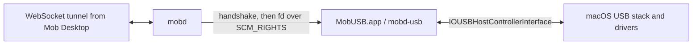

# macOS USB receiver

Status: design, 2026-11-28; not built. Apple granted `com.apple.developer.usb.host-controller-interface`
to team 69GK3C9666 on 2026-11-28 ([runbook](apple-usb-entitlement.md)). Waiting for the App ID and
development profile: [your steps](apple-usb-entitlement.md#after-approval-your-steps), 1–6.

Part of [USB redirection](usb-redirection.md), which stays the contract (API, sessions, tunnel,
authorization). This document only adds the macOS side of importing.

This document has three parts: [the feature](#part-1-feature), [the decisions](#part-2-decisions)
and [the design](#part-3-design).

## Part 1: Feature

### Problem

USB sharing works when the office computer runs Linux: mobd hands the device's USB/IP socket to the
kernel's virtual host controller (`vhci_hcd`). On a Mac office computer, `GET /usb` says importing
needs Apple's entitlement, and nothing happens. macOS has no USB/IP in the kernel; its supported way
to present a device that is not physically plugged in is a user-space virtual host controller
(`IOUSBHostControllerInterface`), which needs the entitlement Apple has now granted.

### What the feature does

A device shared from Mob Desktop appears on a Mac office computer as if it were plugged in: macOS
enumerates it, its drivers load, and tools (OpenOCD, dfu-util, vendor flashers, `screen` on a serial
port) and the agents there use it unchanged. Stopping the share, a lost connection or revoking the
laptop's pairing unplugs it, as on Linux.

### User stories

- My debug probe is on my laptop; the agent on the office Mac flashes and debugs the board.
- I install or update mobd on a Mac and USB sharing works, with no extra setup and with System
  Integrity Protection on.
- If something is missing (old macOS, a damaged install), Mob says what, as it does for Linux.

### Scope

In: the same device classes as Linux's first delivery: control, bulk and interrupt transfers
(debug probes, DFU, serial boards, then USB drives). Apple Silicon, the macOS versions mobd supports
that have `IOUSBHostControllerInterface` (confirmed in phase 0).

Out: isochronous devices (audio, cameras) and hubs, as on Linux; Intel Macs; exporting from a Mac
(Mob Desktop's side, a separate question); Windows import.

### Platforms

| Repository | Change |
| --- | --- |
| mobd | The receiver helper, the macOS importer, packaging, install and upgrade, readiness |
| mob (Desktop) | None expected: it already shares to any mobd whose `/usb` importer is ready |
| mob-ios, mob-android | None |
| mob-site | The USB page lists Mac office computers and the verified devices, once phase 3 passes |

## Part 2: Decisions

### D1. A separate receiver app bundle, not mobd itself

- **Options:** (a) give the entitlement to mobd; (b) a separate app bundle that only does the import;
  (c) put the receiver in Mob Desktop.
- **Choice:** (b), `MobUSB.app`, bundle ID `com.xrdavies.mobd.usb`.
- **Reason:** a restricted entitlement needs a provisioning profile, and only a bundle can carry one;
  mobd is a bare program. A small bundle keeps the entitled code small and leaves mobd's signing,
  install and macOS permissions (Screen Recording, Accessibility) as they are. Desktop is wrong for
  (c): the receiving computer is the office computer, which may not run Desktop.

### D2. Written in Go, sharing mobd's USB/IP code

- **Options:** Swift/Objective-C helper; Go with cgo for the macOS framework; adopt `usbip-macos`.
- **Choice:** a small Go program, `cmd/mobd-usb`, using `internal/usbip` and cgo for IOKit.
- **Reason:** the USB/IP side (import handshake, URB framing, unlink) already exists and is tested
  in Go; the macOS part is a thin layer over the controller interface. `usbip-macos` is the
  reference to read, not a dependency (license and maintenance to be checked if any code is reused).

### D3. mobd does the handshake; the receiver gets a ready socket

- **Choice:** as on Linux, mobd performs `OP_REQ_IMPORT` for the one selected bus ID and checks the
  reply, then passes the connected socket to the receiver over a Unix socket (`SCM_RIGHTS`). The
  receiver never opens network connections and never sees another device.
- **Reason:** keeps the authorization checks (one device, one session) in one place, and the
  `Importer` interface (`Attach(fd, device)`) unchanged.

### D4. One receiver process, started by mobd when needed

- **Options:** a launchd service of its own; a process per device; one process started by mobd.
- **Choice:** mobd starts `MobUSB.app/Contents/MacOS/mobd-usb` as a child on the first `Attach` and
  keeps it while any device is attached; it exits a minute after the last detach. One virtual
  controller per device, so a misbehaving device can be removed alone.
- **Reason:** nothing runs when nothing is shared, no extra launchd item to install or remove, and
  the receiver dies with mobd, which unplugs everything, as the contract requires. Whether a child of
  mobd's login agent may use the interface, and without root, is checked in phase 0; if root turns
  out to be needed, the fallback is a privileged helper like Linux's (`sudo mobd usb setup`).

### D5. Shipped inside mobd's release, installed next to it

- **Options:** a separate download; inside Mob Desktop; inside mobd's macOS archive.
- **Choice:** the macOS archive contains `MobUSB.app`; `install.sh` and `mobd upgrade` install it at
  `~/.local/lib/mobd/MobUSB.app` (next to `--install-dir`) and replace it with mobd, as one version.
  mobd looks for it there.
- **Reason:** mobd and the receiver speak a private protocol and must match. One install and one
  upgrade path; Linux archives are unchanged.

### D6. Signing: Developer ID profile in releases, development profile for testing

- **Choice:** releases embed the Developer ID profile (GitHub secret `MOBD_USB_PROFILE_BASE64`) and
  sign the bundle with the Developer ID Application identity, hardened runtime, the one entitlement;
  the bundle is notarized like mobd. `install.sh` checks its signature (identifier
  `com.xrdavies.mobd.usb`, team `69GK3C9666`) before installing. Development builds use the Mac
  Development profile and an Apple Development certificate on registered Macs (`make usb-helper`).
- **Reason:** Apple's model for restricted entitlements; no SIP changes on any Mac, including
  test Macs, once the development profile exists ([macos-usb-development.md](macos-usb-development.md)
  becomes unnecessary).

### D7. Readiness says exactly what is missing

`GET /usb` and `mobd usb status` report backend `iousbhost` and ready only when: macOS has the
interface, `MobUSB.app` is installed and its signature is valid, and the receiver starts. Otherwise
the detail names the fix (update macOS; reinstall mobd). Nothing for the user to approve is expected;
phase 0 confirms whether macOS asks for anything.

## Part 3: Design

### Components

| Piece | Where | Does |
| --- | --- | --- |
| `importer_darwin.go` | `internal/usb` | Implements `Importer`: starts the receiver, sends sockets, detaches, readiness, `Busy` (mounted volumes via `diskutil`) |
| `cmd/mobd-usb` | new | The receiver: a control socket from mobd, one virtual controller per device, URB translation |
| `internal/usbip` | existing | Import handshake (mobd), URB framing and unlink (receiver) |
| Bundle | build | `MobUSB.app/Contents/{Info.plist, MacOS/mobd-usb, embedded.provisionprofile}` |

### mobd ⇄ receiver protocol

A Unix socket pair created by mobd when it starts the receiver (inherited as fd 3); nothing on disk,
so no other process can connect. Messages are small JSON lines plus passed fds:

- `attach {port, device}` with the socket fd → `attached {port, locationId}` or `error {port, reason}`
- `detach {port}` → `detached {port}`
- `event {port, state, reason}` when the receiver loses a device (socket closed, device error).

mobd keeps ports and session state as today; the receiver only owns controllers. If the receiver
crashes, every device is gone (its controllers die with it); mobd marks those sessions failed.

### Receiver: USB/IP to the virtual controller

For each device the receiver creates one controller with one port, reports the device connected at
its speed, then serves the controller's commands: port status and reset, enable/disable endpoints,
and transfers. Each transfer becomes a USB/IP `CMD_SUBMIT` with a sequence number; the matching
`RET_SUBMIT` completes it. Aborts become `CMD_UNLINK`. Endpoint halt and clear-halt, set
configuration and set interface are control transfers forwarded as they are. Pending transfers are
bounded per device; a closed socket fails them and disconnects the port. The exact command set and
its threading model come from the framework's headers and `usbip-macos`, checked in phase 0.

### Packaging, install, upgrade, removal

- **Release CI (macOS job):** build `mobd-usb` (cgo, arm64), assemble the bundle, decode the profile
  secret into `embedded.provisionprofile`, sign with `--options runtime --entitlements usb.entitlements`,
  notarize together with mobd, add `MobUSB.app` to `mobd_<version>_darwin_arm64.tar.gz`. The job fails
  if the secret is missing, so a release never ships without the receiver by accident.
- **install.sh:** verifies the bundle's signature (requirement on identifier and team, like mobd),
  installs it to `<install-dir>/../lib/mobd/MobUSB.app` atomically (stage, then rename).
- **mobd upgrade:** replaces mobd and the bundle together; rolls back both if the new mobd fails.
- **Removal:** `mobd uninstall` (and the docs' manual steps) delete the bundle too.
- **Archives without the bundle** (old releases, dev builds): readiness says the receiver is not
  installed.

### Development

`make usb-helper SIGN_IDENTITY="Apple Development: …" USB_PROFILE=~/Projects/mob-project/profiles/Mob_USB_Development.provisionprofile`
builds `bin/MobUSB.app`; `MOBD_USB_RECEIVER` points mobd at it. Tests: unit tests for the protocol and
URB translation against a fake controller (any OS); an opt-in end-to-end test on a registered Mac,
like Linux's `TestEndToEndThroughTheHelper`, using the same emulated device (`1209:0001` bulk loopback).

### Phases

0. **Spike (needs your steps 1–6):** on M4002 with the development profile, a minimal receiver that
   creates a controller and enumerates the emulated device. Answers: minimum macOS version; root or
   not; whether a child of mobd's login agent may use the interface; any user approval; one
   controller per device. Results go in [Feasibility results](usb-redirection.md#feasibility-results)
   and may change D4 or D7.
1. **Receiver and importer:** `cmd/mobd-usb`, `importer_darwin.go`, `make usb-helper`, tests; the
   emulated device moves data both ways through the API, as on Linux.
2. **Release (needs your steps 7–8):** CI signing and notarization, archive, `install.sh`, `mobd
   upgrade`, removal; then a clean Mac with SIP on installs a release and imports the emulated device.
3. **Real devices:** a serial board, a debug probe flash and verify, a DFU transition, then a USB
   drive with checksums and safe unmount (acceptance list in [USB redirection](usb-redirection.md#milestones-and-acceptance)).
   Then the site's USB page and support matrix.

### Open questions (answered in phase 0)

- Minimum macOS version with `IOUSBHostControllerInterface`, and whether mobd's macOS 13+ floor
  needs a USB-specific minimum.
- Whether attaching needs root or any approval prompt.
- Whether running the bundle's executable directly (not through `open`) is accepted with its
  embedded profile when started by a launchd agent.
- Speeds supported (high speed is enough for the first devices; super speed later).
