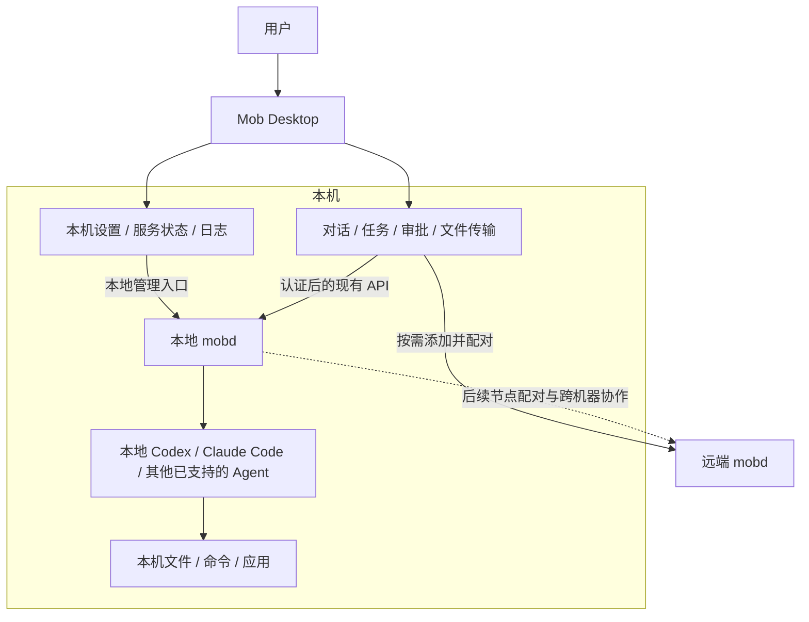
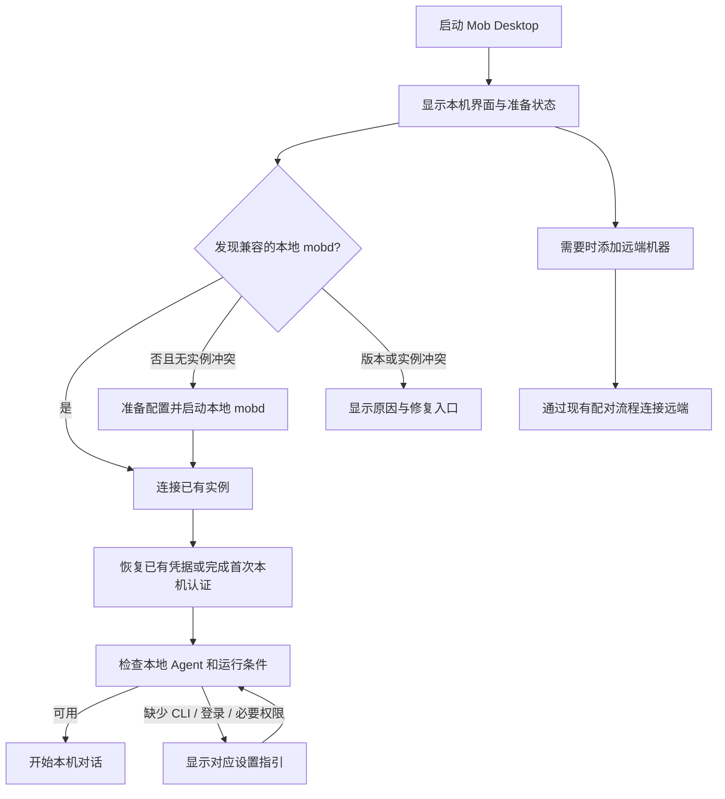

# Mob Desktop 本地 mobd 方案

状态：设计提案，2026-11-10。本文记录已确认的产品方向和建议的实现边界，
不表示 Mob Desktop 已支持自动安装、启动或配置本地 mobd。

## 产品定位与已确认的方向

**Mob Desktop 默认提供本机 Agent 工作环境，并允许用户按需添加远端机器。**
Desktop 负责交互和本地 mobd 的配置、生命周期管理；mobd 负责运行 Agent 和管理任务。
用户可以通过同一套对话界面，让 Agent 使用所在机器的文件、命令和应用完成工作。

- 首次启动默认启用本地 mobd，直接进入本机界面，不要求选择本地模式或远程模式。
- 本地 Agent 使用本机安装的 Codex、Claude Code 等 CLI，以及对应的本地账号环境。
- 需要远端环境时，通过“添加远端机器”接入，再从机器列表切换。
- Desktop 提供本地 mobd 的配置入口，不要求用户手动启动服务、填写本机地址或复制本机配对链接。
- 产品围绕通用 Agent 工作方式展开，不引入传统 IDE 的编辑器、项目树、集成终端或 Git 面板。
- 文件交互先复用现有 [file transfer](file-transfers.md)；文件阅读和预览能力后续按需要增加。

“默认启用本机”表示打开 Desktop 时准备好本地服务。开机自启动、退出 Desktop
后服务是否继续运行，以及允许其他设备访问本机，是独立的生命周期或共享设置。

## 整体结构



本地和远端复用现有会话、任务、SSE、审批和文件传输协议。Desktop 原生层增加本地
服务管理能力；不在 Rust 或前端重新实现 Go 中已有的 runner、调度器和协作状态机。

| 组件 | 职责 |
| --- | --- |
| Desktop 界面 | 机器列表、对话、任务状态、用户审批、本机设置和错误提示 |
| Desktop 原生层 | 发现本机实例、准备兼容的 mobd、调用本地管理入口、保存客户端凭据 |
| 本地 mobd | 会话与任务的权威状态、runner、调度、权限、文件传输和 Agent 协作 |
| 本地 Agent CLI | 使用本机账号和执行环境完成任务，按 mobd 的 runner 协议返回事件 |
| 远端 mobd | 管理远端机器上的任务、文件、Agent 和权限 |

## 首次启动与日常使用



首次准备在本机界面内完成，状态应区分“正在准备”“服务不可用”“Agent 未安装”
和“需要登录或授权”。本地启动失败不妨碍用户添加或使用远端机器。
检测到可用 Agent 后即可开始工作，用户可以在设置中更改默认 Agent 和工作目录。
安装 Agent、登录账号和系统授权仍遵循各自的正常流程。

建议的机器列表：

```text
机器
  ● 本机
  ● 办公室 Mac
  ○ Linux 服务器（离线）

  ＋ 添加远端机器
```

首次启动选中本机；后续启动恢复上次选中的机器和会话，同时准备本地服务。
如果上次的远端机器离线，显示离线状态，不把任务自动改到本机执行。
会话始终属于创建它的 mobd；切换机器只改变查看或新建会话的位置，不迁移已有任务。
恢复界面时以 mobd 的实际状态为准，不自动重放已经中断的任务。

## 本机配置范围

| 配置区域 | 第一版提供的能力 | 配置归属与生效方式 |
| --- | --- | --- |
| 服务 | 查看状态、启动、停止、重启、查看版本和日志 | 复用 mobd 服务管理；停止或重启前说明受影响任务 |
| Agent | 检测 CLI 路径及可用状态，提示安装或登录问题，配置启用的 runner | 可执行文件和 runner 配置由 mobd 管理；登录交给对应 CLI |
| Agent 默认设置 | 默认 Agent、模型、推理强度及现有权限选项 | 复用现有 settings API；按现有会话和任务语义生效 |
| 工作环境 | 查看和修改工作目录、CLI 路径及必要环境设置 | 复用 mobd 配置和服务启动环境，标明需要重启的变更 |
| 本地连接 | 自动连接、认证状态和连接诊断 | 复用客户端凭据及系统安全存储 |
| 运行条件 | 缺少依赖、系统权限、配置错误和版本不兼容的提示 | 使用 mobd 的健康检查、权限状态和服务日志 |

配置仍以 mobd 的配置文件、settings 和实际服务启动参数为准。Desktop 不维护另一套
独立的执行配置；界面可以有未保存的编辑草稿。保存时验证输入并保留无关配置，
显示环境变量或启动参数覆盖后的实际生效值。

运行时 settings 按现有协议更新。启动配置变更需要显式重启；保存不能悄悄中断任务。
当前服务会保存启动快照，修改配置文件后必须经过正常重启流程才能更新实际服务配置。

第一版保留现有 mobd 的工作目录模型：`workdir` 以及已有的 `claudeWorkdir` 覆盖。
不新增必需的 project、workspace 或 worktree 实体，也不把目录改成会话级配置。
界面需要明确目录影响范围；改变目录前提示对后续执行和恢复会话的影响。

## 实现建议：复用已有能力

### 发现、启动与安装

当前 mobd 已有 `start`、`stop`、`restart`、`status` 和 `logs`，底层为
[`internal/service`](../internal/service/service.go) 的用户级服务管理。
优先复用这套能力，Desktop 只提供受约束的原生调用入口。需要机器可读结果时，
补齐相应管理命令或接口，避免依赖面向人的终端输出格式。

启动前检查本地管理入口、已有服务配置和版本兼容性。发现兼容实例时复用它，
保留已有 serverId、会话、凭据和配置；不要因为打开 Desktop 就生成第二个实例。
发现前台运行、自定义安装或不兼容版本时，明确显示实例来源和修复选项，
不自动结束进程、覆盖二进制或改写用户已有的服务定义。
继续使用 mobd 的状态与 socket 锁来保证单实例写入，不能只依赖启动前检查。

建议由 Desktop 的发行包提供经验证的兼容 mobd，避免首次使用还需终端安装。
二进制放置位置、签名、平台依赖和升级方式需要实现前验证；后台服务引用的路径必须稳定。
应用更新不能直接替换仍被活动任务使用的 mobd，更新也不能重置数据或认证。

### 自动建立本机认证

本机仍使用独立客户端凭据，不能因为请求来自 localhost 就绕过认证。
首次连接由 Desktop 原生层通过当前用户的私有管理入口创建短期、单次邀请，
再使用现有配对协议兑换并将凭据保存到系统安全存储，过程不需要用户传递链接。
邀请和凭据不进入日志、命令行参数或普通前端持久化存储。

后续启动复用已有凭据。401 或凭据被撤销时展示“需要重新连接”，由用户操作恢复，
不能自动反复创建邀请来绕过撤销。正常重启不生成新的 serverId，也不重置认证。
协议和邀请生命周期沿用[客户端配对与认证](pairing.md)。

### 本地环境与网络边界

图形界面启动的环境不一定等同于用户终端。配置应明确工作目录和可执行文件路径，
检查 CLI 及其所需运行环境，避免依赖应用包目录或碰巧继承的 PATH。
使用 Agent 已有的本地登录方式，不另建模型账号系统，也不把本地凭据上传到远端。
“使用本地 Agent”不承诺加载用户终端中的所有插件和设置，仍遵循现有 runner 约束，
例如 Claude 的 settings sources 和 MCP 配置规则，见 [runners](runners.md)。

对于新建的本地实例，默认只提供本机访问，不自动启用远程入口或 relay。
现有独立安装的 mobd 默认监听所有接口，不能直接套用该默认值，也不能静默修改已有部署。
实现时需核对 HTTP 和实时桌面媒体的所有监听入口：当前 WebRTC UDP 监听独立于 HTTP，
`streamPort: 0` 只是使用随机端口，并不表示禁用或仅监听本机。

系统权限继续通过操作系统授权，Desktop 展示必要的状态和指引。当前 macOS 首次启动
权限流程含终端交互，需要接入图形界面；不能直接依赖终端提示，也不能代替用户授予权限。
本地 Agent 按当前用户及 runner 的实际权限访问文件和应用，不把工作目录当作隔离沙箱。

## 生命周期建议

以下是建议行为，具体退出选项和平台实现仍需验证：

| 动作或状态 | 建议行为 |
| --- | --- |
| 打开 Desktop | 发现并连接本地实例，必要时启动；不重复创建服务 |
| 关闭窗口 | 任务继续运行，再次打开恢复真实任务状态 |
| 退出 Desktop | 有活动任务时说明影响，让用户选择保留后台服务或停止任务并退出 |
| 手动停止或重启服务 | 明确显示受影响任务，等待用户处理；停止后不在当前应用会话中立即自动拉起 |
| Desktop 崩溃 | 尽量依靠现有独立后台服务保留任务；恢复连接后查询状态 |
| mobd 崩溃或升级 | 保留数据并显示实际恢复状态，不自动重新执行中断任务 |
| 已有用户自行管理的实例 | 保持其生命周期；退出 Desktop 不擅自停止该实例 |
| 开机或登录自启动 | 与打开 Desktop 时启用本机分开，第一版不默认开启 |

Windows、Linux 和 macOS 的服务、依赖与授权条件不同；本方案不代表各平台已经具备
相同的本地启动能力。第一批支持的平台和退出后的默认行为应在实现前确定并验证。

## 与远端机器、跨机器协作的关系

“添加远端机器”复用现有客户端配对能力，让一个 Desktop 操作多个 mobd。
这一步不会自动建立本地 mobd 与远端 mobd 之间的信任，也不会自动共享 Agent。

Agent 之间的跨机器协作遵循独立的[跨机器协作方案](agent-cross-machine-collaboration.md)：
用户在对话中提出需求，由各节点的 Agent 配置 mobd；节点邀请必须有时效且只能使用一次。
本地 mobd 将来可以作为其中一个节点，其身份、共享范围、审批和网络可达性仍按该方案处理。

本地功能可以先独立交付，不依赖 federation、relay 或团队账号系统完成。

## 实施范围与验收

| 仓库 | 必要改动范围 |
| --- | --- |
| `mob` | 首次启动与本机机器项、本地服务的原生管理入口、本机设置与诊断、发行包中的 mobd 管理 |
| `mobd` | 补齐 GUI 所需的管理结果、配置验证与生效反馈、权限衔接和本地监听策略；复用现有服务与 runner |
| 两端联调 | 版本兼容、首次认证、启动失败恢复、升级与退出行为、现有远端连接回归 |

第一版验收应覆盖：

1. 新用户打开 Desktop，默认看到本机并自动准备服务，没有本地/远端模式选择页。
2. 已安装并登录的本地 Agent 能执行任务；缺少条件时展示准确指引，远端入口仍可使用。
3. 对话、进度、审批和文件传输复用现有流程，无需 IDE 或项目实体。
4. 本机设置能读到实际配置；保存、验证失败和需要重启的状态明确，不丢失其他配置。
5. 关闭再打开界面后恢复会话与实际任务状态；中断任务不会被自动重放。
6. 已有实例、端口冲突、不兼容版本和并发启动不会造成双进程写同一份数据或覆盖现有安装。
7. 本机连接有认证，邀请遵循有效期和单次兑换规则，撤销后不会自动绕过；新建实例没有意外对外监听。
8. 添加远端机器后两类机器使用同一工作流程；切换机器不迁移任务或改变执行位置。

实现前需要验证的具体问题：发行包如何携带并稳定更新 mobd、各平台的支持范围、
新实例的初始工作目录、CLI 环境发现、系统权限衔接，以及退出应用后的默认服务行为。
这些问题不改变“本机默认启用、远端按需添加、以 Agent 对话为中心”的产品方向。
