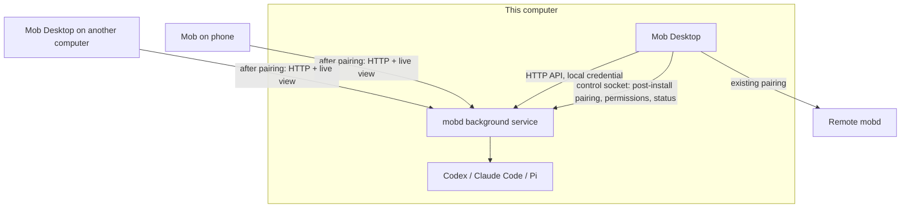

# Mob Desktop local mobd

Status: design settled 2026-11-12; not implemented yet.

## Problem and goal

Mob Desktop can only connect to remote machines today. Most users want agents to work not only on a remote
computer but also on the one in front of them; today that means installing mobd in a terminal and then
pairing Desktop with its own computer by hand.

**Goal: after installing Mob Desktop, this computer has a working mobd.**

- Desktop opens on "This computer" by default: chat with local agents and manage the local mobd directly.
- The same mobd also serves phones and Desktops on other computers: once paired, they use this computer from anywhere.
- The user is sitting at this computer, so the local Desktop does not show live view or control for it; paired
  phones and other Desktops keep both.
- Remote machines are added as today; one Desktop works with this computer and several remote machines.

## Solution

**Desktop is a graphical installer and manager for the standard mobd; it neither bundles nor creates its own mobd.**
Each computer has one mobd, identical to a terminal install: `~/.local/bin/mobd`, `~/.mobd`, and the LaunchAgent
labelled `com.xrdavies.mobd` (a systemd user service on Linux).

### 1. Install

Desktop first looks for a local mobd: the control socket (`~/.mobd/run/control.sock`) answers, or
`~/.local/bin/mobd` exists, or `mobd` is on PATH.

- **Installed**: use it as is; do not change its configuration, listen address or login startup.
- **Not installed**: show "Set up this computer". Desktop's native layer (Rust) performs the same steps as
  `install.sh`, then runs `mobd init` and `mobd start --login`.

Desktop repeats the install steps in Rust rather than running `curl | sh` or a bundled script: it does not depend
on shell output, progress and errors can be shown as structured results, and the script cannot change without
Desktop knowing. The steps match [`.github/release/install.sh`](../.github/release/install.sh):

1. Refuse root; check the platform (macOS 13+ on Apple Silicon; Linux x86_64 / arm64).
2. If mobd is running, stop the installation (installing is only for first installs and upgrades; see section 6).
3. Download `<download base>/mobd/latest.json` for the version, then `v<version>/release.json`; check the version
   and take this platform's `sha256`.
4. Download `mobd_<version>_<platform>.tar.gz` and verify its SHA-256; the archive may contain only the regular
   files `LICENSE`, `README.md` and `mobd`.
5. macOS: `codesign --verify --strict` against the same requirement as the script (identifier `com.xrdavies.mobd`,
   fixed Team ID, Developer ID). The download base and Team ID are fixed when Desktop is built, using the same
   values as the release script.
6. `mobd --version` must equal the target version; write to a temporary file inside `~/.local/bin` first, then
   atomically rename it to `mobd`.

The format of `latest.json` / `release.json` is the shared contract between `install.sh` and Desktop. The mob
repository adds a test that checks Desktop's parsing against the real manifest format, so the two installers
cannot drift apart.

**Environment**: Desktop launched from Finder has a PATH of system directories only and cannot find CLIs installed
with Homebrew, npm or in `~/.local/bin`. Desktop reads the PATH once from the login shell (`$SHELL -lc`, with a
timeout) and uses it to run `mobd init` and `mobd start`; mobd's `start` resolves the CLIs to absolute paths and
writes them into the service definition. The settings page shows the paths found and allows editing them.

**Default configuration**: keep the official `mobd init` defaults, including `listen: 0.0.0.0:8080`, so a Desktop
install behaves like a terminal install and pairing a phone needs no further configuration. Every request still
needs a pairing credential. The working directory should default to `~/Mob` (to be confirmed during
implementation), because the Desktop process's current directory is not a meaningful working directory.

### 2. Desktop connects to this computer

Desktop creates an invitation through the control socket (`POST /invitations`, address
`http://127.0.0.1:<port>`), redeems it with the existing `POST /pair`, and stores the credential in the system's
secure storage. The user never sees the invitation; localhost is not exempt from authentication.

- Invitations and credentials are never written to logs, command-line arguments or frontend persistent storage.
- On 401 or a revoked credential, show "Reconnect this computer"; a new invitation is created only after the user
  clicks it. No automatic repeated pairing.
- This computer is identified by `serverId`. If the list already has a machine with the same `serverId` (paired
  earlier by its LAN address), merge it into "This computer" instead of listing it twice.

### 3. Working on this computer

"This computer" is first in the machine list, selected on first launch; later launches restore the last selection.
Chats, tasks, approvals, agent collaboration and settings work the same as for remote machines.

This computer hides live view, control and USB redirection; the Files entry can open the shared folder directly.
This is decided by "this machine is the local one", not by the `/health` features, because the same mobd still
offers those features to phones.

### 4. Pairing other devices

"Pair a device" shows the QR code and link, the same as `mobd link` (control socket `POST /invitations`, with the
address from `mobd remote` or the LAN address). Once paired, phones and other Desktops have the full feature set,
including live view and control. The settings page lists paired devices and can revoke them (`/clients`).

### 5. Agents using the screen, and the indicator

Local agents' screen tools (`screenshot`, `click`, `type_text`, `key`, `open_app` and so on) are on by default, as
on remote machines, so phones and agents behave the same on every machine.

The user may be using this computer, so **Desktop shows an indicator while an agent uses the screen** (for example
a title bar or menu bar icon, "Agent is using the screen", naming the conversation), so the mouse moving on its own
is not a surprise. The indicator needs mobd to send events while screen tools run (see "mobd changes"). The same
indicator shows while a phone is controlling this computer.

### 6. Management and upgrades

Local settings page:

| Area | Capabilities | Implementation |
| --- | --- | --- |
| Service | Status, version, start, stop, restart, logs, login startup | `mobd start/stop/restart/logs`; status per "mobd changes" |
| Agents | Detected CLI paths, availability, enabled runners | `/health` runners and checks; paths written to `config.json`, then restart |
| Defaults | Default agent, model, reasoning effort, permission options | Existing `GET/PUT /settings` |
| Working directory | View and change `workdir` / `claudeWorkdir` | `config.json` + restart |
| System permissions (macOS) | Status of and requests for Accessibility, Screen Recording and others | Control socket `GET /permissions`, `POST /permissions/{name}`; Screen Recording needs a mobd restart after granting |
| Devices | Paired devices, revoke, pair a new device | Control socket `/clients`, `/invitations` |

Edits to `config.json` keep unrelated fields; changes that need a restart are marked, and before restarting Desktop
explains which running tasks are affected. Quitting Desktop does not stop mobd, so phones can still use this
computer.

**Upgrades**: Desktop checks `latest.json` and offers new versions. When no tasks are running it follows the
official steps: `mobd stop` → the install steps in section 1 → `mobd start` (with `--login` if login startup was
on). Configuration, conversations and attachments are kept. The macOS binary path and signing identifier do not
change, so system permissions survive the upgrade. Desktop and mobd are released independently; compatibility is
decided by `apiVersion` and features on `/health`, and Desktop asks for an upgrade when mobd is too old.

## Platforms

1. **macOS (Apple Silicon, 13+)**: first version.
2. **Linux**: the same install steps; agents work directly. Live view from a phone needs Xvfb, GStreamer and the
   other packages the `.deb` brings, which need sudo, so Desktop shows the `apt install` command instead of running
   it. Linux live view shows each conversation's virtual desktop, not the user's screen.
3. **Windows**: after mobd has an installer and service management.

## Changes by repository

**mobd**

- Control socket `GET /health` adds `serverId`, `version`, the executable path and login startup state; or add
  `mobd status --json`. Desktop uses them to recognise an installed instance, match machines and show service
  status.
- Agent screen tools send events when they start and finish (`/events`, with the session ID) for Desktop's
  indicator; the same when a phone controls this computer.
- Bind the live view UDP port to the same address as `listen` instead of all interfaces.
- Keep the terminal walkthrough in `mobd permissions`; Desktop uses the same capability through the control socket.

**mob (Desktop)**

- Rust installer (section 1) and the manifest format test; reading the login shell PATH.
- First-launch "Set up this computer" flow, automatic local pairing, the "This computer" entry merged by `serverId`.
- Hide live view, control and USB for this computer; the screen-use indicator.
- Local settings page: service, agents, defaults, working directory, permissions, devices; "Pair a device" QR code.
- mobd upgrade prompt and upgrade flow.

## Acceptance

1. A Mac without mobd: open Desktop, finish "Set up this computer", and chat with a local agent without opening a
   terminal.
2. mobd already installed (from a terminal): Desktop uses it directly, without changing its configuration,
   reinstalling, or showing this computer twice.
3. The installer rejects downloads with a wrong checksum, wrong signature, unexpected archive contents or wrong
   version; it never replaces the binary while mobd is running.
4. Agent CLIs installed with Homebrew / npm are found even when Desktop is launched from Finder.
5. This computer shows no live view, control or USB; a paired phone can view and control it.
6. Desktop shows the indicator while an agent or a phone operates this computer's screen.
7. After quitting Desktop, the phone can still use this computer; likewise after a reboot (login startup).
8. After an upgrade, configuration, conversations, paired devices and macOS system permissions are kept; no upgrade
   while tasks are running.
9. After the local credential is revoked, Desktop shows "Reconnect this computer" and does not re-pair on its own.
10. Adding and using remote machines is unaffected.
