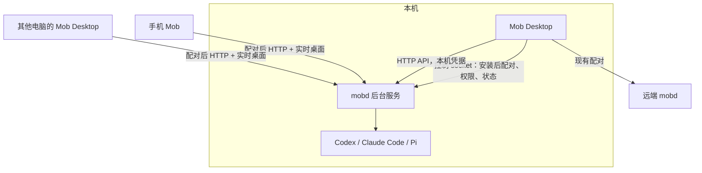

# Mob Desktop 本机 mobd 方案

状态：设计已确定，2026-11-12；尚未实现。

## 问题与目标

Mob Desktop 目前只能连接远端机器。多数用户不只想操作远端电脑，也想让 Agent 在自己面前的这台电脑上工作；
现在这需要在终端安装 mobd，再用 Desktop 手动配对本机。

**目标：安装 Mob Desktop 后，本机就有一个可用的 mobd。**

- Desktop 默认打开“本机”，直接与本机 Agent 对话、管理本机 mobd。
- 同一个 mobd 也服务手机和其他电脑上的 Desktop：配对后从任何地方使用这台电脑。
- 用户坐在本机前，本机 Desktop 不显示本机的实时桌面和控制；配对的手机和其他 Desktop 照常可用。
- 远端机器仍按现有方式添加，一个 Desktop 同时使用本机和多台远端机器。

## 方案

**Desktop 是标准 mobd 的图形安装和管理界面，不内置、不另建 mobd。**
每台电脑只有一个 mobd，与终端安装的完全相同：`~/.local/bin/mobd`、`~/.mobd`、
标签 `com.xrdavies.mobd` 的 LaunchAgent（Linux 为 systemd 用户服务）。

### 1. 安装

Desktop 先找本机 mobd：控制 socket（`~/.mobd/run/control.sock`）有响应，或存在 `~/.local/bin/mobd`，或 PATH 中有 `mobd`。

- **已安装**：直接使用，不改其配置、监听地址或登录自启。
- **未安装**：显示“设置本机”，由 Desktop 原生层（Rust）执行与 `install.sh` 相同的步骤，然后
  `mobd init`、`mobd start --login`。

Desktop 用 Rust 重复安装步骤，而不是运行 `curl | sh` 或内置脚本：不依赖 shell 输出，进度和错误可结构化展示，
脚本内容也不会在 Desktop 不知情时变化。步骤与 [`.github/release/install.sh`](../.github/release/install.sh) 一致：

1. 拒绝 root；检查平台（macOS 13+ Apple Silicon；Linux x86_64 / arm64）。
2. mobd 正在运行则停止安装（安装只用于首次安装和升级，见第 6 节）。
3. 下载 `<下载源>/mobd/latest.json` 取版本，再下载 `v<版本>/release.json`，核对版本，取本平台 `sha256`。
4. 下载 `mobd_<版本>_<平台>.tar.gz`，校验 SHA-256；归档只能含普通文件 `LICENSE`、`README.md`、`mobd`。
5. macOS：`codesign --verify --strict` 校验与脚本相同的签名要求（标识 `com.xrdavies.mobd`、固定 Team ID、
   Developer ID）。下载源和 Team ID 在 Desktop 构建时固定，与发布脚本使用同一值。
6. `mobd --version` 必须等于目标版本；先写入 `~/.local/bin` 内的临时文件，再原子替换为 `mobd`。

`latest.json` / `release.json` 的格式是 `install.sh` 与 Desktop 共同的约定；mob 仓库增加测试，
用真实清单格式检查 Desktop 的解析，避免两个安装器分别演变。

**环境**：从访达启动的 Desktop 的 PATH 只有系统目录，找不到 Homebrew、npm 或 `~/.local/bin` 中的 CLI。
Desktop 以登录 shell 读取一次 PATH（`$SHELL -lc`，带超时），用它运行 `mobd init` 和 `mobd start`；
mobd 的 `start` 会把 CLI 解析为绝对路径并写入服务定义。设置页显示找到的路径，可手动修改。

**默认配置**：沿用 `mobd init` 的官方默认值，包括 `listen: 0.0.0.0:8080`，使 Desktop 安装与终端安装行为一致，
配对手机无需再改配置。所有请求仍需配对凭据。工作目录建议默认 `~/Mob`（实现时确认），
因为 Desktop 进程的当前目录不是有意义的工作目录。

### 2. Desktop 连接本机

Desktop 通过控制 socket 创建邀请（`POST /invitations`，地址 `http://127.0.0.1:<端口>`），
用现有 `POST /pair` 兑换，凭据存入系统安全存储。用户看不到邀请码；localhost 不免认证。

- 邀请和凭据不写入日志、命令行参数或前端持久化存储。
- 401 或凭据被撤销时显示“重新连接本机”，由用户点击后再创建邀请；不自动反复配对。
- 本机用 `serverId` 识别。若列表中已有同一 `serverId` 的机器（以前通过局域网地址配对），合并为“本机”，不重复显示。

### 3. 本机工作

“本机”在机器列表第一项，首次启动默认选中，之后恢复上次选择。对话、任务、审批、Agent 协作、设置与远端相同。

本机隐藏实时桌面、控制和 USB 重定向；文件入口可直接打开共享目录。判断依据是“这台机器是本机”，
而非 `/health` 的 features，因为同一 mobd 对手机仍提供这些功能。

### 4. 配对其他设备

“配对设备”显示二维码和链接，与 `mobd link` 相同（控制 socket 的 `POST /invitations`，地址取 `mobd remote` 或局域网地址）。
手机和其他 Desktop 配对后拥有完整功能，包括实时桌面和控制。设置页列出已配对设备，可撤销（`/clients`）。

### 5. Agent 使用屏幕与提示

本机 Agent 的屏幕工具（`screenshot`、`click`、`type_text`、`key`、`open_app` 等）与远端一样默认开启，
手机和 Agent 在每台机器上行为一致。

用户可能正在使用这台电脑，所以 **Agent 使用屏幕时 Desktop 显示提示**（如标题栏或菜单栏图标“Agent 正在使用屏幕”，
指明哪个对话），避免鼠标突然移动令人意外。提示需要 mobd 在屏幕工具执行时发出事件（见“mobd 改动”）。
手机正在控制本机时也显示同样的提示。

### 6. 管理与升级

本机设置页：

| 区域 | 能力 | 实现 |
| --- | --- | --- |
| 服务 | 状态、版本、启动、停止、重启、日志、登录自启 | `mobd start/stop/restart/logs`，状态见“mobd 改动” |
| Agent | 检测到的 CLI 路径、可用状态、启用的 runner | `/health` 的 runners 与 checks；路径写入 `config.json` 后重启 |
| 默认设置 | 默认 Agent、模型、推理强度、权限选项 | 现有 `GET/PUT /settings` |
| 工作目录 | 查看、修改 `workdir` / `claudeWorkdir` | `config.json` + 重启 |
| 系统权限（macOS） | 辅助功能、屏幕录制等的状态和请求 | 控制 socket `GET /permissions`、`POST /permissions/{name}`；屏幕录制授权后需重启 mobd |
| 设备 | 已配对设备、撤销、配对新设备 | 控制 socket `/clients`、`/invitations` |

修改 `config.json` 时保留无关字段；需要重启才生效的变更标明，重启前说明受影响的运行中任务。
退出 Desktop 不停止 mobd，手机仍可使用这台电脑。

**升级**：Desktop 查询 `latest.json`，有新版本时提示。无运行中任务时按官方步骤：`mobd stop` → 第 1 节安装步骤 →
`mobd start`（原来开启登录自启则加 `--login`）。配置、对话和附件保留。
macOS 二进制路径和签名标识不变，系统权限在升级后保留。Desktop 与 mobd 独立发布，以 `/health` 的 `apiVersion`
和 features 判断兼容；mobd 版本过低时提示升级。

## 平台

1. **macOS（Apple Silicon，13+）**：第一版。
2. **Linux**：安装步骤相同，Agent 可直接使用；手机实时桌面需要 `.deb` 带来的 Xvfb、GStreamer 等，
   安装需要 sudo，Desktop 显示 `apt install` 命令而不代为执行。Linux 的实时桌面是每个对话的虚拟桌面，不是用户屏幕。
3. **Windows**：等 mobd 有安装器和服务管理后再做。

## 各仓库改动

**mobd**

- 控制 socket `GET /health` 增加 `serverId`、`version`、可执行文件路径和登录自启状态；
  或增加 `mobd status --json`。Desktop 据此判断已安装的实例、匹配机器、显示服务状态。
- Agent 屏幕工具开始和结束时发出事件（`/events`，含会话 ID），供 Desktop 显示提示；手机控制本机时同样发出。
- 实时桌面的 UDP 端口绑定到与 `listen` 相同的地址，而不是所有接口。
- `mobd permissions` 的终端引导保留；Desktop 使用控制 socket 的同一能力。

**mob（Desktop）**

- Rust 安装器（第 1 节）与清单格式测试；登录 shell PATH 读取。
- 首次启动“设置本机”流程，本机自动配对，“本机”机器项与 `serverId` 合并。
- 本机隐藏实时桌面、控制和 USB；屏幕使用提示。
- 本机设置页：服务、Agent、默认设置、工作目录、权限、设备；“配对设备”二维码。
- mobd 升级提示与升级流程。

## 验收

1. 未安装 mobd 的 Mac：打开 Desktop，完成“设置本机”后不打开终端即可与本机 Agent 对话。
2. 已安装 mobd（终端安装）：Desktop 直接使用，不改配置、不重复安装、不出现两个本机。
3. 安装器拒绝校验和不符、签名不符、归档内容异常和版本不符的下载；mobd 运行中不替换二进制。
4. 从访达启动时也能找到 Homebrew / npm 安装的 Agent CLI。
5. 本机不显示实时桌面、控制和 USB；配对的手机可查看和控制本机。
6. Agent 或手机操作本机屏幕时，Desktop 显示提示。
7. 退出 Desktop 后手机仍可使用本机；重启电脑后（登录自启）同样可用。
8. 升级后配置、对话、配对设备和 macOS 系统权限保留；有运行中任务时不升级。
9. 本机凭据被撤销后显示“重新连接本机”，不自动重新配对。
10. 远端机器的添加和使用不受影响。
