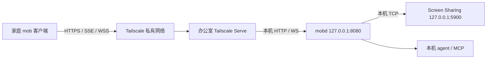

# 从家庭网络连接办公室 mobd

推荐先使用 **Tailscale 私有组网 + Tailscale Serve**。家庭设备和办公室 Mac
加入同一个 tailnet（私有网络），办公室 mobd 保持监听 `127.0.0.1:8080`，
家庭 mob 客户端填写 Serve 提供的 HTTPS 地址。无需办公室公网 IP、路由器端口映射、
自建服务器或修改 mobd 协议。前提是两端可以安装 Tailscale，且办公室允许相关出站连接。

本方案复用当前 mobd，属于部署方案；仓库不内置、安装或管理 Tailscale。
如果已有可用的公司 VPN，优先复用，按现有网络权限访问办公室 mobd 即可。

## 选择依据

| 条件 | 方案 | 需要承担的限制 |
| --- | --- | --- |
| 已有公司 VPN 可以访问办公室 Mac | 现有 VPN + mobd 的私有监听地址 | 由公司网络策略决定可达性 |
| 两端能安装 Tailscale | **首选：Tailscale + Serve** | 依赖 Tailscale 登录、网络服务和访问策略；中继可能影响画面延迟 |
| 不方便安装 VPN，但两端能运行 SSH，且有可信公网服务器 | 下文的 SSH 双向转发 | 自行维护服务器、SSH 密钥与断线重连 |
| 家庭端只能填写公网 URL，不能运行 VPN/SSH | 后续：出站隧道 + 全路径认证入口 | 需要验证并适配 mob 客户端认证，当前不能直接安全上线 |

mobd 已将 HTTP API、SSE 事件流和 `/vnc` WebSocket 中继放在同一个端口。
只需连接这一个入口，`5900` 不需要经过公网转发。远端地址不写入 `vncAddr`
或 `vncViewUrl`；它是家庭 mob 客户端的服务器地址。本地 agent/MCP 继续访问本机 mobd。

当前 `sharedSecret` 只保护写接口，**不保护读取、SSE、截图、附件和 `/vnc`**。
HTTPS 仅加密传输，CORS 仅约束浏览器来源，两者均不能代替身份认证。
不要直接将 mobd 端口发布到公网，也不要用 Tailscale Funnel 发布它。
完整边界见 [security](security.md)。

## 首选：Tailscale + Serve



Tailscale 尝试建立点对点连接；无法直连时可通过加密中继连接。
因此通常不需要办公室入站端口，但仍需要办公室网络放行 Tailscale 的协调和中继服务；
UDP 不通可能退回中继，出站服务被阻断则无法连接。
参见官方 [连接类型](https://tailscale.com/docs/reference/connection-types)
和 [防火墙要求](https://tailscale.com/docs/reference/faq/firewall-ports)。

### 1. 两端加入私有网络

在两端安装并登录 [Tailscale](https://tailscale.com/download)，确认设备属于同一 tailnet。
办公室 Mac 需要保持开机、联网和用户登录；mobd 的 LaunchAgent 及桌面操作依赖该用户会话。
配置电源设置，避免无人值守时自动睡眠导致失联。

macOS 安装 GUI 客户端后，如果终端没有 `tailscale` 命令，按官方
[CLI 设置](https://tailscale.com/docs/reference/tailscale-cli?tab=macos)
安装 CLI integration，或在当前终端使用：

```bash
alias tailscale='/Applications/Tailscale.app/Contents/MacOS/Tailscale'
tailscale status
```

### 2. 先限制访问范围

Serve 也受 tailnet 访问策略约束。将访问限定到需要使用 mobd 的可信家庭设备和办公室
Mac 的 TCP 443；能访问此入口的设备可读取所有会话，并在未设置 `sharedSecret`
时提交 agent 任务。mobd 不根据 Tailscale 身份头隔离用户数据。

以下是**专用两机 tailnet 的完整最小策略示例**，在 Tailscale 管理控制台的访问控制中配置。
将示例 IP 替换为两台设备的真实 Tailscale IPv4 地址（分别运行 `tailscale ip -4` 获取）：

```json
{
  "grants": [
    {
      "src": ["100.101.102.103"],
      "dst": ["100.101.102.104"],
      "ip": ["tcp:443"]
    }
  ]
}
```

规则是累加放行：**仅添加这条规则不会收紧已有的 allow-all 规则**。
专用 tailnet 应替换默认全放行策略；共享 tailnet 应由管理员调整覆盖该办公室机器的
宽泛规则，并保留其他业务所需访问，不能直接覆盖整份策略。
设备重新注册导致地址变化时需同步更新。
参见官方 [grants 语法](https://tailscale.com/docs/reference/syntax/grants)
和 [默认访问策略](https://tailscale.com/docs/reference/examples/acls)。

### 3. 办公室启动 mobd

按 [安装说明](../README.md#install--run-office-mac) 初始化、设置 runner 和 macOS 权限。
编辑现有 `~/.mobd/config.json` 中以下两项，保留工作目录、runner 等其他配置：

```json
{
  "listen": "127.0.0.1:8080",
  "vncAddr": "127.0.0.1:5900"
}
```

首次启动运行 `mobd start`；已启动则在当前任务结束后运行 `mobd restart`。
配置使用自定义文件时继续指定该文件。随后检查：

```bash
mobd status
curl -fsS http://127.0.0.1:8080/health
```

`status` 应显示 `listen=127.0.0.1:8080`；`/health` 的 `ok: true` 只说明 API 可用，
还需检查 `checks` 和 `runners`。如果监听地址不符，检查 `MOBD_LISTEN` 和启动参数：
环境变量、命令行可覆盖 JSON，无参数的 `restart` 会复用已保存的启动参数。
移除旧覆盖后，使用明确的 `--config` 和 `--listen 127.0.0.1:8080` 重启。

### 4. 办公室启用私有 HTTPS 入口

先查看现有 Serve 配置，确认本机 HTTPS 443 根路径未被其他服务占用，再运行：

```bash
tailscale serve status
tailscale serve --bg --https=443 http://127.0.0.1:8080
tailscale serve status
```

首次使用按 CLI 提示启用 tailnet HTTPS 证书。复制实际输出的完整地址，例如
`https://office-mac.example-tailnet.ts.net`，不要改成办公室局域网 IP，
也不要在这个地址后追加 `:8080` 或路径前缀。
确认输出为 **Available within your tailnet**，并检查 `tailscale funnel status`
没有将该入口公开。若已有其他 Serve 服务，先安排独立入口，不要覆盖其配置。

Serve 在办公室终止 HTTPS，再代理到本机 HTTP；API、SSE 和 `/vnc` 使用同一个根路径入口。
`--bg` 保存后台服务配置，Tailscale 重启后可恢复，但不会替你启动 mobd。
mobd 需要登录后自启时使用 `mobd start --login`；已在运行则用 `mobd restart --login`。
Tailscale 也必须保持连接。参见官方 [Serve 命令](https://tailscale.com/docs/reference/tailscale-cli/serve)。

### 5. 家庭端连接和验收

在家庭网络中保持 Tailscale 已连接，使用步骤 4 的实际 URL：

```bash
MOBD_REMOTE_URL='https://office-mac.example-tailnet.ts.net'
curl -fsS --connect-timeout 10 "$MOBD_REMOTE_URL/health"
curl -iN --max-time 20 "$MOBD_REMOTE_URL/events"
```

事件流应返回 `200`、`Content-Type: text/event-stream`，空闲约 15 秒出现 `: ping`。
第二条命令在 20 秒主动结束，curl 返回超时退出码 28 是预期行为；不能只有响应头而无心跳。

在 mob 客户端填写同一 HTTPS URL。客户端的 VNC 地址应派生为
`wss://office-mac.example-tailnet.ts.net/vnc`，Screen Sharing 的登录凭据仍然单独验证。
默认 `corsOrigins` 已包含 mob 桌面客户端的常见来源；自定义 Web 客户端需添加自己的精确
Origin（协议、主机、端口），并保留仍在使用的其他来源。不能用放开 CORS 代替网络授权。

实际验收必须覆盖：

- 在家庭网络提交一个无破坏性任务，事件实时到达，审批/回答（若启用）可以继续任务。
- 读取会话、上传图片、打开截图或附件；有 `sharedSecret` 时写请求仍需携带密钥。
- 打开 VNC 预览，确认画面持续更新且默认不发送键鼠输入。
- 关闭家庭端 Tailscale 后，新请求无法到达；另一个没有获准的 tailnet 设备也不能访问。
- 在无任务运行时重启 mobd、断开并重连 Tailscale，确认重新连接后可继续读取会话和查看画面。

桌面权限和 runner 的完整检查见 [office smoke checklist](office-smoke-checklist.md)。
本指南的命令依据官方文档和 mobd 接口核对；真实跨网可达性、证书、访问策略和画面性能
必须在两端设备上验收，仓库测试不能替代这些检查。

### 排查与关闭

| 现象 | 检查 |
| --- | --- |
| 办公室本机 `/health` 不通 | `mobd status`、`mobd logs`、监听地址及配置覆盖 |
| 本机正常，家庭端超时 | 两端 `tailscale status`、办公室在线状态、DNS、TCP 443 访问规则及公司出站限制 |
| HTTPS 证书失败 | 使用 Serve 输出的完整域名，检查 HTTPS 是否启用和系统时间；不要跳过证书验证 |
| HTTP 502 | 检查 Serve 的本机目标、mobd 是否运行及端口是否一致 |
| API 正常，VNC 403/502 | 403 检查客户端 Origin；502 检查办公室 Screen Sharing 和 `vncAddr` |
| 画面延迟大 | 从家庭端 `tailscale ping office-mac` 并查看 `tailscale status`；`relay` 表示 DERP 中继，测实际带宽后再决定是否部署更近的中继 |
| SSE 没有心跳或更新 | 确认请求到达 mobd；额外代理必须关闭流缓冲和缓存，允许长连接 |

关闭本指南的 Serve 入口，在办公室执行：

```bash
tailscale serve --https=443 off
```

这会停止该 HTTPS 端口上的服务；共享该端口时需先检查影响。它不停止 mobd。
不要使用 `tailscale serve reset` 清除同机其他服务。移除家庭设备的授权时也要更新访问策略。

## 备选：可信公网跳板机 + SSH

两端均能出站 SSH 到同一台可信服务器时，可以保留相同的 loopback mobd 配置。
服务器必须允许 TCP forwarding，`GatewayPorts no` 保证反向端口只绑定服务器本机。
使用专用账号、密钥认证，并核验服务器主机密钥。

办公室运行（替换服务器地址和账号）：

```bash
ssh -NT -o ExitOnForwardFailure=yes \
  -o ServerAliveInterval=30 -o ServerAliveCountMax=3 \
  -R 127.0.0.1:18080:127.0.0.1:8080 mob-tunnel@relay.example.com
```

家庭端另开终端运行：

```bash
ssh -NT -o ExitOnForwardFailure=yes \
  -o ServerAliveInterval=30 -o ServerAliveCountMax=3 \
  -L 127.0.0.1:18080:127.0.0.1:18080 mob-tunnel@relay.example.com
```

家庭 mob 客户端填写 `http://127.0.0.1:18080`。HTTP、SSE、WebSocket 的字节都经过 SSH；
两个 `18080` 监听均只在各自机器本机开放，服务器防火墙不开放 18080/8080/5900。
同样用 `/health`、`/events` 和 VNC 完成验收。任一 SSH 命令退出都会断线，Ctrl-C 可关闭。

这是两段 SSH 加密：**跳板机及其本地用户能访问中间端口，也能看到转发的数据**，
因此需要专用、可信的服务器，不能把 loopback 当成账号隔离。
keepalive 能检测断线，`ExitOnForwardFailure` 能发现端口绑定失败，但不会检测远端 mobd
是否健康，也不会自动重连。长期使用需要分别用服务管理器托管两个 SSH 进程并实际验证恢复；
当前 mobd 不管理这些进程。已有可直达的办公室 SSH 入口时，仅用 `-L` 直连即可。
参数语义见 [OpenSSH ssh](https://man.openbsd.org/ssh)
和 [ssh_config](https://man.openbsd.org/ssh_config)。

## 家庭端只能填公网 URL 时

这是另一种交付要求，需要办公室运行出站连接器，公网入口处理 TLS 和**所有路径**的认证。
可以评估命名 Cloudflare Tunnel + Access，或自建反向隧道 + 认证网关，但不能仅凭
当前 `sharedSecret` 发布服务。不要使用匿名临时隧道；Cloudflare
[Quick Tunnels 明确不支持 SSE](https://developers.cloudflare.com/tunnel/get-started/quick-tunnels/)。

实施前必须明确家庭客户端支持的登录方式：API 请求、SSE、图片/附件和 WebSocket
握手都要携带可验证的凭据。Access 的浏览器登录或
[service token 请求头](https://developers.cloudflare.com/cloudflare-one/access-controls/service-credentials/service-tokens/)
不能假定 mob 客户端已经支持；需检查独立的 mob 仓库，并设计凭据存储、过期和撤销。
网关还需保留 WebSocket Upgrade、禁用 SSE 缓冲和敏感响应缓存，并验证断线恢复。
这一模式可能涉及 mobd 与 mob 两个仓库，不属于当前私有连接部署的必要改动。
