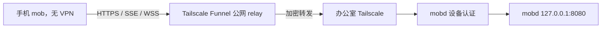
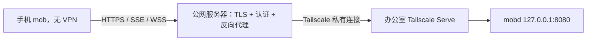
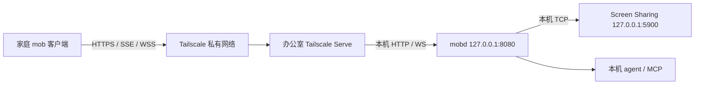

# 从家庭网络连接办公室 mobd

需要直接部署时，先看[连接配置手册](connection-setup.md)：包含内网直连、Tailscale Funnel、
自有公网服务器通过 Tailscale 中继的安装、配置、配对验收和关闭步骤。
本文保留产品模式设计、双端私有 Serve 和 SSH 备选方案；自建网关与尚未实现的托管中继分别运营。

目标是让用户为每台办公室机器选择 **私有网络、用户自管 Funnel、我们的中继** 三种连接方式。
三种方式复用同一套 mobd API、SSE 和 VNC 中继；手机不想安装 VPN 时选择后两种。
**三种模式都要求客户端认证；首次配对，后续自动认证，不提供无认证模式。**
mobd 已实现配对和完整业务认证；客户端选择界面、凭据适配和托管中继仍待实施。
可以先用 curl 测试网络和配对接口；正式使用前需完成客户端适配并验证 HTTPS、SSE 和 VNC。

## 三种连接模式

| 模式 | 用户准备什么 | 手机/桌面 mob 如何连接 | 当前状态 |
| --- | --- | --- | --- |
| **私有网络** | 办公室 Mac 和所有远端客户端设备安装 Tailscale，加入用户自己的 tailnet；已有公司 VPN 也可复用 | 通过邀请添加并配对，保持 VPN 连接 | mobd 配对已实现；客户端待适配 |
| **自管 Funnel** | 用户在办公室 Mac 安装 Tailscale，用自己的账号启用 Funnel | 填公网 HTTPS 地址，配对后连接；无需安装 Tailscale | mobd 认证已实现，待 mob 凭据适配和跨网联调 |
| **我们的中继** | 用户绑定办公室设备；我们维护公网域名、网关和中继连接 | 登录并选择获授权设备；无需安装 Tailscale | 需建设中继服务、设备注册和访问授权 |

Tailscale 安装在运行 mobd 的操作系统上，不是在 mobd 进程里另装一份。
自管 Funnel 指用户管理账号、设备和发布配置，公网 relay 仍由 Tailscale 运营。
私有模式不经过我们的中继，但 Tailscale 无法直连时仍可能经过其加密中继，不能宣传为始终点对点。

截至 2026-10-15，官方说明 [Funnel 对所有套餐开放](https://tailscale.com/docs/features/tailscale-funnel)，
[Personal 套餐免费但面向非商业用途](https://tailscale.com/pricing)。
因此支持用户自带 Tailscale 账号，不承诺所有办公用途或我们的商业中继可使用免费套餐；
Funnel 的带宽限制也不会因接入 mob 而消失。

### 选择流程与共同接口（mobd 已实现配对，客户端待适配）

1. 在 mob 添加办公室设备时展示这三种模式。私有网络和自管 Funnel 输入各自的 URL；
   我们的中继通过账号绑定设备后取得地址。支持链接/二维码添加，始终包含短期邀请，
   长期凭据通过配对/登录获得，不能写入分享 URL。见 [配对生命周期](pairing.md)。
2. 办公室侧配置对应的发布方式。第一版可让用户自行管理 Serve/Funnel，并提供操作指引；
   不必先实现安装 Tailscale、登录和切换发布配置的 CLI 包装。
3. 三种方式连接成功后都进入同一个聊天、任务和画面界面。客户端网络层复用服务器地址与凭据，
   模式选择只负责引导和取得连接信息，不为每种通道各写一套业务 API。
4. 切换连接方式保留办公室设备身份和会话，仅替换入口；先核验新入口属于同一设备。
   serverId 只是设备标识，不能仅凭它或用户输入的地址证明新入口可信。
   不自动从私有网络切到公网。关闭公网方式时必须撤销旧入口/中继绑定，
   仅在手机上修改地址不会关闭办公室的 Funnel。

第一版每个设备连接记录使用一个明确的入口，暂不做并行探测和自动故障切换。
Serve 与 Funnel 不能同时占用同一设备的同一端口，切换前需检查已有服务。
三种模式共享同一套强制应用认证，不增加认证开关，也不因私有网络而跳过配对。
mobd 已强制执行配对认证，非空的旧 `sharedSecret` 配置会提示迁移并阻止启动；
升级保留已有业务数据。客户端需要适配后重新配对，见 [配对协议](pairing.md)。

### 其他部署条件

| 条件 | 方案 | 需要承担的限制 |
| --- | --- | --- |
| 已有公司 VPN 可以访问办公室 Mac | 现有 VPN + mobd 的私有监听地址 | 由公司网络策略决定可达性 |
| 用户自行维护公网服务器 | 自有 HTTPS 网关 + 办公室私有连接 + 完整认证 | 手机使用自定义 URL；与我们的托管中继分别运营 |
| 不方便安装 VPN，但两端能运行 SSH，且有可信公网服务器 | 下文的 SSH 双向转发 | 自行维护服务器、SSH 密钥与断线重连 |

mobd 已将 HTTP API、SSE 事件流和 `/vnc` WebSocket 中继放在同一个端口。
只需连接这一个入口，`5900` 不需要经过公网转发。远端地址不写入 `vncAddr`
或 `vncViewUrl`；它是家庭 mob 客户端的服务器地址。本地 agent/MCP 继续访问本机 mobd。

mobd 的读取、写入、SSE、截图、附件和 `/vnc` 均要求独立设备凭据。
HTTPS 仅加密传输，CORS 仅约束浏览器来源，两者均不能代替身份认证。
客户端凭据适配和真实跨网验证仍待完成。完整边界见 [security](security.md)。

### `mobd link --url` 应填写哪个地址

填写客户端实际访问的入口，不能把 Serve/Funnel 的本机转发目标当成远端入口。
`mobd link` 保留输入的协议、主机和端口，并附加 `/pair#...` 配对信息。

| 接入方式 | `--url` 示例 | 客户端网络条件 |
| --- | --- | --- |
| 办公室局域网直连 | `http://192.168.1.20:8080` | 客户端能访问该局域网 IP；mobd 监听内网接口 |
| Tailscale 节点直连 | `http://100.101.102.103:8080` 或 `http://office-mac:8080` | 两端已加入 Tailscale，允许访问端口；mobd 监听可达接口 |
| Tailscale Serve 默认 / `--https=443` | `https://office-mac.example.ts.net` | 客户端需要 Tailscale 访问权限 |
| Tailscale Serve 显式 `--http=80` | `http://office-mac` | 客户端需要 Tailscale 访问权限 |
| Tailscale Funnel 网页入口 | `https://office-mac.example.ts.net` | 普通公网客户端，无需安装 Tailscale |

Serve 默认 HTTPS，也支持显式 HTTP，见 [Serve CLI](https://tailscale.com/docs/reference/tailscale-cli/serve)。
Funnel 只支持 TLS 加密连接，其网页入口使用 HTTPS，见 [Funnel](https://tailscale.com/docs/features/tailscale-funnel)。
Tailscale 节点之间的连接本身已加密，因此 HTTP URL 不代表该节点间链路明文传输，
见 [Tailscale HTTPS 说明](https://tailscale.com/docs/how-to/set-up-https-certificates)。
若经过子网路由器，其后到普通局域网机器的一段还需单独考虑传输保护。

`mobd link` 对所有 HTTP URL 输出风险提示，但正常生成邀请，不增加确认步骤。
它不检查连接是否实际经过 Tailscale；普通局域网 HTTP 仍可能暴露凭据和业务数据。
链接生成也不检查网络可达性或修改监听地址；公网入口应使用 HTTPS。

## 手机免 VPN：Funnel 或自有公网网关

### 只在办公室安装：Tailscale Funnel



[Funnel](https://tailscale.com/docs/features/tailscale-funnel) 允许未安装 Tailscale 的设备
通过公网域名连接办公室服务。relay 由 Tailscale 提供，TLS 在办公室终止，relay
不解密应用内容。手机使用正常 HTTPS/WSS，不需要加入 tailnet，也不需要路由器端口映射。

**Serve 是私有入口，Funnel 是公网入口。** Funnel 的启用权限控制谁能发布服务，
并不替代手机用户的应用登录。仅增加
[DERP 中继](https://tailscale.com/docs/reference/connection-types)
无法把 Serve 变成普通公网 HTTP 服务：DERP 为 Tailscale 节点转发加密流量。

Funnel 有不可配置的带宽限制、域名限制，官方当前标为 beta。因此先在完整认证下
验证 API、SSE、WebSocket 和实际 VNC 画面性能，再决定是否长期采用；不能只凭
`/health` 可达就认为满足远程桌面需求。当前发布指引仍以私有 Serve 为主，
客户端完成配对和所有通道认证后再验收公网 Funnel。

### 需要自有 relay 时：公网 HTTPS 网关



这里 Tailscale 安装在**办公室和公网服务器**，手机无需安装。公网服务器将一个固定域名
代理到指定办公室 Serve 地址；tailnet 仅允许网关访问该办公室服务端口。
可复用 [Caddy 反向代理](https://caddyserver.com/docs/caddyfile/directives/reverse_proxy)
等现成组件转发 HTTP、SSE 和 WebSocket，无需自行设计 relay 协议。
服务器带宽、区域和域名可自行选择，但需承担维护费用；公司出站限制仍会影响连接。

此拓扑 TLS 在网关终止，**网关可以读取会话和画面数据**，必须使用可信服务器。
目标方案由 mobd 验证独立客户端凭据；网关可另加账号授权，但不能绕过 mobd 认证，
也不能用全用户共享的密钥冒充所有客户端。
无需为手机开放 VNC 的 TCP 5900；所有流量仍经 mobd 的 HTTP 端口。

### 我们的中继：在网关之上提供设备绑定与隔离

我们的中继可以先复用上述网关拓扑，由我们运行公网服务器，并让办公室与网关通过
Tailscale 建立私有连接。采用这个实现时，**办公室仍需安装并注册 Tailscale，手机不需要**。
需要明确设备加入哪个受管理网络，以及注册、撤销和密钥维护流程；不能把用户已有 tailnet
默认视为我们可以访问的网络。

Tailscale 是可选的底层通道，不是手机端协议。若以后要求办公室也只安装 mobd，则需要
在 mobd 中增加或随安装包管理出站连接器，再连接我们的 relay；当前没有这个能力，
不能把普通 HTTPS 反向代理描述成已经能穿透办公室 NAT。

托管服务还必须完成以下边界，单机网关配置不能直接视为多用户中继：

- 设备注册后绑定到所属账号；请求先验证用户有权访问该设备，再由服务端查表选择上游。
  不能接受客户端提供的任意转发目标。
- 限制网关到每台办公室机器的服务端口，并隔离不同用户的办公室设备，禁止相互访问。
  不将所有客户放进默认全互通的私有网络。
- API、SSE 和 VNC 握手统一授权；撤销设备或用户访问时关闭相关长连接。
  断线重连需要恢复订阅，不能自动重发可能已执行的任务创建请求。
- 管理带宽、连接数和可用性；公网网关终止 TLS 时运营方可读取流量，需明确告知用户。
  端到端内容加密需要另行设计，当前拓扑不作此承诺。

### mobd 和 mob 必须配合的改动

1. mobd 在所有网络模式强制认证，覆盖读取、写入、SSE、截图、附件与 VNC 握手，拒绝空凭据。
   保留本地 agent/MCP 的按任务认证，不能因代理请求来自 loopback 就跳过认证。
2. mob 手机端提供地址和配对/登录流程，并为 HTTP、SSE、图片和 WebSocket 使用一致的凭据。
   WebView 无法设置 WebSocket 请求头时使用已实现的[短期 VNC 票据](pairing.md#实时桌面票据)；
   SSE 使用能携带 Authorization 的网络接口。不将长期密钥放进 URL，凭据保存在系统安全存储中。
3. 联调未登录拒绝访问、凭据撤销、SSE 实时推送、画面更新，以及手机网络切换后的恢复。

mobd 统一认证、配对、本机管理和撤销断连已实现；手机端尚未适配或验证。
后续顺序是：**完成 mob 配对及模式选择，验证自管 Funnel，再接入我们的中继服务**。
中继完成前不展示为可用服务。隧道负责网络可达性，应用负责识别和授权用户。

## 双端可以安装 VPN 时：Tailscale + Serve

以下网络步骤适用于配对版本，业务与详细健康检查必须使用已配对凭据。
桌面和手机客户端需要后续升级；旧匿名客户端无法连接。



Tailscale 尝试建立点对点连接；无法直连时可通过加密中继连接。
因此通常不需要办公室入站端口，但仍需要办公室网络放行 Tailscale 的协调和中继服务；
UDP 不通可能退回中继，出站服务被阻断则无法连接。
参见官方 [连接类型](https://tailscale.com/docs/reference/connection-types)
和 [防火墙要求](https://tailscale.com/docs/reference/faq/firewall-ports)。

### 1. 两端加入私有网络

在两端安装并登录 [Tailscale](https://tailscale.com/download)，确认设备属于同一 tailnet。
办公室 Mac 需要保持开机、联网和用户登录；mobd 的 LaunchAgent 及桌面操作依赖该用户会话。
配置电源设置，避免无人值守时自动睡眠导致失联。

macOS 安装 GUI 客户端后，如果终端没有 `tailscale` 命令，按官方
[CLI 设置](https://tailscale.com/docs/reference/tailscale-cli?tab=macos)
安装 CLI integration，或在当前终端使用：

```bash
alias tailscale='/Applications/Tailscale.app/Contents/MacOS/Tailscale'
tailscale status
```

### 2. 先限制访问范围

Serve 也受 tailnet 访问策略约束。将访问限定到需要使用 mobd 的可信家庭设备和办公室
Mac 的 TCP 443；获配对授权的客户端可访问同一办公室的所有业务数据。
mobd 不根据 Tailscale 身份头自动配对或隔离用户数据。

以下是**专用两机 tailnet 的完整最小策略示例**，在 Tailscale 管理控制台的访问控制中配置。
将示例 IP 替换为两台设备的真实 Tailscale IPv4 地址（分别运行 `tailscale ip -4` 获取）：

```json
{
  "grants": [
    {
      "src": ["100.101.102.103"],
      "dst": ["100.101.102.104"],
      "ip": ["tcp:443"]
    }
  ]
}
```

规则是累加放行：**仅添加这条规则不会收紧已有的 allow-all 规则**。
专用 tailnet 应替换默认全放行策略；共享 tailnet 应由管理员调整覆盖该办公室机器的
宽泛规则，并保留其他业务所需访问，不能直接覆盖整份策略。
设备重新注册导致地址变化时需同步更新。
参见官方 [grants 语法](https://tailscale.com/docs/reference/syntax/grants)
和 [默认访问策略](https://tailscale.com/docs/reference/examples/acls)。

### 3. 办公室启动 mobd

按 [安装说明](../README.md#install--run-office-mac) 初始化、设置 runner 和 macOS 权限。
编辑现有 `~/.mobd/config.json` 中以下两项，保留工作目录、runner 等其他配置：

```json
{
  "listen": "127.0.0.1:8080",
  "vncAddr": "127.0.0.1:5900"
}
```

首次启动运行 `mobd start`；已启动则在当前任务结束后运行 `mobd restart`。
配置使用自定义文件时继续指定该文件。随后检查：

```bash
mobd status
# 先通过 mobd link 和 POST /pair 取得本机测试凭据，见配对协议
curl -fsS -H "Authorization: Bearer $MOBD_TOKEN" http://127.0.0.1:8080/health
```

`status` 应显示 `listen=127.0.0.1:8080`；`/health` 的 `ok: true` 只说明 API 可用，
还需检查 `checks` 和 `runners`。如果监听地址不符，检查 `MOBD_LISTEN` 和启动参数：
环境变量、命令行可覆盖 JSON，无参数的 `restart` 会复用已保存的启动参数。
移除旧覆盖后，使用明确的 `--config` 和 `--listen 127.0.0.1:8080` 重启。

### 4. 办公室启用私有 HTTPS 入口

先查看现有 Serve 配置，确认本机 HTTPS 443 根路径未被其他服务占用，再运行：

```bash
tailscale serve status
tailscale serve --bg --https=443 http://127.0.0.1:8080
tailscale serve status
```

首次使用按 CLI 提示启用 tailnet HTTPS 证书。复制实际输出的完整地址，例如
`https://office-mac.example-tailnet.ts.net`，不要改成办公室局域网 IP，
也不要在这个地址后追加 `:8080` 或路径前缀。
确认输出为 **Available within your tailnet**，并检查 `tailscale funnel status`
没有将该入口公开。若已有其他 Serve 服务，先安排独立入口，不要覆盖其配置。

Serve 在办公室终止 HTTPS，再代理到本机 HTTP；API、SSE 和 `/vnc` 使用同一个根路径入口。
`--bg` 保存后台服务配置，Tailscale 重启后可恢复，但不会替你启动 mobd。
mobd 需要登录后自启时使用 `mobd start --login`；已在运行则用 `mobd restart --login`。
Tailscale 也必须保持连接。参见官方 [Serve 命令](https://tailscale.com/docs/reference/tailscale-cli/serve)。

### 5. 家庭端连接和验收

在办公室执行 `mobd link --url https://实际入口域名`，在家庭端使用配对协议兑换凭据。
以下 `MOBD_TOKEN` 为返回的设备凭据。在家庭网络中保持 Tailscale 已连接，使用步骤 4 的实际 URL：

```bash
MOBD_REMOTE_URL='https://office-mac.example-tailnet.ts.net'
curl -fsS -H "Authorization: Bearer $MOBD_TOKEN" --connect-timeout 10 "$MOBD_REMOTE_URL/health"
curl -iN -H "Authorization: Bearer $MOBD_TOKEN" --max-time 20 "$MOBD_REMOTE_URL/events"
```

事件流应返回 `200`、`Content-Type: text/event-stream`，空闲约 15 秒出现 `: ping`。
第二条命令在 20 秒主动结束，curl 返回超时退出码 28 是预期行为；不能只有响应头而无心跳。

在 mob 客户端填写同一 HTTPS URL。客户端的 VNC 地址应派生为
`wss://office-mac.example-tailnet.ts.net/vnc`，Screen Sharing 的登录凭据仍然单独验证。
默认 `corsOrigins` 已包含 mob 桌面客户端的常见来源；自定义 Web 客户端需添加自己的精确
Origin（协议、主机、端口），并保留仍在使用的其他来源。不能用放开 CORS 代替网络授权。

实际验收必须覆盖：

- 在家庭网络提交一个无破坏性任务，事件实时到达，审批/回答（若启用）可以继续任务。
- 读取会话、上传图片、打开截图或附件；所有请求和 VNC 握手均需携带设备凭据。
- 打开 VNC 预览，确认画面持续更新且默认不发送键鼠输入。
- 关闭家庭端 Tailscale 后，新请求无法到达；另一个没有获准的 tailnet 设备也不能访问。
- 在无任务运行时重启 mobd、断开并重连 Tailscale，确认重新连接后可继续读取会话和查看画面。

桌面权限和 runner 的完整检查见 [office smoke checklist](office-smoke-checklist.md)。
本指南的命令依据官方文档和 mobd 接口核对；真实跨网可达性、证书、访问策略和画面性能
必须在两端设备上验收，仓库测试不能替代这些检查。

### 排查与关闭

| 现象 | 检查 |
| --- | --- |
| 办公室本机 `/health` 不通 | `mobd status`、`mobd logs`、监听地址及配置覆盖 |
| 本机正常，家庭端超时 | 两端 `tailscale status`、办公室在线状态、DNS、TCP 443 访问规则及公司出站限制 |
| HTTPS 证书失败 | 使用 Serve 输出的完整域名，检查 HTTPS 是否启用和系统时间；不要跳过证书验证 |
| HTTP 502 | 检查 Serve 的本机目标、mobd 是否运行及端口是否一致 |
| HTTP 401 | 尚未配对或凭据已撤销；先完成配对并检查所有通道的 Authorization |
| API 正常，VNC 403/502 | 403 检查客户端 Origin；502 检查办公室 Screen Sharing 和 `vncAddr` |
| 画面延迟大 | 从家庭端 `tailscale ping office-mac` 并查看 `tailscale status`；`relay` 表示 DERP 中继，测实际带宽后再决定是否部署更近的中继 |
| SSE 没有心跳或更新 | 确认请求到达 mobd；额外代理必须关闭流缓冲和缓存，允许长连接 |

关闭本指南的 Serve 入口，在办公室执行：

```bash
tailscale serve --https=443 off
```

这会停止该 HTTPS 端口上的服务；共享该端口时需先检查影响。它不停止 mobd。
不要使用 `tailscale serve reset` 清除同机其他服务。移除家庭设备的授权时也要更新访问策略。

## 备选：可信公网跳板机 + SSH

两端均能出站 SSH 到同一台可信服务器时，可以保留相同的 loopback mobd 配置。
服务器必须允许 TCP forwarding，`GatewayPorts no` 保证反向端口只绑定服务器本机。
使用专用账号、密钥认证，并核验服务器主机密钥。

办公室运行（替换服务器地址和账号）：

```bash
ssh -NT -o ExitOnForwardFailure=yes \
  -o ServerAliveInterval=30 -o ServerAliveCountMax=3 \
  -R 127.0.0.1:18080:127.0.0.1:8080 mob-tunnel@relay.example.com
```

家庭端另开终端运行：

```bash
ssh -NT -o ExitOnForwardFailure=yes \
  -o ServerAliveInterval=30 -o ServerAliveCountMax=3 \
  -L 127.0.0.1:18080:127.0.0.1:18080 mob-tunnel@relay.example.com
```

家庭 mob 客户端填写 `http://127.0.0.1:18080`。HTTP、SSE、WebSocket 的字节都经过 SSH；
两个 `18080` 监听均只在各自机器本机开放，服务器防火墙不开放 18080/8080/5900。
同样用 `/health`、`/events` 和 VNC 完成验收。任一 SSH 命令退出都会断线，Ctrl-C 可关闭。

这是两段 SSH 加密：**跳板机及其本地用户能访问中间端口，也能看到转发的数据**，
因此需要专用、可信的服务器，不能把 loopback 当成账号隔离。
keepalive 能检测断线，`ExitOnForwardFailure` 能发现端口绑定失败，但不会检测远端 mobd
是否健康，也不会自动重连。长期使用需要分别用服务管理器托管两个 SSH 进程并实际验证恢复；
当前 mobd 不管理这些进程。已有可直达的办公室 SSH 入口时，仅用 `-L` 直连即可。
参数语义见 [OpenSSH ssh](https://man.openbsd.org/ssh)
和 [ssh_config](https://man.openbsd.org/ssh_config)。

## 其他公网通道

三种模式之外，用户自定义 URL 也可来自命名 Cloudflare Tunnel + Access 等部署，
同样需要办公室出站连接器及完整认证。不要使用匿名临时隧道；Cloudflare
[Quick Tunnels 明确不支持 SSE](https://developers.cloudflare.com/tunnel/get-started/quick-tunnels/)。

实施前必须明确家庭客户端支持的登录方式：API 请求、SSE、图片/附件和 WebSocket
握手都要携带可验证的凭据。Access 的浏览器登录或
[service token 请求头](https://developers.cloudflare.com/cloudflare-one/access-controls/service-credentials/service-tokens/)
不能假定 mob 客户端已经支持；需检查独立的 mob 仓库，并设计凭据存储、过期和撤销。
网关还需保留 WebSocket Upgrade、禁用 SSE 缓冲和敏感响应缓存，并验证断线恢复。
这类集成不作为第一版三种模式的必要依赖。
