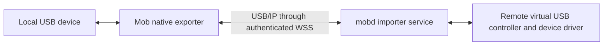

# USB redirection

Status: draft USB-1, 2026-11-01. Not implemented or released.

This is the shared design for all five repositories. Mob Desktop exports a
user-selected local USB device; mobd imports it on the remote machine. Use
USB/IP over an authenticated, encrypted reverse tunnel and open-source
implementations only. Do not introduce a proprietary dependency or a new USB
wire protocol. Platform signing and system permissions still apply.

## Scope and terminology

The remote operating system should enumerate the device so its existing driver
and tools can use it: write files to a USB drive, communicate with a development
board, flash firmware, or use a debug probe. The remote OS still needs the device
driver and, for disks, support for the filesystem. This is host-level device
access, not access isolated to a chat or a virtual desktop.

USB/IP calls the physical-device exporter the **server** and the importer the
**client**. Thus Mob Desktop is on the USB/IP server side and mobd on the USB/IP
client side, regardless of which side initiates the encrypted network connection.

Downloading a file to a locally mounted USB drive remains an ordinary
[file transfer](file-transfers.md). It does not expose the disk or USB interface
to remote tools. tus upload/download resume cannot resume arbitrary device I/O.

First delivery targets a Linux importer, with Linux/Windows exporters and a
verified subset of macOS exporters. Validate macOS device capture early rather
than implying that every Mac-connected drive works. Windows and macOS importers
are later milestones; macOS import requires the [Apple application](apple-usb-entitlement.md).
Target drives, serial development boards, DFU devices and debug probes first.
Camera/audio isochronous traffic, hubs, automatic sharing of all devices, and
mobile USB export/import are outside the first delivery. A composite device is
accepted only when its complete required interface set is supported.

## Repository responsibilities

| Repository | Responsibility |
| --- | --- |
| [mobd](https://github.com/xrdavies/mobd) | Canonical contract, authenticated sessions/tunnel, importer integration, readiness, cleanup, Apple entitlement application |
| [mob](https://github.com/xrdavies/mob/blob/main/docs/usb-redirection.md) | Native local device inventory, explicit sharing, exporter integration, outgoing tunnel, lifecycle UI |
| [mob-ios](https://github.com/xrdavies/mob-ios/blob/main/docs/usb-redirection.md) | First-version compatibility and scope; no phone USB forwarding or ownership of Desktop shares |
| [mob-android](https://github.com/xrdavies/mob-android/blob/main/docs/usb-redirection.md) | First-version compatibility and scope; no phone USB forwarding or ownership of Desktop shares |
| [mob-site](https://github.com/xrdavies/mob-site/blob/main/docs/usb-redirection.md) | Future user documentation and verified support matrix; no browser USB bridge |

Update this contract first when changing direction, platform coverage, lifecycle
or authorization; update the linked repository drafts in the same change set.
The Apple application runbook is owned by mobd and linked rather than duplicated.

## Architecture and component selection

| OS | Export on the user's computer | Import on the mobd computer |
| --- | --- | --- |
| Linux | Kernel `usbip-host` and userspace tools | Kernel `vhci_hcd` and userspace tools; first baseline |
| Windows | Evaluate `usbipd-win` | Evaluate `usbip-win2`; requires supported signed drivers |
| macOS | Evaluate `usbipd-mac` / system USB APIs for claimable devices; storage capture is unproven | Evaluate `IOUSBHostControllerInterface` and `usbip-macos`; Apple entitlement and hardware verification required |

These are candidates, not bundled dependencies or a tested support matrix.
`usbipd-mac` currently reports no support for mass storage, HID, audio and cameras
held by system drivers. libusb has device-capture paths with platform/permission
limitations; its existence does not prove that a target drive can be exported.
Test with normal system security enabled. Disabling SIP or driver-signature
enforcement is not a product installation path.

Prefer invoking an existing tool/helper before adding a library or writing a
driver. If a backend needs work, implement USB/IP-compatible device handling and
contribute upstream where practical. Linux's kernel importer, Windows UDE and
macOS's virtual controller are different system integrations. libusb alone does
not create a device in the remote OS. Cover descriptors, configuration/alternate
settings, control/bulk/interrupt transfers, asynchronous completion/cancellation,
reset, clear-halt and removal for each supported device.

Keep dependencies' licenses and notices intact. In particular, `usbipd-win` is
GPL-3.0, `usbip-win2` is BSD-2-Clause, and `usbipd-mac` is MIT at the reviewed
revisions. Record pinned versions and review distribution/source obligations
before bundling; independent process execution is not a blanket license exemption.
Mob's MIT license does not relicense third-party code.

## Connection and authorization

1. Desktop enumerates devices locally and probes whether the selected device can
   be exported. Inventory is not uploaded automatically. The user chooses the
   device and paired destination and sees the exclusive-access consequences.
2. Desktop asks mobd to create a USB session. Derive the owner from existing
   paired authentication, never a caller-supplied owner ID. Bind the session to
   one source device and one destination; USB bus addresses alone are not stable
   device identities.
3. Desktop's native service opens an outgoing authenticated WSS tunnel to mobd.
   Bridge the backend's required TCP connection(s) through dedicated channels,
   each bound to that session. The remote importer connects to a restricted
   local bridge; the user need not expose an inbound port at home.
4. Import only the selected device. Validate/filter device-list/import requests
   against that selection; an authenticated tunnel must not expose every device
   bound in an underlying USB/IP service. Prevent another local process from
   taking an unclaimed importer connection; loopback alone is not authentication.
5. Report connected only when the importer confirms device attachment. Stop
   sharing through remote device release, importer detach, tunnel close and
   exporter release, in that order when the connection remains healthy.

Reuse per-client credentials and revocation from [pairing](pairing.md). Native
connections use an Authorization header; credentials must not enter URLs or
logs. Authorize every session operation and tunnel channel. A second paired
client cannot attach to, replace or release another client's USB session through
the USB API. Provide local administrator recovery for an orphaned attachment.
Remote processes with OS permission can still access the imported device;
[the existing same-user trust model](security.md) is not changed by session ownership.

Use HTTPS/WSS or an explicitly verified encrypted transport, not unprotected
USB/IP on the public network. A TLS-terminating gateway can see the traffic, as
with existing Mob connections; do not describe that topology as end-to-end
encrypted. Do not bind a raw USB/IP service to a public interface by default.
Close any extra exposure introduced by an upstream helper's default firewall rule.

Keep USB separate from `/stream`, media queues and chat SSE. It is reliable,
ordered device traffic: never discard old USB packets to catch up like video.
Bound packet sizes, pending requests, memory and inactivity; fail the attachment
on sustained transport failure rather than queue unbounded work. Freeze concrete
limits and the bridge framing after testing the selected backends.

## Discovery and lifecycle contract

Proposed health feature: `usbRedirection`. It means this mobd build implements
the USB session contract, not that every device or backend is ready. Missing
feature means unsupported; old clients continue using chat/files/live view.
Expose importer readiness separately: backend, ready flag and an actionable
reason such as missing helper, unsupported OS, permission or entitlement.

Control operations are create, inspect and release an owned USB session, plus
open its authenticated tunnel. The session result contains an opaque ID, selected
device summary, state and optional reason. Reserve these common states:
`connecting`, `connected`, `disconnecting`, `disconnected`, `failed`.
Do not create a second identity system. Exact HTTP routes and model definitions
will be frozen with the backend proof of concept before implementation in clients.

Only one remote attachment may own a local device at a time. Keep an active share
independent of the selected chat, preview, video transport and foreground window.
Switching machines must not retarget an existing share. First delivery keeps the
native Desktop process alive while sharing; quitting releases it, and crash,
sleep, device removal, revoked pairing or daemon shutdown terminate the session.
Use liveness checks so an abandoned tunnel does not leave a device leased forever.

On broken transport, cancel outstanding requests and detach. Reconnection creates
a fresh attachment; never replay an operation whose device-side completion is
unknown. Automatic continuation of a flash/write is not promised. Initially ask
the user to reconnect after re-enumeration. Any later bootloader reconnection must
match a narrowly authorized physical device and expected identity transition,
not automatically capture any device with the same vendor/product ID.

For disks, unmount local volumes before exporting and finish remote flush/unmount
before orderly detach. If safe release fails, report busy and retain ownership;
forced detach must explicitly disclose possible data loss. An unexpected network
loss is effectively unplugging the device and cannot guarantee a successful flush.
Never mount the same filesystem writable on both hosts. Transport reconnection
does not prove a filesystem or firmware image remains valid.

## mobd implementation boundaries

| Area | Future work |
| --- | --- |
| `internal/api/`, including `health.go` and route registration | Capability/readiness, owned session operations, dedicated authenticated tunnel |
| `internal/pairing/` integration | Existing identity checks and revoke/reset hooks close USB sessions |
| Native importer manager/helper | Backend probing, narrow privileged operations, attach/detach, device events, crash recovery |
| Daemon startup/shutdown and local control | Cleanup stale attachments owned by Mob, status and administrator recovery |
| Packaging and `docs/releases.md` | Dependency/version/license handling; macOS entitled helper/profile installation if approved |

Do not run all of mobd as root just to manage devices. A helper should validate
its local caller, selected device and allowed operation; it must not expose an
arbitrary shell or arbitrary TCP forwarding. Avoid importing into a desktop
cgroup whose normal idle freeze would suspend active USB handling.

The current macOS release is a signed standalone executable. The Apple gate
includes a viable profile-bearing app/helper bundle and launch/install design,
not merely adding an entitlement to that executable. Track this in the
[Apple entitlement runbook](apple-usb-entitlement.md).

## Milestones and acceptance

1. **Feasibility:** test macOS capture of actual target devices and investigate
   macOS importer entitlement/profile packaging early. Establish Linux import
   with an existing exporter before committing to broader platform claims.
2. **First complete path:** native Desktop selection, authenticated reverse
   tunnel, Linux import, normal release, failure cleanup and meaningful errors.
3. **Broader coverage:** verify Windows import and, after Apple approval, macOS
   import independently. Publish exact exporter/importer OS and device combinations.

For each combination record helper/driver versions, OS/architecture, device
model and USB identity, remote tool/driver, permissions and results. Acceptance:

- USB drive: disposable test data, create/read/write, checksum on both sides and
  safe unmount; no tests that format or overwrite a user's real data.
- Serial board: bidirectional traffic, baud changes and required control lines;
  probe/DFU: actual flash and verification, reset and bootloader transition.
- Network: LAN and HTTPS gateway paths, delayed/limited links, abrupt disconnect;
  no unbounded queues, hidden packet replay or false successful writes.
- Lifecycle: quit/crash, sleep/wake, unplug/replug, daemon restart, pairing revoke,
  second client contention, and chat/video changes during active device I/O.
- Boundaries: unauthorized session/channel, wrong-device import, oversized or
  malformed input, stale device identity and helper crash. Verify signed release
  installation on clean machines with normal system protections enabled.

No throughput/latency guarantee is made before measurements. Debugging can be
latency-sensitive even when a disk copy has acceptable throughput. Successful
enumeration alone does not qualify a device for the supported list.

## Sources and companion documents

Reviewed 2026-11-01; upstream claims are not Mob hardware test results.

- [USB/IP wire protocol](https://www.kernel.org/doc/html/latest/usb/usbip_protocol.html)
- [Linux USB/IP components](https://github.com/torvalds/linux/blob/master/tools/usb/usbip/README)
- [usbipd-win](https://github.com/dorssel/usbipd-win), [usbip-win2](https://github.com/vadimgrn/usbip-win2)
- [usbipd-mac](https://github.com/beriberikix/usbipd-mac), [libusb platform limitations](https://github.com/libusb/libusb/wiki/FAQ)
- [usbip-macos importer](https://github.com/carlossless/usbip-macos)
- [Microsoft UDE](https://learn.microsoft.com/en-us/windows-hardware/drivers/usbcon/developing-windows-drivers-for-emulated-usb-host-controllers-and-devices)
- [Apple USB entitlement application and materials](apple-usb-entitlement.md)
